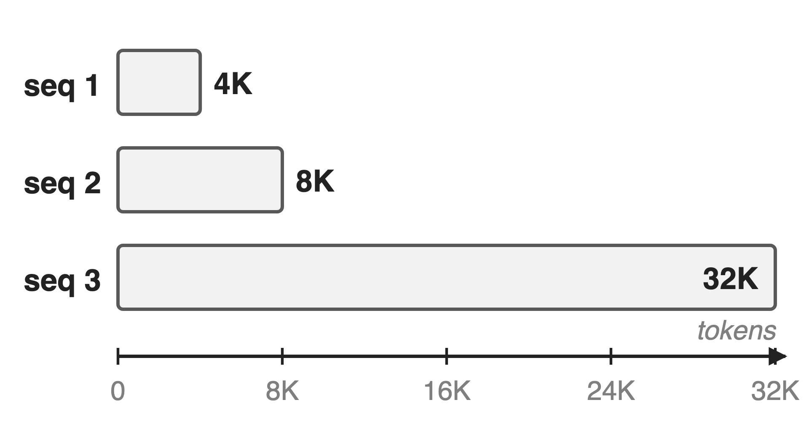
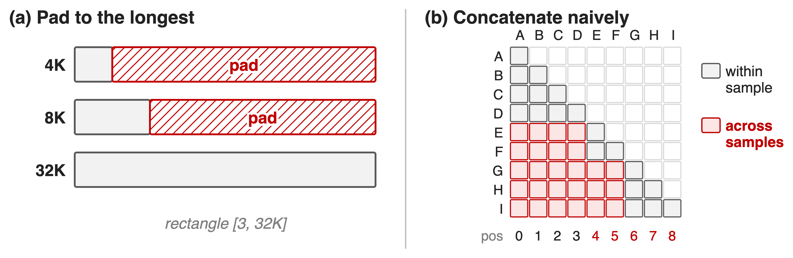
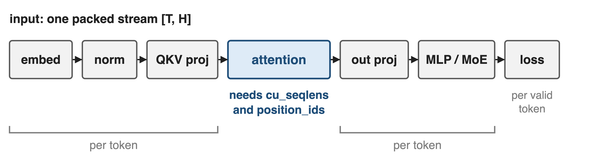
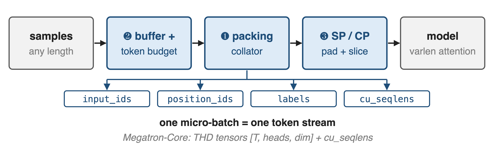
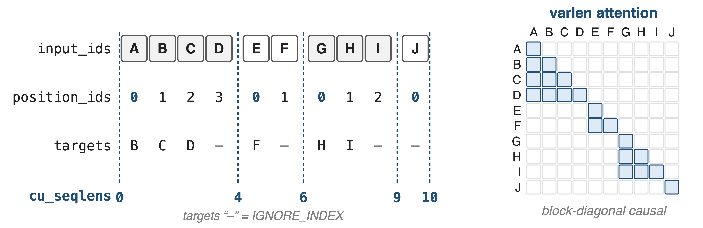
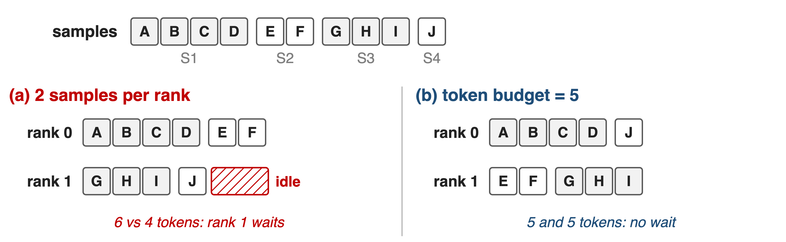
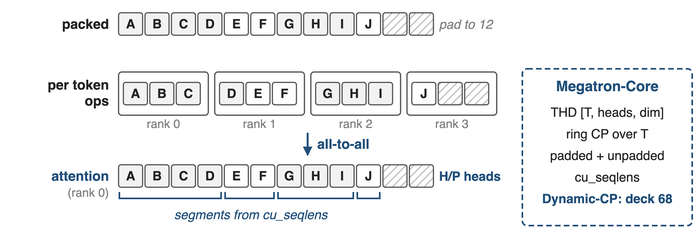
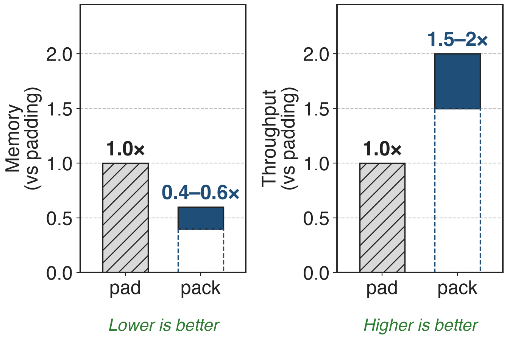
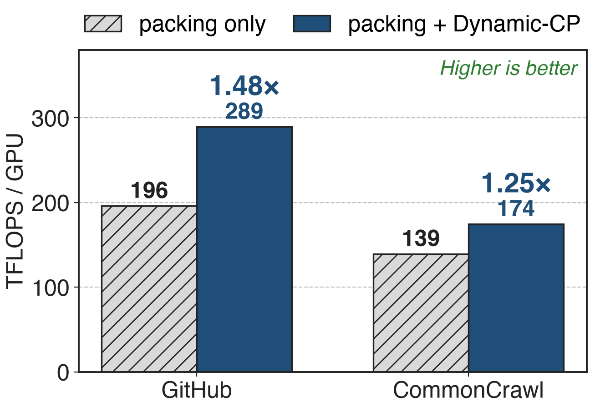

# Real batches mix 4K and 32K samples
{right 55%}
- Multimodal: image and video token counts vary
- GLM-5 mid-training: context grows **4K → 200K**
- RL traces: hundreds to tens of thousands of tokens
<!-- notes: Real training data never has one length. Vision-language samples carry different numbers of image or video tokens, long-context stages such as GLM-5's mid-training stretch context from 4K to 200K tokens, and RL with thinking models produces traces from hundreds to tens of thousands of tokens. The running example is the batch from the Megatron-Core report: three sequences of 4K, 8K and 32K tokens. Sources: GLM-5 arXiv 2602.15763 (Fig. 5 text); Megatron-Core MoE report arXiv 2603.07685 §6.4. -->

# Padding wastes most of the batch
%% big: ~60%
%% sub: of compute and memory wasted padding 4K and 8K samples to 32K
%% source: Megatron-Core MoE technical report, arXiv 2603.07685, §6.4 (p.59)
<!-- notes: A dense batch is a rectangle, so the 4K and 8K sequences are padded to 32K. Megatron-Core's report puts the waste for this batch at about 60 percent of computation and memory. As a sanity check: 54 percent of the token slots are padding, and since attention cost grows with the square of length, about 64 percent of attention work is padding (derived). Every layer pays this tax, and the longer the context, the worse it gets. -->

# Padding wastes FLOPs; concat leaks attention
{full}
> Pack without padding, but keep every sample's attention and positions its own
<!-- notes: The two obvious fixes both fail. Padding keeps samples separate but computes on the red region. Concatenating samples into one long row removes the padding, but a plain causal mask then lets E attend to A through D, and position ids keep counting across samples, so samples contaminate each other. A third problem appears across ranks: packing a fixed number of samples per rank gives ranks different token counts. Sources: Megatron-Core report §6.4; VeOmni docs data_packing_and_dyn_bsz.md. -->

# Insight: only attention needs sample boundaries
{full}
> Flatten to one token stream; hand attention the offsets as cu_seqlens
<!-- notes: Walk through a layer. Embedding, norms, projections, MLP or MoE and the loss all act on each token independently, so they do not care whether a tensor is [batch, length] or one flat stream of T tokens. Attention, together with RoPE positions, is the only place where tokens from one sample must not see another. So drop the batch dimension, keep a short list of cumulative sequence lengths, and give it to a variable-length attention kernel. Sources: VeOmni docs; Megatron-Core §6.4.1. -->

# Pack, budget, then shard the token stream
{full}
%% caption: VeOmni: DynamicBatchSizeDataLoader + PackingCollator + SequenceParallelCollator; Megatron-Core: THD + PackedSeqParams
<!-- notes: Three mechanisms. Two, read first: a buffer collects samples and cuts micro-batches by a token budget instead of a sample count. One: the packing collator concatenates the chosen samples and emits input ids, restarting position ids, boundary-masked labels and cu_seqlens. Three: with sequence or context parallelism, the packed stream is padded and sliced across ranks. Megatron-Core does the same with THD tensors. Sources: VeOmni dynamic_batching.py, data_collator.py; Megatron-Core §6.4.1. -->

# ❶ cu_seqlens turn one stream into four samples
{full}
> FlashAttention varlen applies this mask from cu_seqlens; nothing is padded or materialized
<!-- notes: This is the example from VeOmni's docs: samples of 4, 2, 3 and 1 tokens become one stream of 10. Position ids restart at zero for every sample, so RoPE sees each sample from position zero, and cu_seqlens 0, 4, 6, 9, 10 is derived from those restarts. The collator also marks the first label of every later sample as ignored, so D is never trained to predict E. Given cu_seqlens, FlashAttention's variable-length kernel computes exactly the blue block-diagonal causal pattern without building a mask. Sources: docs data_packing_and_dyn_bsz.md; data_collator.py (PackingCollator). -->

# ❷ Fill each batch to a token budget
{full}
%% caption: VeOmni dyn_bsz: buffer of ≥ 500 samples, first-fit to the budget; count all tokens or only loss tokens (physical cap 1.5×)
<!-- notes: Packing alone still leaves ranks unequal if each takes a fixed number of samples: with two samples each, rank 0 gets 6 tokens and rank 1 gets 4, and rank 1 idles at the gradient synchronization. VeOmni's dyn_bsz keeps a buffer of at least 500 samples, scans it in order and takes every sample that still fits the token budget, leaving the rest for the next micro-batch. The budget can count all tokens or only loss-carrying tokens, with a 1.5 times physical cap. VeOmni recommends it for pretraining and recommends turning it off for epoch-based SFT. Sources: docs data_packing_and_dyn_bsz.md; dynamic_batching.py. -->

# ❸ A packed stream splits cleanly across SP ranks
{full}
> VeOmni pads only the stream's tail, to a multiple of the SP size
<!-- notes: Packing composes with sequence parallelism. VeOmni pads the packed stream only at the end to a multiple of the SP size, slices it so each rank runs per-token ops on T over P tokens, and computes cu_seqlens on the full stream before slicing; Ulysses' all-to-all then gives each rank the whole stream for H over P heads, and the same cu_seqlens apply. Megatron-Core's THD format does the same for ring context parallelism, keeping padded and unpadded cu_seqlens. Its Dynamic-CP goes further and picks the CP size per micro-batch: deck 68. Sources: data_collator.py (SequenceParallelCollator); Megatron-Core §6.4.1-6.4.2. -->

# Packing: 1.5–2× throughput, 40–60% less memory
{right 60%}
- Megatron-Core, RL with thinking models
- Lengths: hundreds to tens of thousands of tokens
- Gain grows beyond 32K context
<!-- notes: Megatron-Core reports that for RL training with thinking models, where sequence lengths range from hundreds to tens of thousands of tokens, packed sequences reduce memory by 40 to 60 percent and raise throughput by 1.5 to 2 times compared with padding, and that the gain matters more beyond 32K tokens. The bars show the published ranges, not single measurements. VeOmni's paper does not isolate packing in its evaluation. Source: arXiv 2603.07685 §6.4.1. -->

# Balancing the packs adds up to 1.48×
{right 60%}
- Llama 13B, PP 8, CP 8, batch 2048
- Equal tokens still mean unequal attention FLOPs
- **> 35%** end to end on thousands of GPUs
<!-- notes: Packing equalizes tokens, not work: attention grows with the square of each sub-sequence, so a pack of one long sample costs more than a pack of many short ones. Megatron-Core's Dynamic-CP reschedules packs across data-parallel ranks and picks the CP size per micro-batch: on Llama 13B it raises throughput from 196 to 289 TFLOPS per GPU on GitHub data, 1.48 times, and from 139 to 174 on CommonCrawl, 1.25 times; in a multi-thousand-GPU job, over 35 percent end to end. GLM-5 reports the same idea: workload-aware reordering and CP groups of varying size. Sources: NVIDIA blog (Jan 2026) Table 1; GLM-5 §2.4.2. -->

# The cost: kernels, static shapes, uneven FLOPs
%% layout: two-col
- !!Varlen kernels!! required: FlashAttention, TE fused attention
- !!Static-shape features!! (compile, CUDA graphs) need `pad_to_length`
|||
- Equal tokens ≠ equal FLOPs without a scheduler
- Loss averaged per valid token
- VeOmni batch buffer not yet checkpointed
> Packing removes padding; balancing the work is a separate problem
<!-- notes: Packing only works with attention kernels that accept cumulative sequence lengths. Features that need fixed shapes, per-block torch.compile and CUDA graphs, need the packed stream padded back to a fixed length, which VeOmni offers as pad_to_length. Token-balanced packs can still be FLOP-imbalanced, which is why Dynamic-CP and GLM-5's workload-aware reordering exist. Losses must be averaged per valid token, not per sample, and dyn_bsz changes the number of samples per step. VeOmni's batching buffer carries a TODO for checkpointing, so buffered samples are not restored on resume. Sources: docs; dynamic_batching.py; Megatron-Core §6.4.2. -->

# Summary
- Padding a 4K/8K/32K batch: **~60%** of compute and memory wasted
- ==Insight==: only attention needs boundaries, so pack and pass cu_seqlens
- **1.5–2×** throughput, **40–60%** less memory; Dynamic-CP **1.25–1.48×** more
- Parent: deck 28 (VeOmni); related 68 (CP / Dynamic-CP)
%% qr: https://arxiv.org/abs/2508.02317
<!-- notes: Sequence packing replaces the padded rectangle with one token stream plus cumulative offsets, dynamic batching fills each micro-batch to a token budget, and the stream splits cleanly across SP or CP ranks. The remaining imbalance is in FLOPs, not tokens; that is the subject of Dynamic-CP in deck 68. Parent framework: deck 28. -->
