# Activations are two-thirds of MoE memory
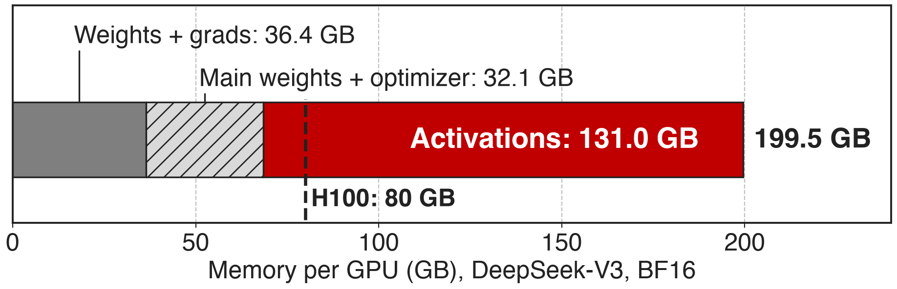{full}
%% caption: DeepSeek-V3 (685B total, 37B active), BF16, PP4 × VPP4 × EP64 on 256 GPUs. 131 of 199.5 GB = 66% (derived)
> 131 GB of activations alone overflow an 80 GB H100
<!-- notes: This is the memory wall of fine-grained MoE. Megatron-Core's breakdown for DeepSeek-V3 in BF16 needs 199.5 GB per GPU, and 131 GB of that is activations, more than weights, gradients and optimizer state combined. Parallelism shrinks the parameter part, but activations are what this deck and its two siblings attack: recomputation here, memory-efficient permutation in deck 53, offload in deck 54. Source: arXiv 2603.07685 Table 3 and §4.1.1 (p.20); 685B/37B from §1.2. -->

# Full recompute costs a third more compute
%% big: ~33%
%% sub: extra compute for full-layer recomputation, and in MoE it also replays the EP all-to-all
%% source: Megatron-Core MoE technical report, arXiv 2603.07685, §4.1.4 (p.22)
<!-- notes: The textbook answer to activation memory is to checkpoint each layer and recompute it in backward. The Megatron-Core report puts that at roughly 33% extra compute, and for MoE it is worse: recomputing the experts re-runs the expert-parallel dispatch and combine all-to-alls too. Source: §4.1.4 p.22. -->

# Checkpointing is too coarse or frees nothing
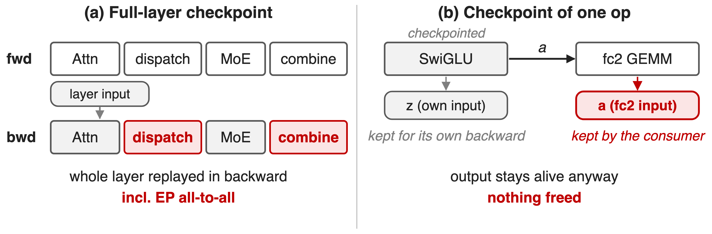{full}
> The memory sits in outputs that the next GEMM saves as its input
<!-- notes: Left: whole-layer checkpointing keeps only the layer input and replays everything, including the all-to-alls. Right: the obvious fix, checkpointing a single cheap op such as SwiGLU, saves nothing with standard checkpointing. SwiGLU's input z is kept for its own backward, and its output a is still saved by the next GEMM, fc2, for fc2's weight gradient. The output is the large tensor, and the consumer pins it. Mechanism source: Megatron-Core report §4.1.4 "output-discarding recomputation" (p.23) and the CheckpointWithoutOutput docstring in megatron/core/tensor_parallel/random.py. -->

# Insight: saved outputs are cheap to re-derive
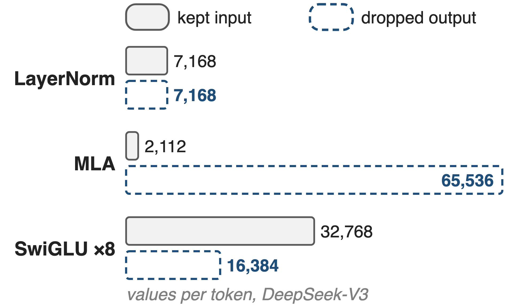{right 52%}
- Each output is **one cheap op** away from an input kept anyway
- MLA: Q, K, V hold **31×** the values of their latents (analytic)
> Drop the output, keep the input, rebuild it just before backward
<!-- notes: Activation memory and compute cost are badly correlated inside an MoE layer, and many saved tensors are cheap functions of other saved tensors. The figure counts values per token for each pair (analytic, DeepSeek-V3 dimensions, TP1). Each norm keeps a 7,168-wide input and its 7,168-wide output. In DeepSeek-V3's MLA, each token's query, key and value after the up-projection hold 128 heads × (192 + 192 + 128) = 65,536 values, rebuilt by two small GEMMs and RoPE from latents of 1,536 + 512 + 64 = 2,112 values: a 31× ratio (analytic, from DeepSeek-V3 §4.2 dimensions). SwiGLU keeps the fc1 output (8 routed copies × 4,096) and also stores its own 8 × 2,048 output for fc2. Norm and activation outputs cost one elementwise pass. So keep the small input, which is saved anyway, free the big output, and rebuild it just in time. -->

# Three modules drop their outputs in every layer
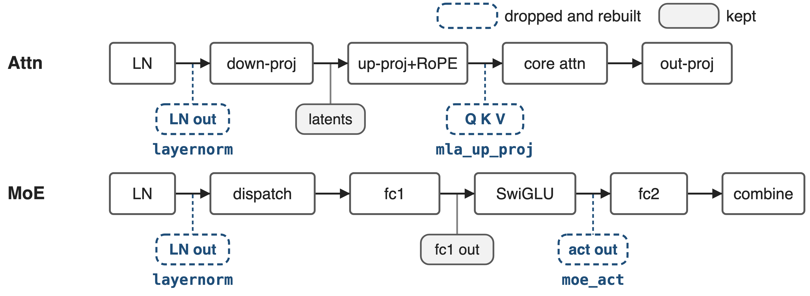{full}
%% caption: `--recompute-granularity selective --recompute-modules layernorm mla_up_proj moe_act` (MCore v0.13; FP8 support v0.14)
<!-- notes: This is one DeepSeek-V3 layer. Gray chips are tensors that stay saved, blue dashed chips are what the three output-discarding modules free: the two LayerNorm outputs (layernorm), Q, K and V after the MLA up-projection and RoPE (mla_up_proj), and the SwiGLU output that feeds expert fc2 (moe_act). Each keeps its input: the norm input, the MLA latents, the fc1 output. Module list: Megatron-LM MoE README and TransformerConfig.recompute_modules docstring; release versions from the README What's New (v0.13 2025/07, v0.14 2025/09). -->

# ❶ Free the output, rebuild it from a grad hook
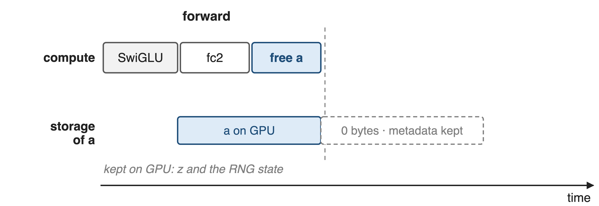{full}
--
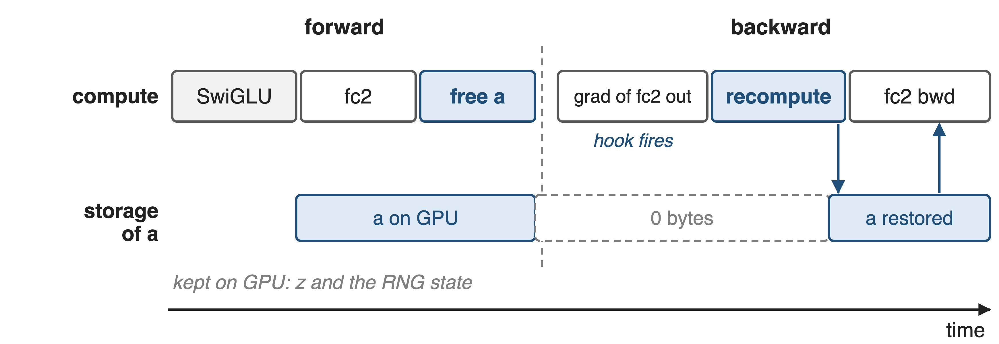{full}
> Running example: SwiGLU output a, consumed and saved by expert fc2
<!-- notes: Megatron-Core's CheckpointWithoutOutput runs f without grad, saves its inputs and RNG state, lets the consumer use the output in forward, then resizes the output's storage to zero while the tensor object, which fc2 still references, survives. A gradient hook on the consumer's output fires in backward: it recomputes f and re-points the original storage at the new data, zero-copy, so every view fc2 saved sees it. Then fc2's backward runs as usual. Sources: random.py CheckpointWithoutOutput.checkpoint / discard_output_and_register_recompute / _recompute; experts.py TEGroupedMLP.forward registers the hook on the fc2 output. -->

# ❷ Drop what is big to store, cheap to redo
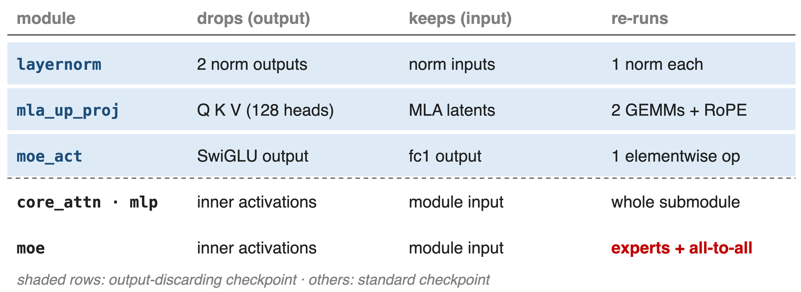{full}
<!-- notes: Three modules use output-discarding: layernorm frees the input-layernorm and pre-MLP-layernorm outputs, mla_up_proj frees Q, K, V after up-projection and RoPE (hook on the core-attention output), moe_act frees the SwiGLU output (hook on the fc2 output). core_attn, mlp, moe and shared_experts use standard checkpointing of the whole submodule. moe is the expensive one: it re-runs the experts and their all-to-alls. Sources: Megatron-LM MoE README "Fine-grained Recomputation"; TransformerConfig.recompute_modules docstring; transformer_layer.py, multi_latent_attention.py, experts.py. -->

# ❸ Replay with the forward's RNG and FP8 recipe
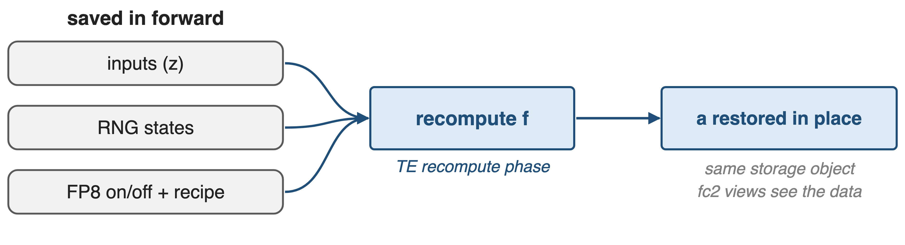{full}
%% caption: FP8 for fine-grained recompute since MCore v0.14; `moe_act` / `layernorm` under FP8 need TE ≥ 2.6 and no delayed scaling
> The rebuilt tensor must match the forward value exactly
<!-- notes: The recompute must reproduce the forward value. The checkpoint stores the input tensors, the CPU, CUDA and tracker RNG states, and whether FP8 was on with which recipe. In backward it restores the RNG states, re-enters FP8 autocast with the same recipe, and runs under Transformer Engine's activation-recompute context in the recompute phase. The result is swapped into the original storage. Sources: random.py CheckpointWithoutOutputFunction.forward and CheckpointWithoutOutput._recompute; transformer_config.py validation (delayed scaling rejected; TE >= 2.6.0dev0 for moe_act, layernorm under FP8); README v0.14. -->

# 42.4 GB saved per GPU for under 5% compute
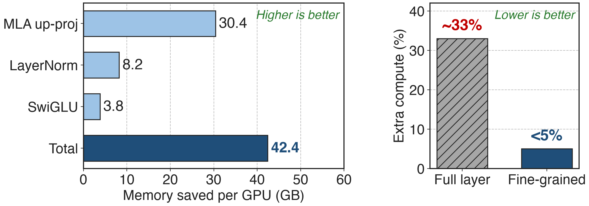{full}
%% caption: DeepSeek-V3, PP4 × VPP4 × EP64, 256 GPUs (Table 4). Compute: full layer ~33% (§4.1.4); fine-grained "less than 5%" (upper bound)
> MLA up-projection alone frees 30.4 GB per GPU
<!-- notes: On the same DeepSeek-V3 configuration as the memory breakdown, the three output-discarding modules save 42.4 GB per GPU: 30.4 GB from the MLA up-projection, 8.2 GB from LayerNorm and 3.8 GB from SwiGLU. The report puts the extra compute at less than 5%, against about 33% for full-layer recompute; the fine-grained bar is drawn at 5 as an upper bound. Sources: Table 4 p.24; §4.1.4 p.22-23. -->

# The largest single activation saver in the toolbox
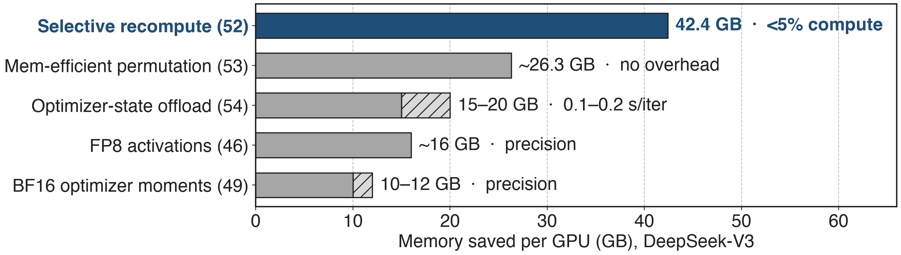{full}
%% caption: Each saving is reported separately against the 199.5 GB BF16 baseline (Table 3), so they do not simply add up
> Together they bring DeepSeek-V3 from 199.5 GB to under 80 GB per GPU
<!-- notes: How the Megatron-Core memory techniques compare on DeepSeek-V3: fine-grained recompute 42.4 GB for under 5% compute; memory-efficient permutation about 26.3 GB at no cost (deck 53); optimizer-state offload 15 to 20 GB for 0.1 to 0.2 s per iteration on GB200 (deck 54); FP8 activation storage about 16 GB (deck 46); BF16 optimizer moments about 10 to 12 GB (deck 49). FSDP (deck 70) shards parameters and optimizer state instead. Combined, the report says DeepSeek-V3 goes from 199.5 GB to under 80 GB per GPU. Sources: Table 4 p.24, §4.1.2 p.21, §4.1.3 p.22, §4.1.6 p.26-27, §11 p.78. -->

# At 64K, recompute everything but attention
%% layout: two-col
- **Core attention** (SDPA)
- !!72%!! of compute at 64K
- Recompute: !!+18%!! compute, !!−16%!! speed, **9 GB** saved
|||
- **Non-attention modules**
- **89.8 GB** saved in total
- Same or lower speed cost
> Choose by memory-to-compute ratio; the best set shifts with sequence length
<!-- notes: Selectivity matters more as context grows. For DeepSeek-V3 at 64K tokens, scaled dot-product attention is up to 72% of compute; recomputing it adds about 18% compute, costs about 16% performance, and saves only 9 GB. Recomputing the non-attention modules instead saves 89.8 GB (the report says "globally") with comparable or lower impact, so the report recommends disabling core-attention recompute. Source: §6.2 p.58. -->

# H100 recomputes four modules, GB200 only one
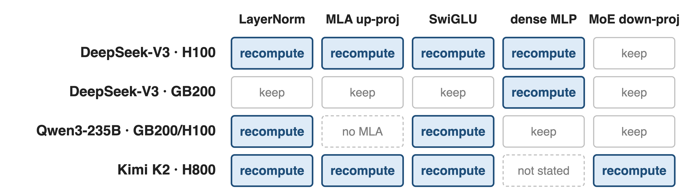{full}
%% caption: DeepSeek-V3: 1,024 H100 at 368 TFLOPS/GPU; 256 GB200 at 1,048 (Table 17). Qwen3-235B: App. B.2. Kimi K2: §2.4.3 of its report
> The recompute set is a per-platform knob, not a fixed recipe
<!-- notes: DeepSeek-V3 on 80 GB H100 recomputes mlp, mla_up_proj, moe_act and layernorm; on 192 GB GB200, where NVLink-C2C makes optimizer-state offload cheap, it recomputes only the dense mlp. Qwen3-235B recomputes moe_act and layernorm on GB200 and H100. Kimi K2 independently recomputes LayerNorm, SwiGLU, MLA up-projections and MoE down-projections. Sources: Table 17 p.74 and §9.2.2 p.75; App. B.2 p.87 (whose DeepSeek-V3 line differs from Table 17, see sources.md); Kimi K2 report arXiv 2507.20534 §2.4.3 p.8. -->

# The cost: compute, prerequisites, and conflicts
%% layout: two-col
- !!Extra compute!!: under 5%, not zero
- `moe` replays all-to-all; blocks EP overlap (deck 11)
- Fused attention makes `core_attn` moot
|||
- `moe_act` needs grouped GEMM; `mla_up_proj` needs MLA
- FP8: TE ≥ 2.6, no delayed scaling
- `shared_experts` excludes shared-expert overlap
<!-- notes: The compute bill is small but real. Constraints asserted in TransformerConfig: moe_act requires --moe-grouped-gemm, mla_up_proj requires multi-latent attention, shared_experts recompute cannot run with --moe-shared-expert-overlap, FP8 output-discarding recompute rejects delayed scaling and needs TE >= 2.6.0dev0, and core_attn triggers a warning because fused attention already avoids storing the score matrix. The 1F1B EP-overlap schedule (deck 11) rejects full recompute and moe recompute. Selective mode applies to every layer; recompute_num_layers must be unset. -->

# Summary
- **131 GB** of activations per GPU; full-layer recompute costs **~33%**
- ==Insight==: many saved outputs are one cheap op from a kept input
- Drop outputs, keep inputs, rebuild from a grad hook, FP8-exact
- **42.4 GB** saved per GPU for **< 5%** extra compute
%% qr: https://arxiv.org/abs/2603.07685
<!-- notes: Fine-grained selective recomputation turns recomputation from a 33% tax into a sub-5% one by choosing the activations with the worst memory-to-compute ratio and discarding outputs that the next GEMM would otherwise pin. Sibling decks: 53 memory-efficient permutation, 54 activation and optimizer offload, 46 FP8 activations, 49 precision-aware optimizer, 70 Megatron-FSDP, 11 the EP-overlap schedule. Source: arXiv 2603.07685 §4.1.4 and Table 4. -->
