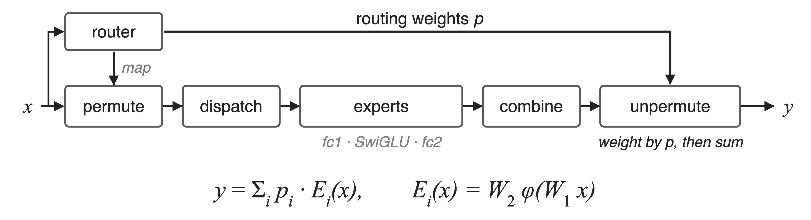
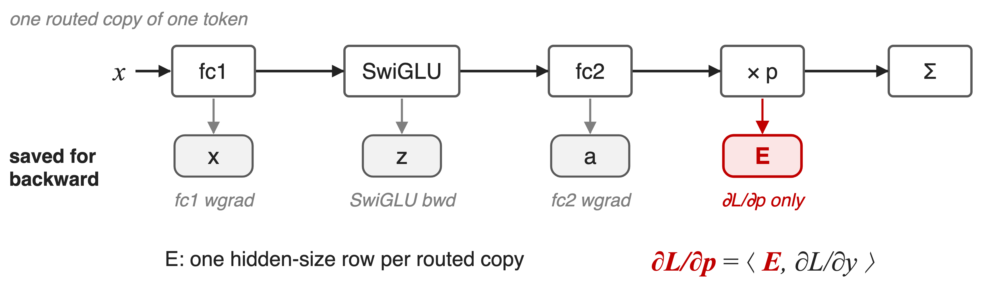
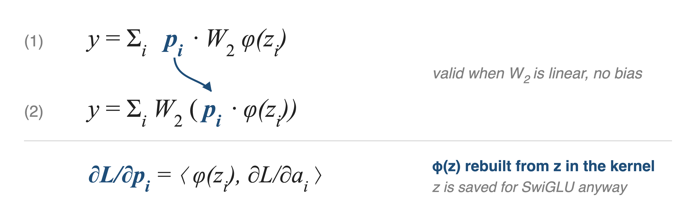
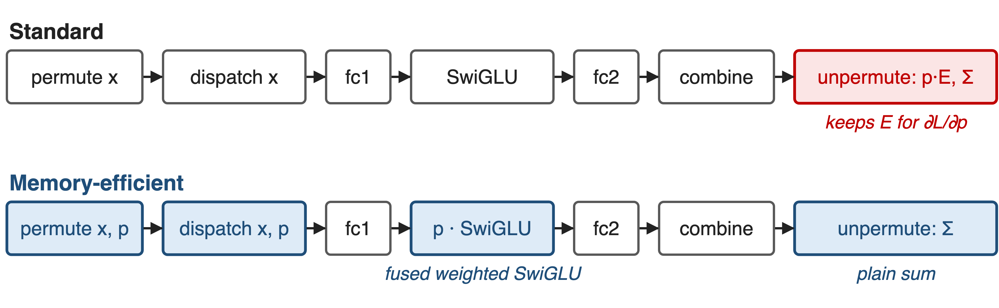
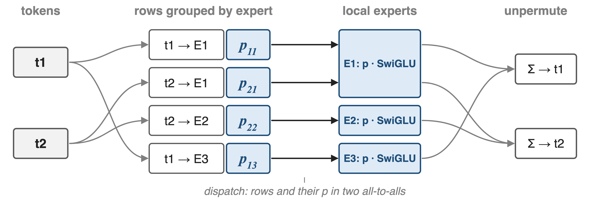
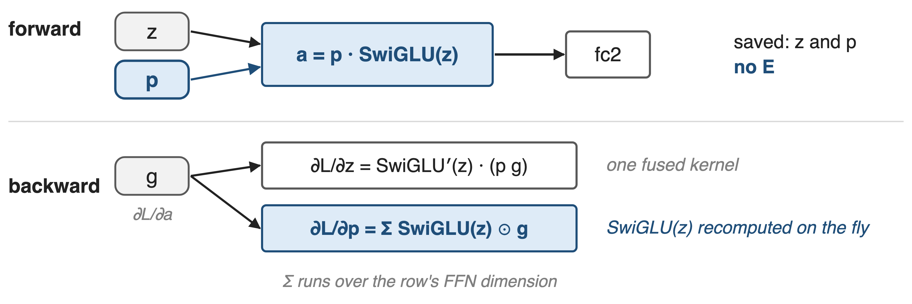
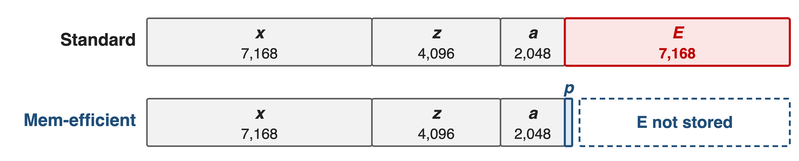
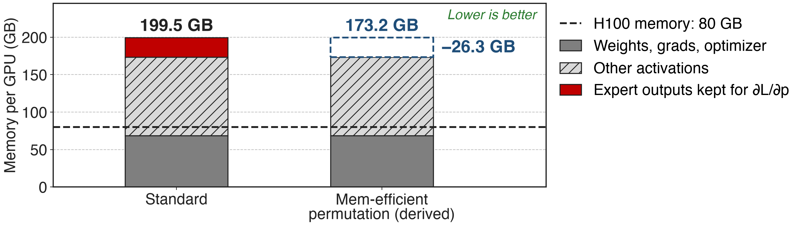
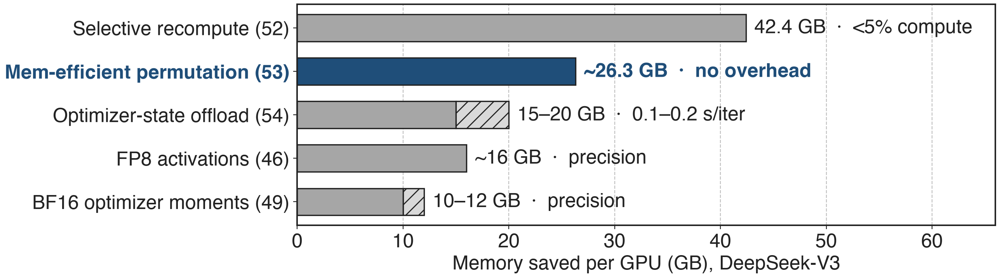

# Every MoE output is a router-weighted expert sum
{full}
%% caption: DeepSeek-V3: 256 routed experts, top-8 per token. Permute groups tokens by expert; unpermute restores order and combines
> Permutation: how tokens and weights reach experts and return
<!-- notes: An MoE layer routes each token to its top-k experts, permutes the token copies so each expert's rows are contiguous, ships them with an all-to-all, runs the experts, ships the results back, and unpermutes. The standard implementation applies the routing weight p at the very end, in unpermute, as a weighted sum of the expert outputs. DeepSeek-V3 uses 256 routed experts with top-8 routing. Sources: arXiv 2603.07685 §2.1 and Fig. 1 (p.9), §9.2 (p.73); DeepSeek-V3 report §4.2. -->

# One multiply pins a fifth of all activations
%% big: 26.3 GB
%% sub: per GPU of DeepSeek-V3 activations kept only to differentiate the router weights, 20% of the 131 GB (derived)
%% source: Megatron-Core MoE technical report, arXiv 2603.07685, §4.1.2 (p.21) and Table 3 (p.20)
<!-- notes: In the DeepSeek-V3 BF16 configuration of the memory breakdown, activations take 131 GB per GPU. Of that, about 26.3 GB exists only so that backward can compute the gradient of the routing weights. 26.3 divided by 131 is 20%, our derivation. Sources: §4.1.2 p.21 (26.3 GB saved) and Table 3 p.20 (131 GB activations). -->

# Weighting after the expert pins its output
{full}
> fc2's backward needs its input a, never its output E
<!-- notes: Follow one routed copy of a token. fc1 saves its input x, SwiGLU saves its input z, fc2 saves its input a: each for its own backward. Then the output E is multiplied by p. That multiply must keep E, because the gradient of p is the inner product of E with the incoming gradient. Nothing else in backward needs E, and E is a full hidden-size row per routed copy. In the unfused path, an FP32 p can even promote the rows to FP32 (code comment in moe_utils.unpermute). Sources: §4.1.2 p.21; megatron/core/transformer/moe/moe_utils.py unpermute. -->

# Storing or recomputing E both cost something
%% layout: two-col
- **Store E** (standard)
- One hidden-size row per routed copy
- !!26.3 GB!! per GPU on DeepSeek-V3
|||
- **Recompute E** in backward
- Kimi K2 recomputes its MoE down-projections
- !!An extra expert GEMM!! per layer
> Needed: a router gradient that never touches E
<!-- notes: The two obvious options trade memory for compute. Keep E, and pay 26.3 GB per GPU on DeepSeek-V3. Or do not keep it and recompute it: Kimi K2's report says it recomputes MoE down-projections to reduce activation memory, which re-runs the fc2 GEMM in backward. Neither removes the dependency itself. Sources: arXiv 2603.07685 §4.1.2 p.21; Kimi K2 report arXiv 2507.20534 §2.4.3 p.8. -->

# Insight: a scalar weight commutes with fc2
{full}
> Then the router gradient needs only z, which SwiGLU saves anyway
<!-- notes: p is one scalar per token-expert pair and the expert's second layer is a bias-free linear map, so p times W2 applied to h equals W2 applied to p times h. Equations 1 and 2 are the same function. In form 2 the gradient of p is the inner product of SwiGLU of z with the gradient of fc2's input, and SwiGLU of z can be recomputed from z, which SwiGLU's own backward keeps anyway. So no new buffer appears and E is no longer needed. Source: §4.1.2 Eqs. 1-2 (p.21). -->

# Move the multiply from unpermute into SwiGLU
{full}
%% caption: No flag: from MCore v0.13 every expert backend applies probs in its activation; unpermute only sums (§4.3.3)
<!-- notes: Three places change. Permute now also permutes the routing weights, dispatch ships them, the expert activation multiplies them in, and unpermute becomes a plain sum, accumulated in FP32. The README lists this under MCore v0.13 (2025/07); in current code TEGroupedMLP and SequentialMLP both take permuted_probs and the dispatchers call unpermute without probs. Sources: README What's New v0.13; §4.3.3 p.37; token_dispatcher.py; experts.py. -->

# ❶ Router weights travel with their tokens
{full}
%% caption: `permute(tokens, routing_map, probs=probs)` → one p per row; `unpermute(...)` without probs. Same for all-to-all, all-gather, DeepEP and HybridEP paths
<!-- notes: Token t1 goes to experts E1 and E3, t2 to E1 and E2. Permute sorts the four copies by expert and produces one routing weight per row, in the same order. The all-to-all dispatcher sends the token rows, then sends the weights with a second all-to-all using the same splits. Each expert multiplies its rows by their p inside the activation, and unpermute scatter-adds the rows back into t1 and t2. Sources: moe_utils.permute; MoEAlltoAllTokenDispatcher.dispatch_preprocess / token_dispatch; §4.3.3 p.37. -->

# ❷ One fused kernel weights forward and backward
{full}
%% caption: `weighted_bias_swiglu_impl` (megatron/core/fusions/fused_bias_swiglu.py) saves only z and p
<!-- notes: The forward computes p times SwiGLU of z and saves exactly two tensors: z, which plain SwiGLU would save anyway, and p, one scalar per row. Backward gets g, the gradient of fc2's input. The input gradient is SwiGLU's derivative applied to p times g; the weight gradient sums SwiGLU of z times g over the row, with SwiGLU of z recomputed on the fly. The extra work is elementwise inside a kernel that runs anyway. Sources: fused_bias_swiglu.py WeightedSwiGLUFunction and weighted_swiglu_back; §4.1.2 p.21. -->

# Per routed token, the E row disappears
{full}
%% caption: Analytic, DeepSeek-V3 dimensions (hidden 7,168; expert FFN 2,048, gated fc1 4,096); BF16 rows, p is one scalar
> E was 35% of the expert path's saved values per routed copy (analytic)
<!-- notes: Per routed copy of a token, the expert path saved x for fc1, z for SwiGLU, a for fc2, and E for the router gradient: 7,168 + 4,096 + 2,048 + 7,168 values. Memory-efficient permutation keeps the first three and adds one scalar p. E was 7,168 of 20,480 values, 35% (analytic, from DeepSeek-V3 §4.2 dimensions). This is a per-row picture; the measured total follows. -->

# 26.3 GB freed per GPU at zero compute cost
{full}
> Zero overhead: p is applied once either way, only earlier
<!-- notes: On DeepSeek-V3 with PP4 × VPP4 × EP64 on 256 GPUs in BF16, memory-efficient permutation saves about 26.3 GB of activation memory per GPU. The right bar is derived by subtracting 26.3 from the 199.5 GB total. The report lists no trade-off for this technique, unlike every other memory optimization in its summary table. Sources: §4.1.2 p.21; Table 3 p.20; Table 6 p.29. -->

# The only memory saver with no trade-off
{full}
%% caption: Each saving is reported separately against the 199.5 GB BF16 baseline (Table 3); they do not simply add up
> On in both final DeepSeek-V3 configurations, GB200 and H100
<!-- notes: Compared with the other Megatron-Core memory techniques on DeepSeek-V3: fine-grained recompute saves 42.4 GB for under 5% compute (deck 52), optimizer-state offload 15 to 20 GB for 0.1 to 0.2 s per iteration (deck 54), FP8 activations about 16 GB at some precision cost (deck 46), BF16 optimizer moments 10 to 12 GB (deck 49). Permutation's 26.3 GB is the only one with no trade-off in Table 6, and Table 18 lists it in both final DeepSeek-V3 configurations. Sources: Tables 4, 6, 18; §4.1.2-4.1.6. -->

# Kimi K3 cuts the same dependency another way
%% layout: two-col
- ==Megatron-Core==: move p before fc2
- Router gradient from SwiGLU(z)
- **No extra work**
|||
- **Kimi K3**: rewrite the p gradient
- Uses activation output and output gradient
- One light elementwise op
> Both stop backward from reading the expert output
<!-- notes: Kimi K3's report describes the same problem: in the native implementation the gradient of the permuted probs depends on the forward output. Following SonicMoE, K3 rewrites that gradient so it depends only on the activation output and the upstream gradient, at the cost of one additional lightweight elementwise computation. K3 also saves only the dispatch input and recomputes dispatch in backward to recover the grouped-GEMM input. Source: Kimi K3 report arXiv 2607.24653 §5.2.2 "Unified activation manager" paragraph. -->

# The cost: a bias rule and a tiny all-to-all
%% layout: two-col
- Needs a !!bias-free fc2!!, or a bias scaled by p apart
- Only E goes; x, z, a stay
|||
- p needs !!its own all-to-all!!, one scalar per row
- Top-1 variant: `moe_apply_probs_on_input`
> Pair with moe_act recompute (52), FP8 (46), offload (54)
<!-- notes: The swap is exact only if fc2 is linear without bias; Megatron adds any fc2 bias separately, scaled per token by p (experts.py _apply_bias). It removes only the router-gradient copy: x, z and a remain, which is what moe_act recompute, FP8 activation storage and offload attack. Because p is now consumed on the expert rank, the all-to-all dispatcher ships it with a second all-to-all of one value per routed row; with hidden size 7,168 that is negligible next to the token rows (analytic). For top-1 routing, moe_apply_probs_on_input multiplies p into the expert input instead. Sources: §4.1.2 p.21; experts.py; token_dispatcher.py; transformer_config.py. -->

# Summary
- **26.3 GB** per GPU held only for the router-weight gradient
- ==Insight==: p is a scalar and fc2 is linear, so weight before fc2
- Probs ride with tokens; one fused weighted-SwiGLU kernel
- **26.3 GB** freed per GPU, **zero** extra compute
%% qr: https://arxiv.org/abs/2603.07685
<!-- notes: Memory-efficient token permutation is the cheapest fix for the MoE activation wall: a one-line algebraic move that deletes a hidden-size buffer per routed token. Family: deck 52 (fine-grained recompute), deck 54 (activation and optimizer offload), deck 46 (FP8 activations), deck 49 (BF16 optimizer state), deck 70 (Megatron-FSDP). Sources: arXiv 2603.07685 §4.1.2; Megatron-LM MoE README. -->
