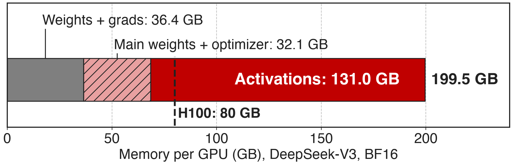
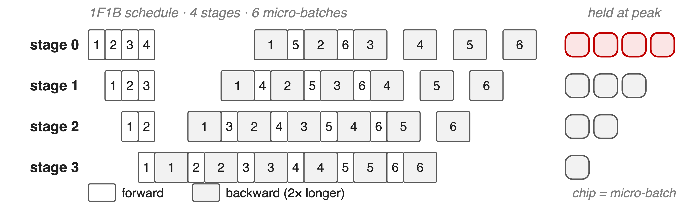
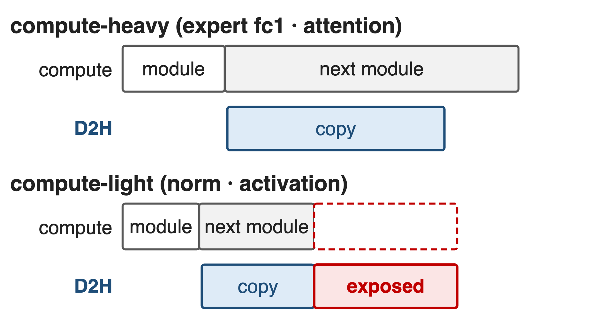
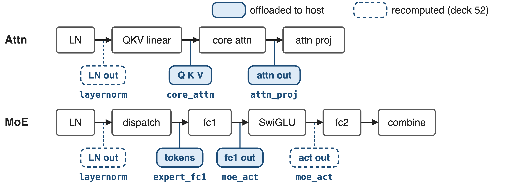
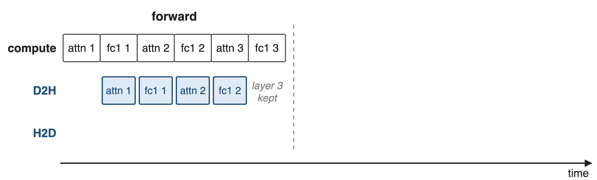
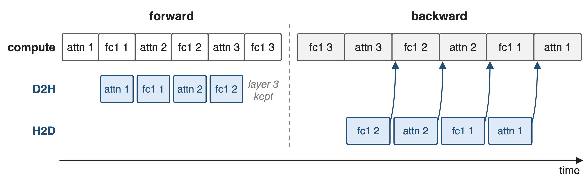
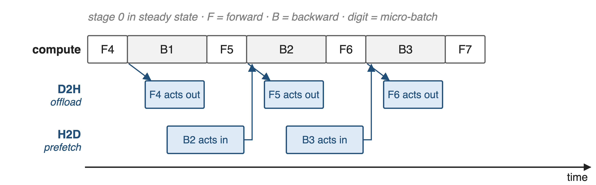
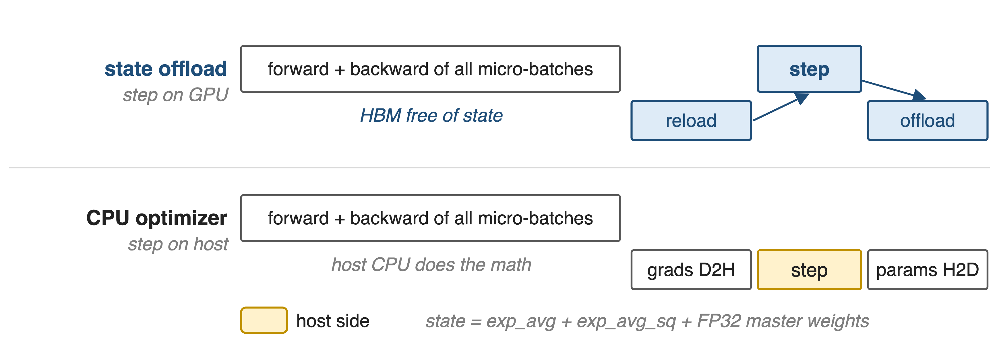
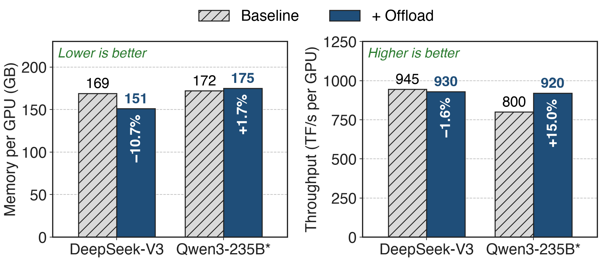
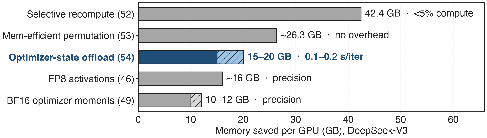

# Activations and optimizer state overflow HBM
{full}
%% caption: DeepSeek-V3 (685B total, 37B active), BF16, PP4 × VPP4 × EP64 on 256 GPUs (Megatron-Core Table 3)
> Meanwhile Kimi K2's H800 nodes carry 2 TB of host RAM per 8 GPUs
<!-- notes: The two red blocks are what this deck moves off the GPU. In BF16, DeepSeek-V3 needs 199.5 GB per GPU: 131 GB of activations and 32.1 GB of main weights and optimizer state, against 80 GB on an H100. The optimizer block is idle during forward and backward, and most activations sit idle between their forward and their backward. Host memory is large and mostly unused: Kimi K2's training nodes have 2 TB of RAM for 8 GPUs. Sources: arXiv 2603.07685 Table 3 p.20 and §4.1.6 p.26; Kimi K2 report §2.4.1 p.7. Siblings: deck 52 recompute, deck 53 permutation. -->

# Memory, not speed, picks the parallel layout
%% big: 15%
%% sub: Qwen3-235B throughput forgone while memory pins it at TP2 / EP16 (800 TF/s) instead of TP1 / EP64 (920 TF/s)
%% source: Megatron-Core MoE technical report, arXiv 2603.07685, §4.1.5 and Table 5 (p.25)
<!-- notes: Memory pressure does not only cause out-of-memory errors; it forces worse parallel layouts. Qwen3-235B runs at TP2 with EP16 at 800 TFLOPS per GPU. With activation offloading it fits at TP1 with EP64 and runs at 920, 15.0% faster, at nearly the same memory (172 vs 175 GB). So the cost of the memory wall here is 15% throughput. Source: §4.1.5 Performance paragraph and Table 5, p.25. -->

# Activations pile up on the first pipeline stage
{full}
> EP and PP cut parameters per GPU, not this activation pile
<!-- notes: In 1F1B, stage s runs P minus s forwards before its first backward, so with 4 stages the first stage holds the activations of 4 micro-batches at its peak and the last stage holds one. Kimi K2 calls out exactly this: the initial pipeline stages accumulate the largest activations during warm-up. The Megatron-Core report adds that activation memory does not decrease with expert or pipeline parallelism; those reduce parameter memory. Sources: Kimi K2 §2.4.3 p.8; arXiv 2603.07685 §4.1.5 Motivation p.24; Kimi K3 §5.2.2 (resident activations decrease with PP rank). Schedule drawn analytically, backward = 2 × forward. -->

# Full recompute and layer offload both fall short
%% layout: two-col
- **Full recompute**
- Keeps every layer's input: !!L × layer input!! on GPU
- ~33% more compute, replays all-to-all (deck 52)
|||
- **Layer-level offload** (TE)
- !!All or nothing!! per layer
- Legacy path rejects PP > 1 and recompute
> Needed: per-module choice, timed by the pipeline schedule
<!-- notes: Full recomputation keeps each layer's input on the GPU, so its peak is L times the layer input plus one layer's intermediates, growing with depth, and it costs about a third more compute. Transformer Engine's layer-level offloading cannot tell a cheap LayerNorm from an expensive expert fc1 input, so it offloads everything or nothing; Megatron's legacy cpu_offloading path even raises errors with pipeline parallelism or recomputation. Sources: arXiv 2603.07685 §4.1.4 p.22 and §4.1.5 p.24-25; transformer_config.py validation of cpu_offloading. -->

# Insight: copies are free while a module computes
{right 52%}
- Copy engine runs beside the SMs: hidden if compute outlasts the copy
- 1F1B fixes when each activation returns
> Offload heavy modules' inputs after forward; reload just before backward
<!-- notes: The GPU's copy engines are independent of its compute engines. When a module's computation takes longer than moving its activation over PCIe or C2C, the device-to-host copy runs underneath the next module at no cost. That holds for compute-heavy modules such as expert fc1 or attention; norm and activation outputs are cheap to compute relative to their size, so their copies would be exposed, and they are better recomputed (schematic, not to scale). And in a pipelined schedule nothing is random: the forward and backward order of every module of every micro-batch is known in advance, so reloads can be issued exactly early enough. Source: arXiv 2603.07685 §4.1.5 "High-Level Idea: Overlap and Prefetch" p.24. -->

# Offload heavy inputs, recompute cheap outputs
{full}
%% caption: `--offload-modules core_attn attn_proj expert_fc1 moe_act` with `--recompute-modules layernorm moe_act`
<!-- notes: Fine-grained offloading works per module: each listed module's saved input goes to pinned host memory. It composes with fine-grained recomputation from deck 52: cheap norm and activation outputs are recomputed, expensive inputs such as Q, K, V, the attention output, the dispatched tokens and the fc1 output are offloaded. For moe_act both apply, freeing the whole fc1-to-activation chain. Megatron-Core lists pipeline-aware fine-grained activation offloading in its 2026/01 dev release. Sources: §4.1.5 Key Technical Features p.25; Megatron-LM docs fine_grained_activation_offloading.md; README What's New (MCore dev 2026/01). -->

# ❶ Copy out after forward, back one layer early
{full}
--
{full}
> The last layer stays on GPU; one reload per module type is in flight
<!-- notes: Forward: when an offloaded module finishes, a dedicated D2H stream waits for it and copies the tensors autograd saved inside that module to pinned host memory, while the next module computes; the GPU copy is then freed. The last layer is kept, because its backward starts immediately. Backward: when a module of layer l finishes its backward, the H2D stream reloads the same module's tensors for layer l minus 1, and the compute stream waits on that reload event only when it needs the data. So only one extra activation per module type is resident. Sources: §4.1.5 Forward Pass / Backward Pass p.24; fine_grained_activation_offload.py on_group_commit_forward, on_group_start_backward, bulk_reload, post_warmup_callback (offload margin). -->

# ❷ The 1F1B schedule decides what moves when
{full}
%% caption: One handler per micro-batch × VPP chunk; later PP ranks offload less (`--delta-offload-bytes-across-pp-ranks`)
> Kimi K2: offload the previous forward, prefetch the next backward
<!-- notes: Megatron-Core creates one ChunkOffloadHandler per micro-batch and virtual-pipeline chunk and queues them so that popping during backward follows the interleaved 1F1B order: VPP stages first-in-last-out, micro-batches first-in-first-out. When a chunk has nothing left to reload, it pre-reloads the last layer of the next backward chunk. Higher PP ranks hold fewer micro-batches, so they can offload fewer bytes. Kimi K2 describes the same rhythm: during 1F1B, offload the forward activations of the previous micro-batch while prefetching the backward activations of the next, overlapped with compute and communication. Sources: §4.1.5 PP and VPP Handling p.25; fine_grained_activation_offload.py; docs tuning parameters; Kimi K2 §2.4.3 p.9 and Fig. 7. -->

# ❸ Optimizer state leaves HBM between steps
{full}
%% caption: `--offload-optimizer-states` (dev branch; now `--chunked-optimizer-state-offload`) vs `--optimizer-cpu-offload`
<!-- notes: Optimizer state is used once per iteration, in the step, yet sits in HBM through every forward and backward. State offloading keeps the step on the GPU: Adam's two moments and the FP32 master weights move to host memory after optimizer.step and are reloaded before the next one. The other option, Megatron's CPU optimizer, copies gradients to the host and runs the step there, then copies parameters back. With BF16 moments (deck 49) there is less to move. Sources: arXiv 2603.07685 §4.1.6 State Offloading p.26-27; Megatron-LM optimizer_config.py (dev) and docs optimizer_cpu_offload.md. -->

# Offload costs 1.6% speed, or buys back 15%
{full}
%% caption: Table 5. DeepSeek-V3: TP1 PP8 EP32 VPP4, MXFP8. *Qwen3-235B moves from TP2 / EP16 to TP1 / EP64 when offload is on
> Across configurations: 10–18% less memory for 1.6–2% throughput
<!-- notes: On DeepSeek-V3 with the layout unchanged, offloading cuts per-GPU memory from 169 to 151 GB, 10.7%, while throughput drops from 945 to 930 TFLOPS per GPU, 1.6%. On Qwen3-235B the freed memory is spent on a better layout: TP1 with EP64 instead of TP2 with EP16, at 175 instead of 172 GB, and throughput rises from 800 to 920, 15.0%. The report summarizes 10 to 18% memory reduction for 1.6 to 2% throughput overhead. Source: §4.1.5 Performance and Table 5, p.25. -->

# Optimizer offload frees 15–20 GB per GPU
{full}
%% caption: Each saving is reported separately against the 199.5 GB BF16 baseline (Table 3); they do not simply add up
> Long context, DeepSeek-V3 on 256 H100: worst-case overhead about 2%
<!-- notes: For DeepSeek-V3, optimizer-state offload saves 15 to 20 GB per GPU, 47 to 62% of the 32.1 GB main-weights-and-optimizer budget, for 0.1 to 0.2 seconds per iteration, in the GB200 setting with NVLink-C2C. For long-context training of DeepSeek-V3 on 256 H100 at around 50% MFU and sequences of 16K or more, the report puts the worst-case overhead of optimizer CPU offloading at about 2%. GB200's final DeepSeek-V3 config uses optimizer offload so it only needs to recompute mlp (deck 52). Sources: §4.1.6 p.27; §6.2 p.58; §9.2.2 p.75. -->

# Kimi K2 and K3 offload the rest at trillion scale
%% layout: two-col
- **Kimi K2** (1T, H800)
- Recompute, FP8, then offload the rest
- EP stays fully overlapped
|||
- **Kimi K3** (2.8T)
- Offload or remote-offload per tensor
- Balances PP ranks' activations
> Recompute what is cheap, compress what is safe, offload the rest
<!-- notes: Kimi K2, 1 trillion parameters on H800 nodes with 2 TB of RAM each, recomputes LayerNorm, SwiGLU, MLA up-projections and MoE down-projections, stores some activations in FP8, and offloads all remaining activations to CPU RAM with a copy engine overlapping compute and communication; PCIe traffic may slightly affect EP traffic, but EP communication stays fully overlapped in their tests. Kimi K3, 2.8T, treats recomputation, quantization, offload and remote offload as per-tensor storage policies, remotely offloads activations to the memory of other PP ranks with the Mooncake Transfer Engine to balance them, and keeps sharded gradients in CPU memory. Sources: Kimi K2 §2.4.1 p.7, §2.4.3 p.8-9; Kimi K3 abstract and §5.2.2 p.20. -->

# The cost: bandwidth, host memory, constraints
%% layout: two-col
- !!Copy bandwidth!!: compute must outlast the copy
- PCIe traffic can touch EP (Kimi K2)
- Pinned host pool; last layer stays on GPU
|||
- Needs TE; `NVTE_CPU_OFFLOAD_V1=1` on TE ≥ 2.10
- CUDA graphs: no `attn_norm` / `mlp_norm`
- State offload: no Megatron-FSDP
<!-- notes: Offload is free only while computation hides the copy; the report lists CPU overhead and non-overlapped copies as its trade-off, and state offload is most effective on GB200's NVLink-C2C. Kimi K2 notes PCIe congestion can slightly affect EP traffic. Activations go to a pinned CPU tensor pool, and the last layer's groups stay on the GPU. In Megatron the feature requires the Transformer Engine implementation and NVTE_CPU_OFFLOAD_V1=1 with TE 2.10 or newer; under CUDA graphs the norm inputs cannot be offloaded; the chunked optimizer-state offload does not support Megatron-FSDP (deck 70) and needs torch_dist checkpoints. Sources: Table 6 p.29; §4.1.6 p.26; Kimi K2 p.9; megatron/training/arguments.py; fine_grained_activation_offloading.md. -->

# Summary
- Memory pins Qwen3-235B at TP2: **15%** throughput forgone
- ==Insight==: copies hide under compute; 1F1B says when to move
- Module-level offload, layer-staggered reload, per-chunk handlers, state offload
- **−10.7%** memory for **−1.6%** speed; **+15%** via TP1; **15–20 GB** of optimizer state
%% qr: https://arxiv.org/abs/2603.07685
<!-- notes: Pipeline-aware offload turns idle host memory and idle copy engines into GPU memory headroom, and spends it either on a smaller footprint or on a faster parallel layout. Family: deck 52 (fine-grained recompute), deck 53 (memory-efficient permutation), deck 46 (FP8 activations), deck 49 (precision-aware optimizer), deck 70 (Megatron-FSDP). Sources: arXiv 2603.07685 §4.1.5-4.1.6; Kimi K2 and K3 reports. -->
