# Every MoE step waits for its busiest expert
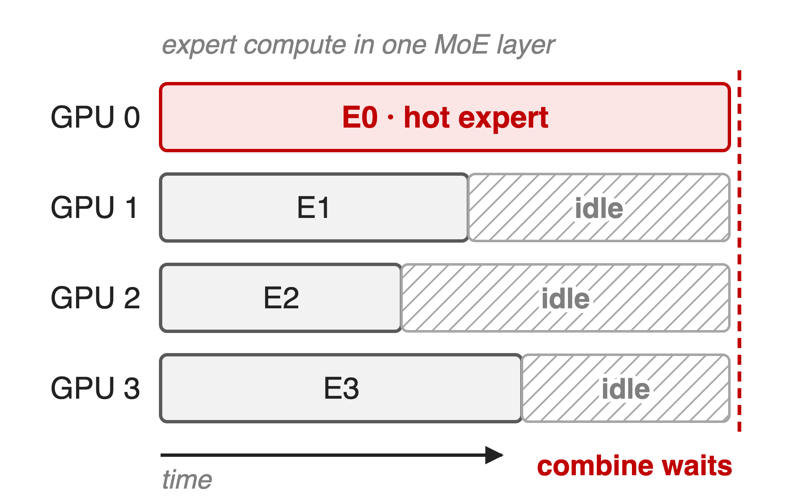{right 55%}
- DeepSeek-V3: **256** routed experts, top-**8**, spread over **64** GPUs
- GLM-4.5: **160** routed experts, top-**8**
- Starved experts stop learning: routing collapse
<!-- notes: A fine-grained MoE layer sends every token to K of N experts, and expert parallelism puts those experts on different GPUs. The layer cannot combine until the most loaded expert finishes, so any imbalance turns directly into idle GPUs; in the extreme the router collapses onto a few experts and the rest never train. DeepSeek-V3 has 256 routed experts with 8 active, deployed on 64 GPUs across 8 nodes per layer; GLM-4.5 has 160 routed experts with 8 active. Sources: DeepSeek-V3 arXiv 2412.19437 §4.2 p.22-23; GLM-4.5 arXiv 2508.06471 Table 1; collapse: arXiv 2408.15664 §2.2. -->

# A tuned aux loss still leaves 72% overload
%% big: +72%
%% sub: more tokens than its fair share on the busiest expert, even with a tuned auxiliary loss (1B MoE, α = 0.001)
%% source: arXiv 2408.15664, Table 2: MaxVio_global = 0.72, i.e. max load = 1.72 × mean load (layer average)
<!-- notes: The paper measures balance with MaxVio, the busiest expert's load minus the mean, divided by the mean. With the auxiliary-loss coefficient the authors picked as the best trade-off, alpha 0.001, a 1B MoE still has MaxVio 0.72 on the validation set: the hottest expert gets 72 percent more tokens than a perfectly balanced router would give it. Under expert parallelism that expert's GPU sets the pace of the layer. Source: arXiv 2408.15664 Table 2 and Eq. 4. -->

# Every aux-loss weight loses balance or perplexity
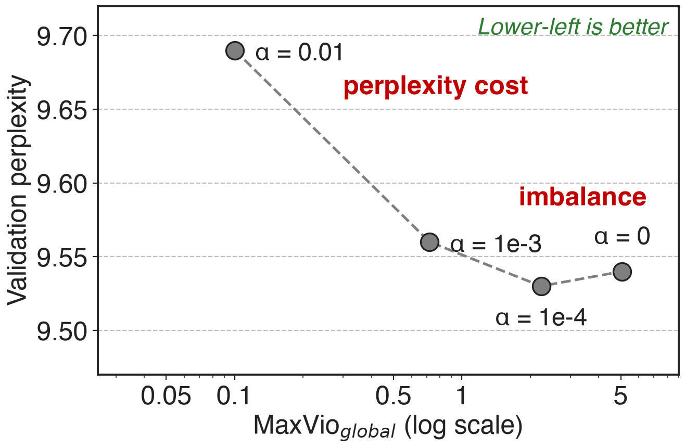{right 60%}
- **α = 0**: MaxVio ≈ **5**, near collapse
- **α = 0.01**: balanced, perplexity ≈ **9.69**
- No α reaches the lower-left corner
%% caption: 1B MoE. α = 1e-3 from Table 2; other α read off Fig. 2 of arXiv 2408.15664 (approximate)
<!-- notes: Sweeping the auxiliary-loss weight traces a frontier. With no aux loss MaxVio is about 5, so the busiest expert carries about six times its fair share; with alpha 0.01 balance is good but validation perplexity rises to about 9.69, against 9.56 at alpha 0.001. Every setting gives up one side. The alpha 1e-3 point is exact (Table 2); the other three points are digitized from Fig. 2 of the paper, so treat them as approximate. -->

# Existing fixes touch the gradient or the future
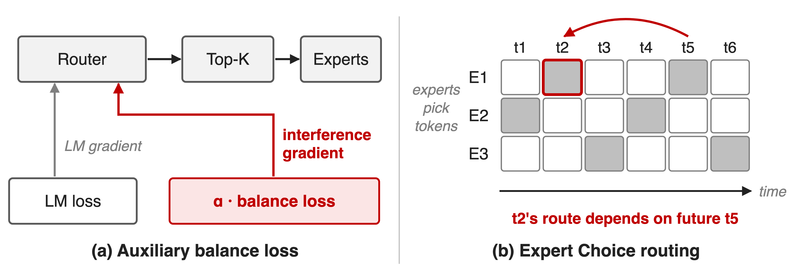{full}
> Both couple balance to the gradient or to future tokens
<!-- notes: The auxiliary loss is a differentiable penalty, so its gradient lands on the same router weights the language-modeling gradient trains, and the two pull against each other. Expert Choice flips the direction: each expert takes its top tokens across the chunk, which balances perfectly, but whether token 2 gets an expert now depends on token 5. The paper measured this leak: shrinking the chunk to 512 tokens gave an abnormal loss drop of about 10 percent, and its bound allows more than 50 bits per token for a 9-layer, 16-expert, top-2 model. Source: arXiv 2408.15664 §2.2, Table 1, §5.2, App. D. -->

# Insight: top-K selection needs no gradient
- Router scores do two jobs: **pick** experts, **weight** their outputs
- Balance needs only the pick, and top-K is never differentiated
--
> Steer the pick with a per-expert bias that never enters the loss or the output
<!-- notes: The gradient reaches the router only through the gate values that multiply the expert outputs; the discrete top-K choice itself has no gradient. So the choice is a free control input. If we add a per-expert offset only inside the top-K comparison, we can push tokens away from hot experts without any extra loss term and without changing what the layer computes for the chosen experts. Source: arXiv 2408.15664 §3, Eq. 3; DeepSeek-V3 Eq. 16. -->

# Bias the pick, keep the weights, close the loop
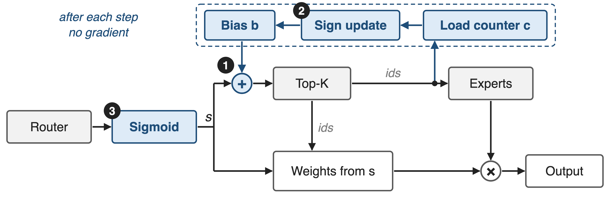{full}
%% caption: ❶ biased Top-K · ❷ sign update after each step · ❸ sigmoid scores; bias and counters carry no gradient
<!-- notes: Here is the whole router. Sigmoid turns the router logits into per-expert scores s. Mechanism one adds the bias b only on the selection path into Top-K; the gate weights that scale the expert outputs still come from s. Mechanism two counts tokens per expert and, after the step, nudges each bias up or down. Mechanism three is the choice of sigmoid, which makes that additive bias behave predictably. The top loop runs outside autograd. Sources: arXiv 2408.15664 Fig. 1, Eq. 3, Alg. 1; DeepSeek-V3 Eq. 13-16. -->

# ❶ The bias moves the pick, never the weight
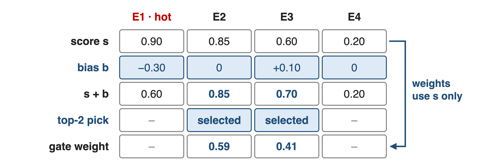{full}
> Without b, top-2 is E1 + E2; with b, E2 + E3, weighted by s alone
<!-- notes: One token, four experts, illustrative numbers. E1 is hot, so its bias has been pushed down to minus 0.3, and E3 is cold. On raw scores the top-2 would be E1 and E2; on s plus b it becomes E2 and E3. The gate weights are the selected sigmoid scores 0.85 and 0.60 normalized to sum to one, 0.59 and 0.41, exactly as DeepSeek-V3 computes them; the bias never appears in the output, so it cannot distort what the experts contribute. Sources: arXiv 2408.15664 Eq. 3 and the note below it; DeepSeek-V3 Eq. 13-16. -->

# ❷ A sign step nudges each bias by ±u
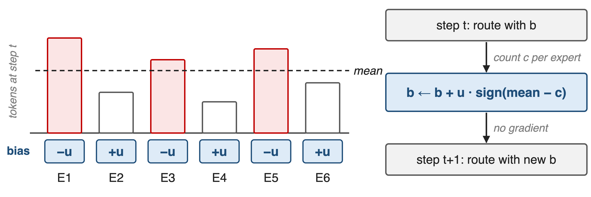{full}
> u = 0.001: smaller adapts too slowly early, larger oscillates late
<!-- notes: After every training step the router counts how many tokens each expert received. Experts above the mean lose u from their bias, experts below gain u. Only the sign of the error is used; a proportional variant balanced slightly better but did not improve perplexity (Table 3). The update uses past batches only: using the current sequence's own load would leak future tokens. The paper tuned u at 1B: 1e-4 converges slowly, 1e-2 makes the bias fluctuate late in training, 1e-3 gave perplexity 9.50 against 9.51 for both. Sources: arXiv 2408.15664 Alg. 1, §3, §4.3, Fig. 4, Table 3. -->

# ❸ Sigmoid keeps each expert's score independent
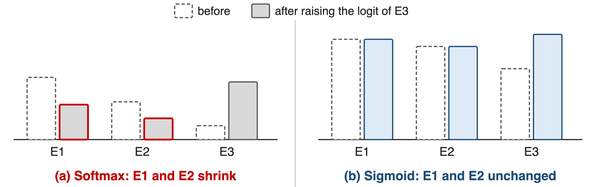{full}
> Softmax couples the score gaps a fixed bias must shift; sigmoid does not
<!-- notes: With softmax, every score shares one normalizer, so the gap between E1 and E2 changes whenever some other expert's logit moves; a fixed bias then flips different decisions on different tokens. With sigmoid each score depends only on its own logit. The paper also found the sigmoid baseline beat the softmax baseline in perplexity, and for softmax it had to switch to a proportional bias update to keep balance. DeepSeek-V4 replaces sigmoid with square-root softplus, which is also per-expert. Illustrative logits. Sources: arXiv 2408.15664 §4.1, App. C.1-C.2; DeepSeek-V4 arXiv 2606.19348 §2.1. -->

# Production: u = 0.001 plus a 1e-4 sequence loss
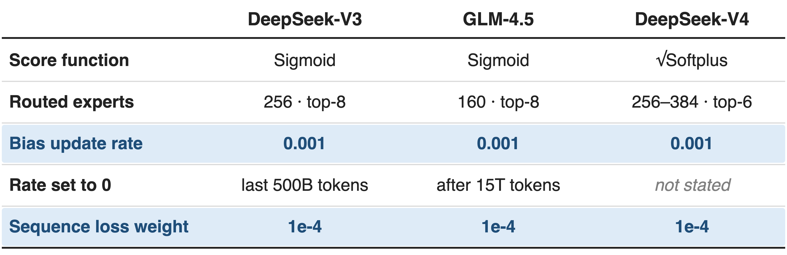{full}
> All three keep a tiny sequence loss against in-sequence skew
<!-- notes: The three production recipes agree. Bias update rate 0.001; DeepSeek-V3 sets it to zero for its last 500B of 14.8T tokens, GLM-4.5 after its first 15T tokens, which freezes the bias for the end of training. Each also keeps a complementary sequence-wise balance loss with weight 0.0001, because the bias balances the whole batch, not each sequence. Sources: DeepSeek-V3 §2.1.2 and §4.2 p.23; GLM-4.5 §2.1 Table 1 and §2.4; DeepSeek-V4 §2.1, §4.2.1-4.2.2. -->

# MCore updates the bias once per global batch
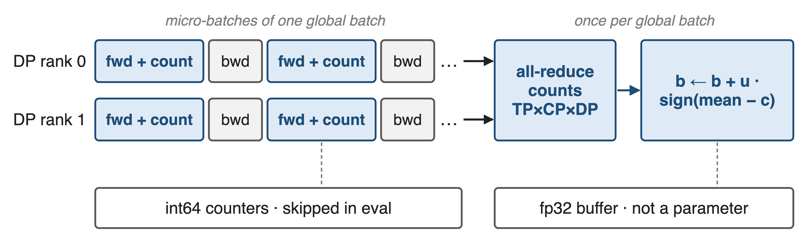{full}
%% caption: --moe-router-score-function sigmoid --moe-router-enable-expert-bias --moe-router-bias-update-rate 1e-3 (fused router: deck 42)
<!-- notes: In Megatron-Core the router keeps an int64 token counter per expert and adds to it in every forward that has gradients enabled, so evaluation is not counted and a recomputed forward is not counted twice. In finalize_model_grads, once per global batch, the counters of all MoE layers are stacked, all-reduced over the tensor, context and data-parallel group, and each bias moves by plus or minus the rate; then the counters are zeroed. The bias is an fp32 buffer, not a parameter, so it has no gradient and no optimizer state, and the fused router kernel takes it as an input. Sources: Megatron-LM router.py, moe_utils.get_updated_expert_bias, finalize_model_grads.py; MoE README. -->

# MaxVio 0.72 → 0.04, with lower perplexity
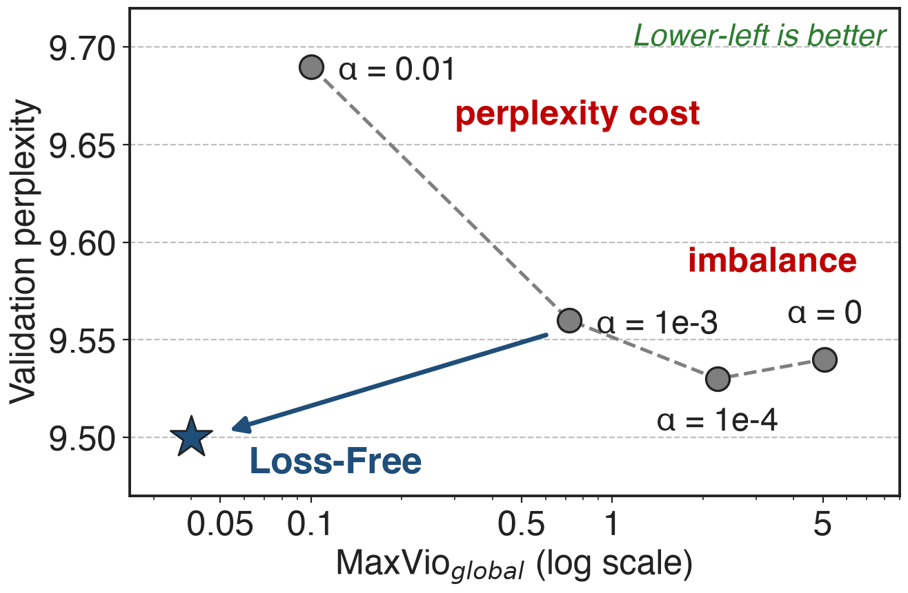{right 60%}
- 1B: perplexity **9.56 → 9.50**
- 3B: **7.97 → 7.92**, MaxVio **0.52 → 0.04**
- Balance keeps improving as EP batches grow
%% caption: 1B on 100B tokens, 3B on 200B tokens; α = 1e-2, 1e-4, 0 read off Fig. 2 (approximate)
<!-- notes: Against the tuned auxiliary loss, Loss-Free Balancing improves both axes at once: global MaxVio drops from 0.72 to 0.04 and validation perplexity from 9.56 to 9.50 at 1B; at 3B, 0.52 to 0.04 and 7.97 to 7.92. It lies off the aux-loss frontier, not on it. Because the bias targets the whole batch, balance per computation batch keeps improving as expert parallelism enlarges that batch, while the aux-loss model plateaus. Sources: arXiv 2408.15664 Table 2, Fig. 2, §5.1 Fig. 5. -->

# At 228.7B, loss-free wins 7 of 9 benchmarks
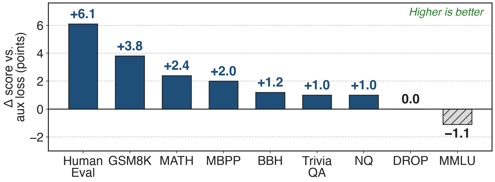{full}
%% caption: DeepSeek-V3 ablation, 228.7B total / 20.9B active MoE on 578B tokens, same data; Pile BPB 0.656 → 0.652
> Up to +6.1 HumanEval and +3.8 GSM8K; MMLU drops 1.1
<!-- notes: DeepSeek repeated the comparison at scale: a 228.7B MoE with 20.9B active, trained on 578B tokens, once with only auxiliary losses and once with the loss-free strategy and no auxiliary loss. Loss-free is better on 7 of 9 benchmarks, ties on DROP and loses 1.1 on MMLU; Pile bits-per-byte goes from 0.656 to 0.652. At the 15.7B scale it is better on 8 of 9. The bars are derived differences of the published scores. Source: DeepSeek-V3 arXiv 2412.19437 §4.5.2 Table 5. -->

# Limits: batch scope, one step size, ~1k experts
%% layout: two-col
- !!Per batch, not per sequence!!: production adds the **1e-4** loss
- Scope explains part of the gain: a batch-wise aux loss ties (**2.253**)
|||
- !!One fixed step u!!: slow or oscillating
- **896** experts per layer: Kimi K3 replaces the sign rule (deck 56)
<!-- notes: The bias balances whole batches, so a single sequence or a small batch can still be skewed, and inference traffic can shift domains; DeepSeek-V3 relies on large EP and DP micro-batches in training and redundant experts in serving. DeepSeek-V3 also shows part of the gain is the batch-wise scope: at 1B, sequence-wise aux loss 2.258, loss-free 2.253, batch-wise aux loss 2.253. The fixed step trades slow adaptation against oscillation, and Kimi K3 with 896 routed experts per layer replaces it with Quantile Balancing, deck 56. In Megatron-Core it is opt-in: the expert bias defaults off and the score function defaults to softmax. Sources: DeepSeek-V3 §4.5.3; Kimi K3 arXiv 2607.24653 §2.3.3; MoE README. -->

# Summary
- Aux loss trades balance for perplexity: **+72%** overload at the tuned α
- ==Insight==: top-K needs no gradient, so steer it with a bias
- Sign step on token counts; weights still from sigmoid scores
- MaxVio **0.72 → 0.04**, perplexity **9.56 → 9.50**; production u = **0.001**
%% qr: https://arxiv.org/abs/2508.06471
<!-- notes: Loss-free balancing moves load control out of the loss and into a feedback loop on the routing decision, which is why frontier MoEs (DeepSeek-V3 and V4, GLM-4.5) and Megatron-Core adopted it. Origin: DeepSeek, arXiv 2408.15664; the QR points to GLM-4.5, the reference of this landscape row. Related decks: 56 (Quantile Balancing for ~1k experts), 58 (ultra-sparse MoE), 42 (router fusion kernels). -->
