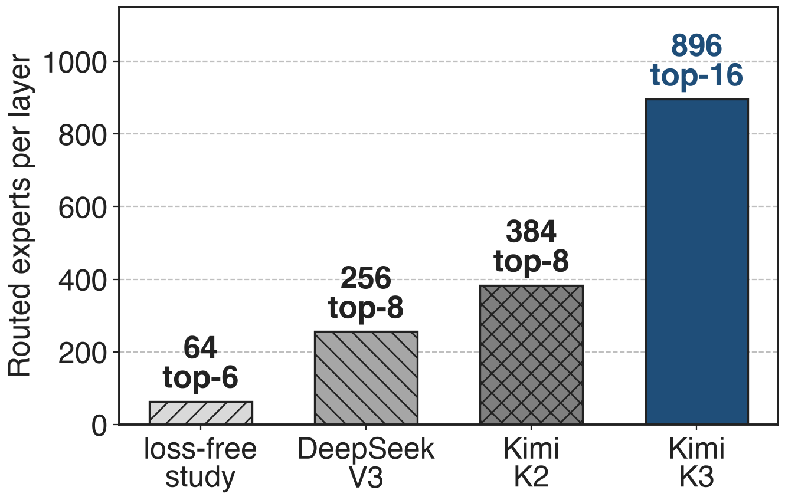
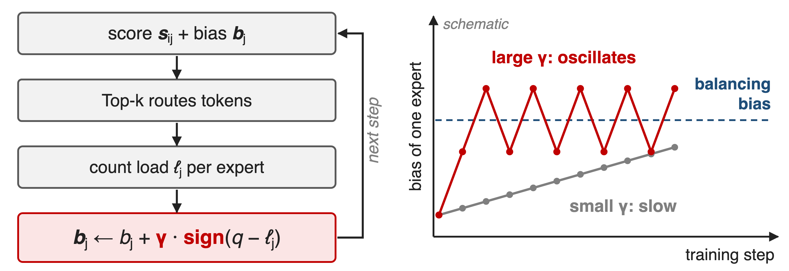
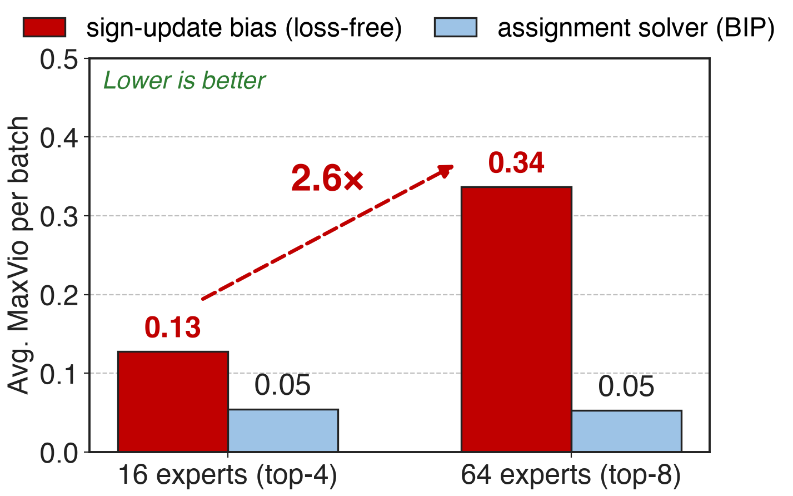
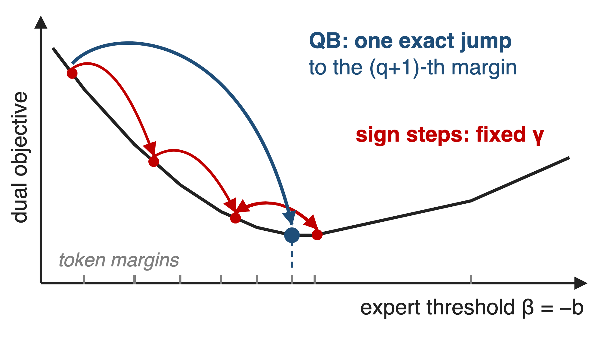
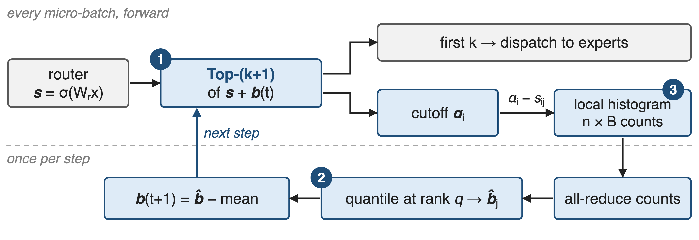
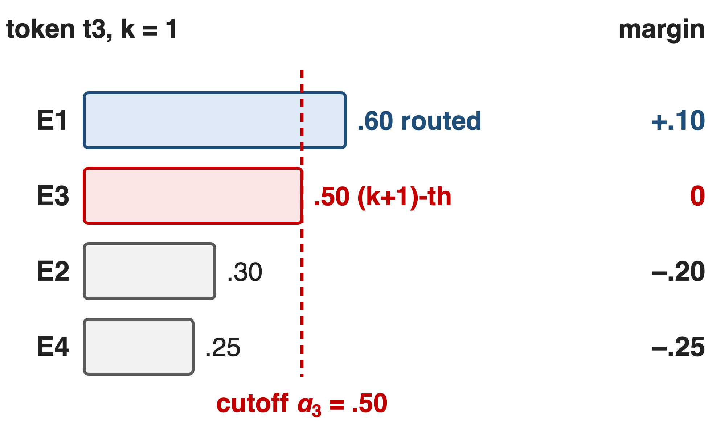
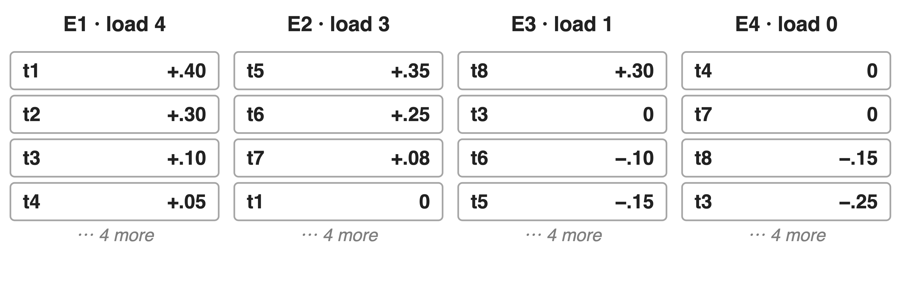
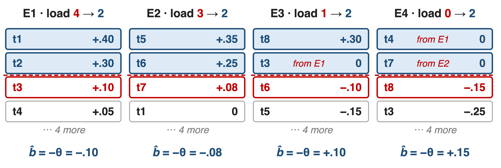
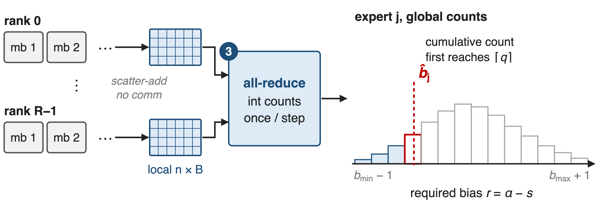
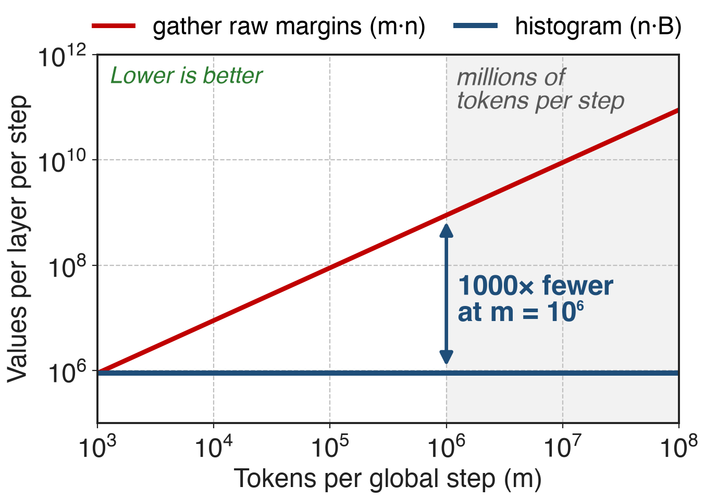

# K3 picks 16 of 896 experts per token
{right 55%}
- Kimi K3: **2.8T** params, **104B** active
- Router score + per-expert **bias**; the bias only picks experts
- Every layer must keep **896** experts evenly loaded
<!-- notes: Expert pools keep growing: the loss-free balancing paper validated its method on 64 routed experts, DeepSeek-V3 has 256, Kimi K2 384, and Kimi K3 896 with 16 active per token, a sparsity of 56. K3 routes with sigmoid scores and adds a per-expert bias only for the Top-k selection; the mixture weights use the unbiased scores. If a few of those 896 experts get most tokens, expert parallelism waits for them and the idle ones barely train. Sources: K3 abstract, §2.3, Table 1, Eq. 13; DeepSeek-V3 §4.2; LFB Table 5. Baseline method: deck 55; sparsity: deck 58. -->

# Sign updates leave hot experts overloaded
%% big: +34%
%% sub: busiest expert's load above its fair share on an average batch: sign-update balancing, 64 experts (+13% at 16)
%% source: AvgMaxVio 0.34 vs 0.13; worst batch 2.71. BIP paper, arXiv 2502.15451, Tables 2–3 (0.3B / 1.1B MoE)
<!-- notes: MaxVio is the busiest expert's load divided by the mean load, minus one. In a third-party study that re-ran DeepSeek's loss-free balancing, the average over all training batches was 0.13 with 16 experts and 0.34 with 64, so on a typical batch the hottest expert carries 34 percent more than its share; the worst batch reached 2.71, almost four times the mean. Under expert parallelism the layer waits for the busiest expert. These are small softmax-router models, so read the trend, not the absolute value. Source: arXiv 2502.15451, Tables 2 and 3; MaxVio definition from arXiv 2408.15664 Eq. 4. -->

# Loss-free balancing nudges each bias by ±γ
{full}
> γ trades slow adaptation against oscillation, and one γ serves all 896 experts
<!-- notes: After each step, loss-free balancing counts each expert's load and moves its bias up or down by a fixed γ, using only the sign of the error. Too small and the bias crawls toward balance; too large and it overshoots back and forth. The original paper tuned γ = 0.001 once, at the 1B scale with 64 experts, and showed 1e-4 balancing poorly early and 1e-2 fluctuating late (Fig. 4); DeepSeek-V3 even switched γ to zero for its last 500B tokens. K3 says the same trade-off leaves nearly a thousand experts outside the regime where this update behaves. Sources: arXiv 2408.15664 Alg. 1, §4.1, §4.3; DeepSeek-V3 §4.2; K3 §2.3.3 p.8. Right panel is a schematic. -->

# Imbalance grows 2.6× from 16 to 64 experts
{right 58%}
- Same sign update, **4×** the experts
- Assignment solver (BIP) stays at **0.05**
- K3 needs **14×** more: **896**
%% caption: Third-party runs: Minimind MoE, 0.3B / 1.1B, softmax router (BIP paper, Tables 2–3)
<!-- notes: The sign update's average imbalance grows from 0.13 to 0.34 as the pool grows from 16 to 64 experts, a 2.6× increase. A solver that treats routing as an assignment problem (BIP, binary integer programming) stays at about 0.05 at both sizes. BIP is the last suitor: it already holds the right idea, but it uses inequality constraints, so its update can only push overloaded experts down, never pull idle ones up, and K3 found it markedly slower to equilibrate. 896 is 14 times the 64 experts loss-free balancing was tuned on. Sources: arXiv 2502.15451 Tables 2-3 (BIP at T = 14); K3 App. C p.44; LFB Table 5. -->

# Insight: the balancing bias is a quantile
{right 52%}
- Balanced Top-k = assignment LP
- Bias = expert's dual variable
- Slope = target − current load
--
> Exact minimizer: the (1 − k/n)-quantile of the expert's margins
<!-- notes: Write balanced routing as an assignment: every token takes k experts, every expert takes exactly q = mk/n tokens. Its dual has one variable per token and one per expert, and the expert variable is exactly minus the routing bias. Along one expert's variable the dual is convex and piecewise linear, and its slope is the target load minus the current load. The sign update is SignSGD on that slope: a fixed step in the downhill direction. But the minimizer has a closed form, the (q+1)-th largest margin, which is the (1 − k/n) quantile. QB jumps there in one step and has no learning rate. Source: K3 App. C, Eq. 20-27; the figure is a schematic. -->

# QB recomputes every bias once per step
{full}
%% caption: ❶ cutoff from Top-(k+1) · ❷ quantile → bias · ❸ histogram + one all-reduce. At inference the bias is frozen.
<!-- notes: In every micro-batch the router runs Top-(k+1) instead of Top-k on the biased score. The first k entries are dispatched as usual; the extra entry is the token's cutoff. From cutoffs and raw scores each rank histograms the bias every expert would need to win each token, locally and without communication. Once per step, one all-reduce sums the counts, each expert reads its quantile, the biases are mean-centred, and they route the next step. A batch is never routed with a bias computed from itself. Source: K3 §2.3.3 Eq. 13-14, App. D. -->

# ❶ Top-(k+1) gives each token a cutoff
{right 55%}
- k routes plus **one** extra score
- Cutoff: the score an expert must beat
- Margin = score − cutoff
<!-- notes: Toy example from the next slide: 8 tokens, 4 experts, k = 1, current bias zero. Token t3 scores E1 at .60 and E3 at .50, so Top-2 routes it to E1 and sets its cutoff at .50. Margins are raw score minus cutoff: E1 is .10 above, E3 sits exactly at the cutoff, E2 and E4 are .20 and .25 short. Holding cutoffs fixed, expert j wins token i exactly when its bias exceeds minus the margin. Taking the cutoff from the same Top-(k+1) call avoids a separate token-side quantile. Source: K3 §2.3.3 p.8; toy values constructed for this deck (notes/sources.md), same setting as K3 Fig. 5. -->

# ❷ Each bias jumps to its margin quantile
{full}
--
{full}
> Bias = −(q+1)-th largest margin, so exactly q = mk/n tokens clear it
<!-- notes: Same toy: target q = mk/n = 2. Before, loads are 4, 3, 1, 0. For each expert, sort its margins over all tokens and put the threshold at the third largest; the bias is minus that value. E1 keeps t1 and t2 and drops t3 and t4; E3 picks up t3; E4, which had nothing, gets t4 and t7. Loads become 2, 2, 2, 2, in one update. Then the mean bias is subtracted, which leaves Top-k unchanged. On real batches the cutoffs move as well, so each training step acts as one round of the alternating solver; K3 reports equilibrium within a few updates. Source: K3 Eq. 14, Fig. 5, App. C Alg. 1; values in notes/sources.md. -->

# ❸ One all-reduce makes the quantile global
{full}
> Error ≤ one bin: a few 10⁻³ at B = 1000; result independent of sharding
<!-- notes: The quantile spans the whole global batch: millions of margins spread over data-parallel ranks and gradient-accumulation steps. Each rank scatter-adds the required bias, cutoff minus score, into a per-expert histogram over every micro-batch, without communicating. At the end of the step one integer all-reduce sums the counts; every rank takes the first bin whose cumulative count reaches q and interpolates inside it. The bin range is the current bias range widened by one on each side, recomputed every step, because sigmoid scores lie in (0,1). Counts add, so the result is the pooled-batch quantile, not an average of per-rank ones. Source: K3 §2.3.3 p.9, App. D p.44-45. -->

# Quantile traffic drops below 1% of raw margins
{right 58%}
- **n·B** counts per layer per step
- Same for any batch or sharding
- K3 measured **< 1%** of raw-margin exchange
%% caption: Analytic: n = 896 experts, B = 1000 bins (upper bound; K3 text: a few hundred)
<!-- notes: Gathering raw margins grows with the batch: one value per token per expert. The histogram costs n times B integers per MoE layer per step no matter how many tokens or ranks there are; with 896 experts and 1000 bins that is under 0.9 million counts, a thousand times fewer than raw margins at a million tokens per step. These lines are analytic. The measured statement is K3's: below 1 percent of exchanging the raw margins over a process group every micro-batch, in its configuration. Sources: K3 App. D p.45, §2.3.3 p.9; derivation in notes/sources.md. -->

# K3 balances 896 experts without a step size
%% layout: two-col
- ==QB==: router, per step
- No learning-rate-like knob
- No measurable residual imbalance
|||
- ==MoonEP==: EP ranks, per micro-batch
- Exactly S×K tokens per rank
- Deep dive: deck 27
> QB keeps every expert evenly trained; MoonEP keeps every micro-batch's shapes static
<!-- notes: K3 uses QB in pretraining (§3.3). Because QB jumps to the exact minimizer, it has no learning-rate-like hyperparameter and, per K3, equilibrates within a few updates even at nearly a thousand experts; with the histogram estimator K3 observes no measurable residual load imbalance (App. C, App. D). Balance over a step is not balance in each micro-batch, so K3 adds MoonEP, which plans redundant experts per micro-batch so that every EP rank computes exactly S×K tokens (§5.2.1; deck 27). K3 reports no isolated throughput number for QB; its 2.5× scaling-efficiency gain over K2 combines KDA, AttnRes, Stable LatentMoE and recipe changes (deck 57 covers the MoE layer). -->

# The price: lag, two levels, no ablation
%% layout: two-col
- !!One-step lag!!: step t's bias routes step t+1
- Needs Top-(k+1) and bounded scores
- Micro-batch skew still needs MoonEP
|||
- !!No public ablation!!: no MaxVio or throughput vs sign update
- Inference: frozen bias, plain Top-k
<!-- notes: The bias is applied one step late for causality, so a sudden shift in routing is corrected one step later; K3 suggests an EMA of quantiles across steps to reduce sampling noise. The histogram range relies on sigmoid scores in (0,1). QB balances the whole step, so EP still needs per-micro-batch balancing. Most important for adopters: K3 publishes the derivation and the estimator but no head-to-head curve against the sign update, so the 1000-expert claim rests on K3's statements. On the plus side, inference is unchanged: a frozen bias and an ordinary Top-k. Related: Expert Threshold routing keeps EMA thresholds but lets the number of experts per token vary. Sources: K3 Eq. 14, App. C-D; arXiv 2603.11535. -->

# Summary
- Sign updates: hottest expert **+34%** at 64 experts, **2.6×** worse than at 16
- ==Insight==: the balancing bias is a quantile of routing margins
- Top-(k+1) cutoff, per-expert quantile, one histogram all-reduce
- K3: **896** experts, no step size, traffic **< 1%** of raw margins
%% qr: https://arxiv.org/abs/2607.24653
<!-- notes: Quantile Balancing replaces a hand-tuned bias walk with the exact solution of the balanced-assignment dual, computed from statistics the router already produces. Related decks: 55 (loss-free balance routing, the baseline), 57 (Stable LatentMoE, where QB lives), 58 (ultra-sparse MoE), 27 (MoonEP). Sources: K3 §2.3.3, App. C-D; BIP Tables 2-3. -->
