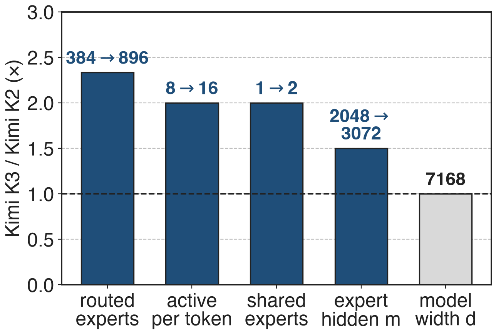
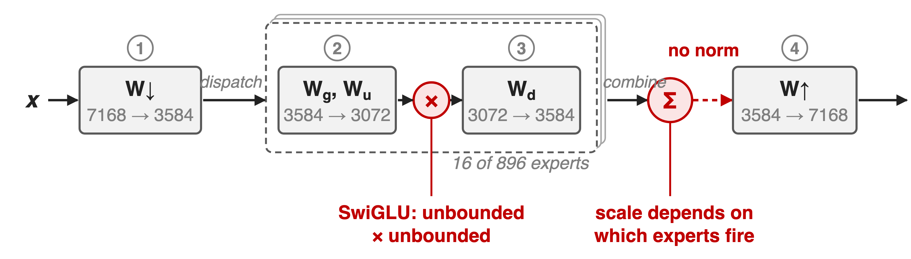
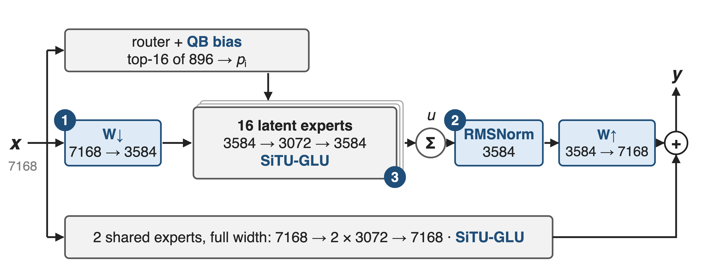
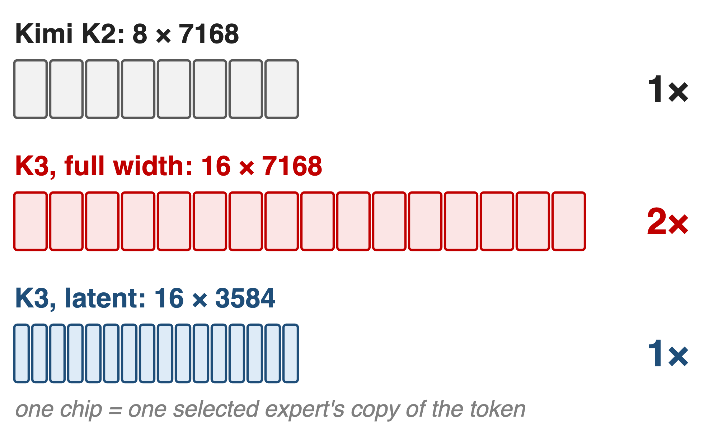
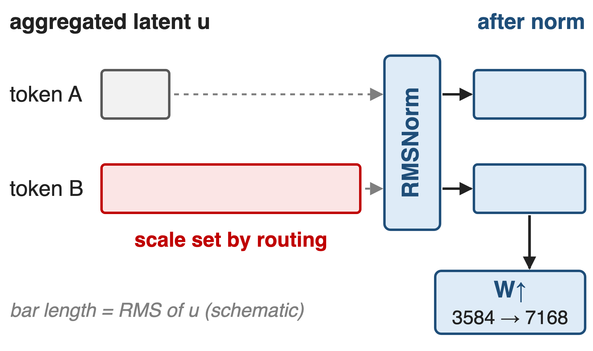
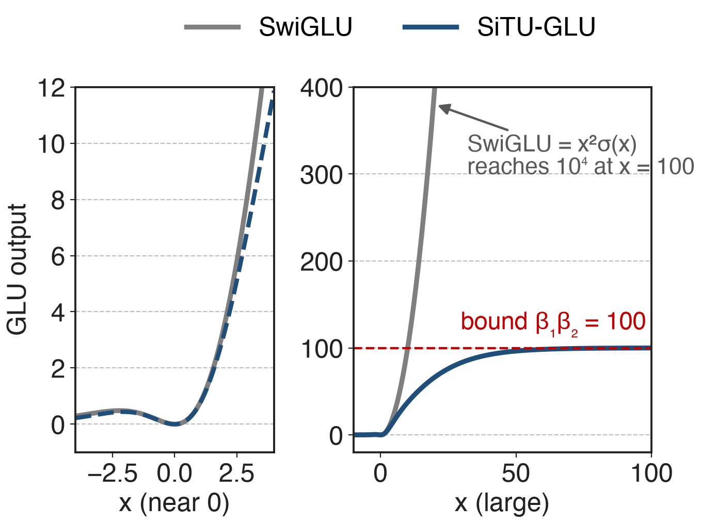
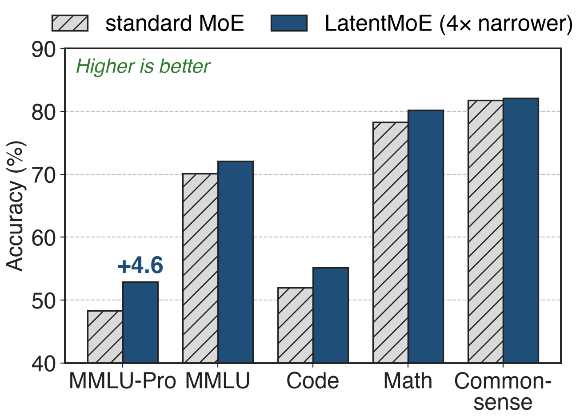
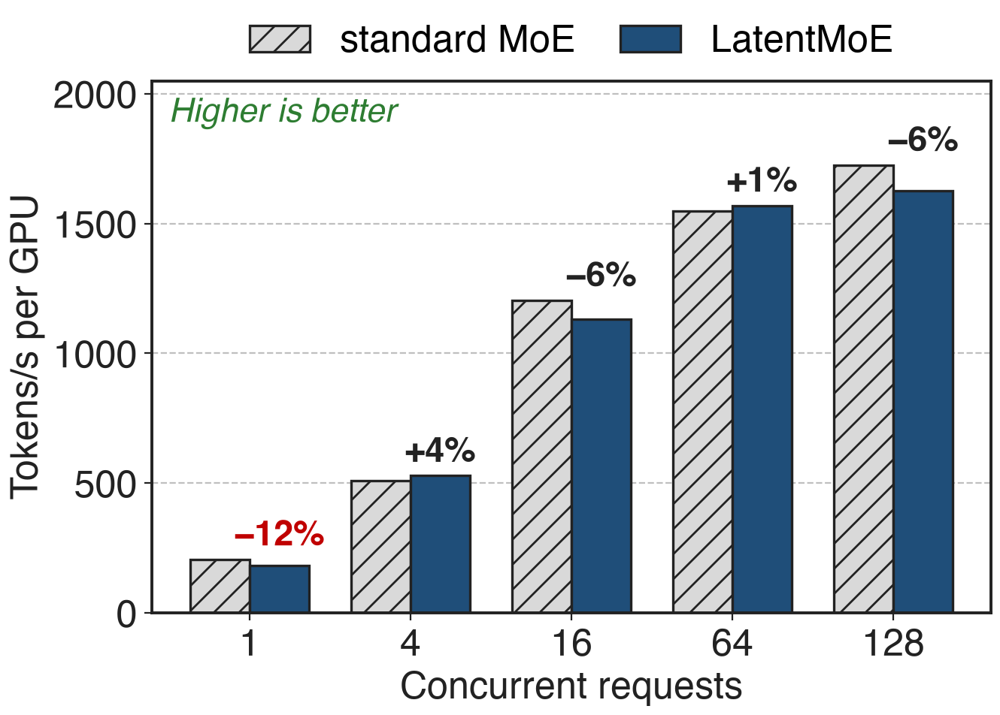

# K3 doubles K2's active experts at equal width
{right 55%}
- Kimi K3: **2.8T** params, **104B** active
- **16** of **896** routed experts: sparsity **56**
- Model width d stays **7,168**
<!-- notes: Kimi K3 scales its MoE in width. Compared with Kimi K2 it has 896 instead of 384 routed experts, activates 16 instead of 8 per token, has 2 shared experts instead of 1, and widens each expert's hidden layer from 2,048 to 3,072, while the model width stays at 7,168. Total parameters go from 1.04T to 2.78T and active from 32.6B to 104.2B. Source: K3 report Table 1 and §2.3. Sparsity 56 = 896 / 16 (K3 §2.3). Ultra-sparse MoE in general: deck 58. -->

# Full-width experts would double the all-to-all
%% big: 2×
%% sub: dispatch + combine volume per token if K3's 16 experts each took the full 7,168-wide token, vs K2's 8 (analytic)
%% source: K3 Table 1 (arXiv 2607.24653); volume ∝ top-k × routed width, LatentMoE §2.2 (arXiv 2601.18089)
<!-- notes: Under expert parallelism every selected expert gets its own copy of the token, so the all-to-all volume per token is proportional to top-k times the width the experts consume. K2 sends 8 copies of a 7,168-wide token; K3 with 16 full-width experts would send 16, twice the bytes, and each expert at K3's hidden size would hold 66M instead of 33M parameters, doubling weight traffic in memory-bound decoding. The LatentMoE paper estimates that in throughput-oriented serving the MoE layer is already dominated by all-to-all, about 9 times the expert compute in its GB200 example. Derivation in notes/sources.md. -->

# Plain LatentMoE stacks four matmuls, no norm
{full}
> At 896 experts and 2.8T parameters this chain produced exploding activations
<!-- notes: LatentMoE, from NVIDIA, already fixes the bytes: one shared W-down projects the token to a narrow latent before dispatch, experts run in that latent, and one shared W-up restores the width. K3 reports two failure modes once this is pushed to 896 experts. First, the routed path is W-down, a gated expert FFN, and W-up: nearly four consecutive matrix multiplications, ill-conditioned, and at 2.8T parameters its internal activations explode. Second, balancing about a thousand experts breaks the usual bias update, which deck 56 covers. SwiGLU makes the first worse: both factors of its product are unbounded. Sources: K3 §2.3 p.6-7, §2.3.2; LatentMoE §3. -->

# Insight: narrow is safe; scale is not
- LatentMoE: quality holds up to **4×** narrower experts
- K3 goes **2×** narrower and doubles top-k
- Blow-ups come from scale: routed sum, GLU product
--
> Keep the narrow path; bound its scale where it can grow
<!-- notes: The width itself is not the problem. NVIDIA's compression sweep on a 16B MoE found model quality preserved for hidden-to-latent ratios up to 4, and K3 uses only 2: 7,168 to 3,584. With half the width, K3 can activate twice the experts at K2's all-to-all volume. What goes wrong is scale: the weighted sum of expert outputs changes size with which experts fire, and SwiGLU's product can grow without bound. So K3 keeps the latent path and adds control at exactly those two points. Sources: LatentMoE §4.1 and Fig. 3; K3 Table 1, §2.3.1, §2.3.2. -->

# Stable LatentMoE: narrow, normalized, bounded
{full}
%% caption: ❶ latent W↓ / W↑ (from LatentMoE) · ❷ RMSNorm on the weighted sum · ❸ SiTU-GLU in every FFN · balancing: Quantile Balancing (deck 56)
<!-- notes: One K3 MoE layer. The router and the two shared experts see the full 7,168-wide token. The routed path projects it to 3,584, dispatches that latent to 16 of 896 experts, each 3,584 to 3,072 to 3,584, sums them with the router weights into u, normalizes u, and projects back to 7,168 before adding the shared branch. Every FFN, shared and routed, uses SiTU-GLU. Routing weights come from sigmoid scores with Quantile Balancing deciding the selection. Sources: K3 Eq. 11 and Table 1; Hugging Face modeling_kimi_linear.py (KimiSparseMoeBlock); the two shared experts are implemented as one MLP of hidden size 2 × 3,072. -->

# ❶ Sixteen half-width experts cost K2's bytes
{right 50%}
- Shared **W↓** to 3,584 before dispatch
- Experts: 3,584 → 3,072 → 3,584
- Shared **W↑** after combine
<!-- notes: Drawn to scale: each chip is one selected expert's copy of the token. K2 sends 8 × 7,168 values, K3 at full width would send 16 × 7,168, and K3's latent path sends 16 × 3,584, the same as K2. Each routed expert also shrinks from 66M to 33M parameters, while the routed nonlinear width per token, top-k times expert hidden size, grows 3× over K2 (16 × 3,072 vs 8 × 2,048). W-down and W-up are shared by all experts, so they add only 51M parameters per layer. Sources: K3 Table 1; LatentMoE §2-3; derivations in notes/sources.md. -->

# ❷ RMSNorm fixes the latent's scale before W↑
{right 55%}
- u: weighted sum of **16** expert outputs
- Its scale depends on the routing
- Normalize, then W↑, then add shared
<!-- notes: The aggregated latent u is a router-weighted sum over whichever 16 experts the token selected, so its scale moves with the selection and the weights. Plain LatentMoE feeds u straight into W-up and then adds it to the full-width shared branch. K3 inserts one RMSNorm on u, 3,584 wide, between the sum and W-up, so the routed branch enters the residual at a controlled scale. K3 reports that beyond stabilizing training this also consistently improves validation loss and downstream benchmarks, without giving numbers. Source: K3 §2.3.1, Eq. 11; config flag latent_moe_use_norm. -->

# ❸ SiTU-GLU caps both GLU factors smoothly
{right 55%}
- Gate: 4·tanh(g/4)·σ(g)
- Up: 25·tanh(u/25)
- ≈ SwiGLU near 0; output ≤ **100**
%% caption: Analytic: both branches fed the same x, as in K3 Fig. 4
<!-- notes: SwiGLU multiplies Swish of the gate, x times sigmoid, by the linear up branch; both factors are unbounded, so two large coordinates make an outlier and risk overflow in low precision. SiTU-GLU soft-caps the linear part of the gate with 4 tanh of x over 4, keeps the sigmoid, and caps the up branch with 25 tanh of x over 25. Near zero it matches SwiGLU to first order, as beta grows it becomes SwiGLU, and every output is bounded by 4 × 25 = 100. K3 prefers this smooth cap to hard clamping because it keeps gradients away from saturation. K3 uses it in every FFN. Sources: K3 §2.3.2 Eq. 12, Fig. 4, App. B Eq. 18-19, Table 1. -->

# Latent experts add +4.6 MMLU-Pro at equal cost
{right 58%}
- Same active (**8.0B**), total (**73B**) params
- 1T tokens, hybrid Mamba-attention MoE
- Plain LatentMoE, no K3 stabilizers
%% caption: NVIDIA LatentMoE paper (arXiv 2601.18089), Table 4
<!-- notes: K3 does not publish an isolated ablation, so the measured evidence for the latent design comes from NVIDIA's LatentMoE paper. On a hybrid Mamba-attention MoE with 73B total and 8B active parameters trained on 1T tokens, the latent variant that scales experts and top-k by the compression ratio gains 4.6 points on MMLU-Pro, 2.0 on MMLU, 3.2 on code and 1.9 on math at the same parameter counts. On their 95B Transformer at 300B tokens the MMLU-Pro gain is 5.7 points. This is plain LatentMoE at a 4× ratio, without K3's normalization or SiTU. Source: LatentMoE Tables 3-4. -->

# The latent detour costs up to 12% throughput
{right 58%}
- **−12%** at concurrency 1
- Within **6%** at 4–128
- Extra W↓ / W↑ GEMMs, smaller expert GEMMs
%% caption: Two H100, vLLM, FP8, hybrid 73B MoE (LatentMoE Table 5)
<!-- notes: The latent path adds two GEMMs and shrinks the expert GEMMs. In NVIDIA's vLLM measurement on two H100 with FP8, the LatentMoE model is 12% slower at a single concurrent request and within about 6% from 4 to 128, sometimes faster. The paper suggests separate streams for routed and shared experts and small-GEMM kernels to close the gap. At trillion-parameter scale its simulator projects the latent overhead within about 9% of native Kimi K2, while a standard MoE scaled to the same accuracy would be 1.24 to 3.46 times slower. Sources: LatentMoE Table 5, §4.3, §4.3.1 (projections, not measurements). -->

# K3 trains 16-of-896 routing at 2.8T scale
%% big: 2.5×
%% tone: ours
%% sub: K3's overall scaling-efficiency gain over Kimi K2: KDA, AttnRes, Stable LatentMoE and new recipes together
%% source: Kimi K3 report (arXiv 2607.24653), abstract, §3.2 and Fig. 7; no isolated Stable LatentMoE ablation is published
<!-- notes: The stabilized latent path is what lets K3 run 16 of 896 experts through a full 2.8T pretraining run. The only quantified outcome is K3-wide: fitted scaling-law curves show about 2.5 times the scaling efficiency of K2, which Moonshot attributes jointly to Kimi Delta Attention (deck 05), Attention Residuals (deck 59), Stable LatentMoE and refined data and training recipes. Read 2.5× as the context Stable LatentMoE lives in, not as its own gain. Source: K3 abstract, §1, §3.2. -->

# The price: two extra GEMMs and no ablation
%% layout: two-col
- !!Two extra GEMMs!!: W↓, W↑, 51M params per layer
- K3 fuses W↓ into the router GEMM
- More, smaller expert GEMMs strain kernels
|||
- Width floor: quality drops past **4×**
- !!No K3 ablation!! of RMSNorm or SiTU
- Needs exact balance: QB (deck 56)
<!-- notes: W-down and W-up are dense GEMMs every token pays for: 2 × 7,168 × 3,584 = 51M parameters per layer. In serving K3 fuses W-down with the router into one GEMM, shards the latent weights with the all-gather fused into the GEMM epilogue, and overlaps it with shared-expert compute; for decoding it uses a token-centric routed-expert kernel because small expert GEMMs become memory-bound weight streaming. NVIDIA's sweep shows quality loss beyond a 4× compression ratio. K3 describes RMSNorm and SiTU qualitatively, with no loss curves, and the design depends on Quantile Balancing to keep 896 experts loaded. Sources: K3 §5.4.2; LatentMoE §4.1; K3 §2.3. -->

# Summary
- 16 full-width experts: **2×** K2's all-to-all bytes
- ==Insight==: narrow experts work; bound the scale instead
- Latent W↓/W↑, RMSNorm on the sum, SiTU-GLU (≤ **100**)
- **+4.6** MMLU-Pro at equal cost; K3 runs 16 of **896** at **2.8T**
%% qr: https://arxiv.org/abs/2607.24653
<!-- notes: Stable LatentMoE is LatentMoE's narrow routed path made safe for 2.8T-scale training: a norm where the routed sum enters, and a smooth cap inside every GLU. Related decks: 56 (Quantile Balancing), 58 (ultra-sparse MoE), 27 (MoonEP), 05 (KDA), 59 (Attention Residuals). Sources: K3 §2.3, Table 1; LatentMoE Tables 4-5. -->
