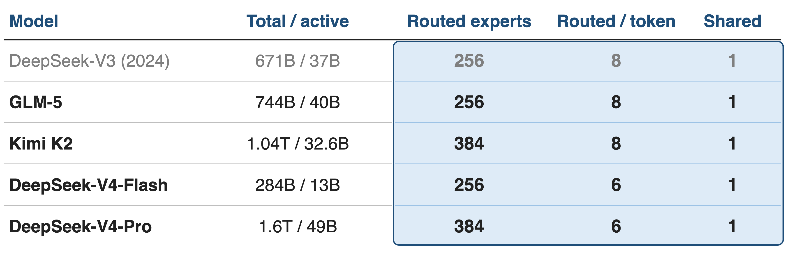
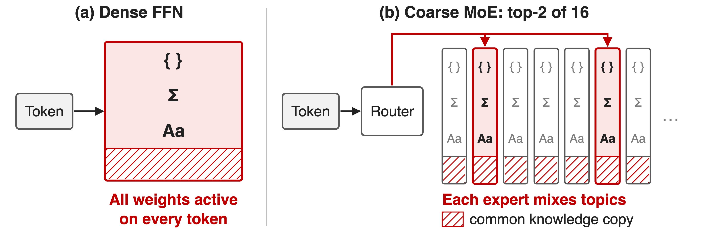
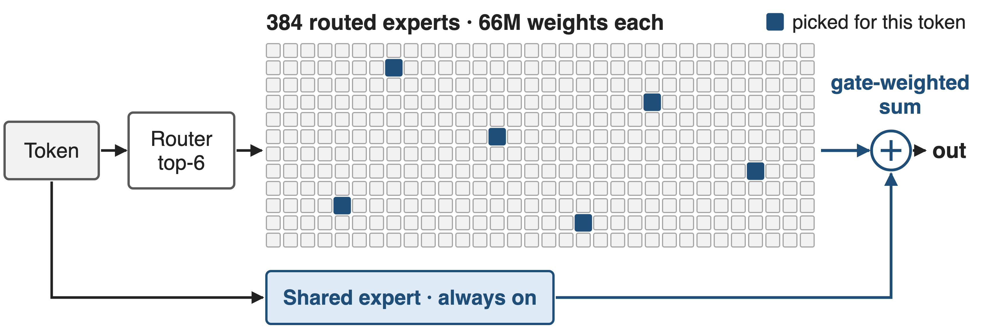
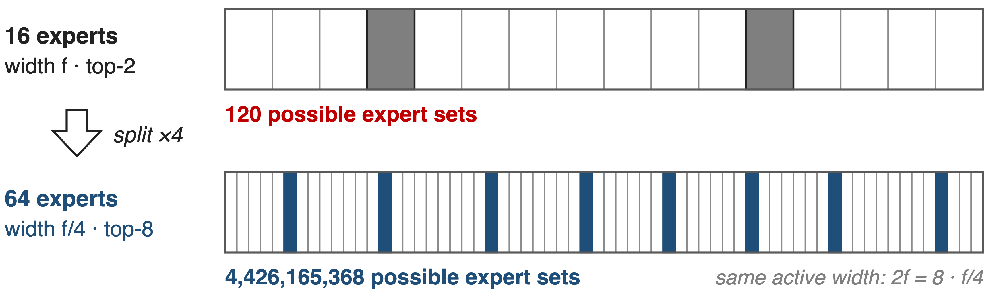
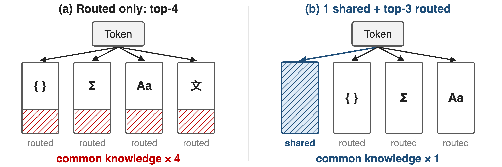
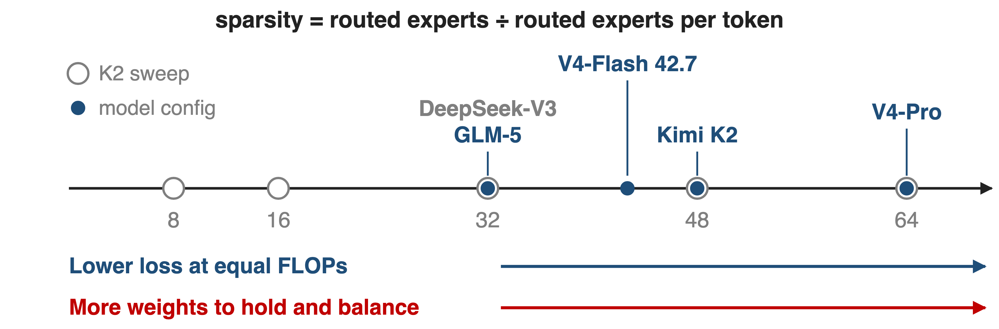
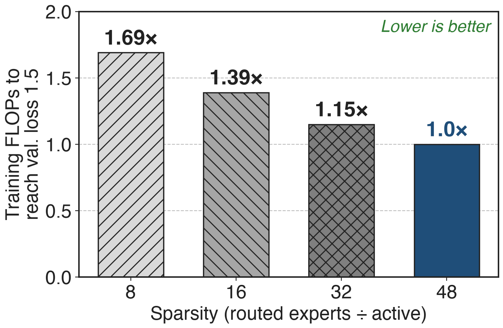
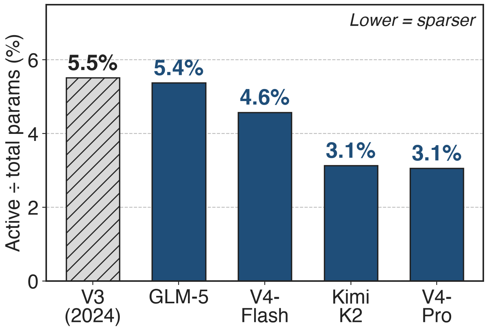

# Frontier open MoEs share one FFN shape
{full}
> Hundreds of routed experts, 6–8 per token, plus one always-on shared expert
<!-- notes: Every 2026 open frontier MoE in this landscape uses the same feed-forward design: a large pool of small routed experts, a router that picks six or eight of them per token, and one shared expert that every token uses. DeepSeek-V3 is the 2024 reference point. Sources: V4 abstract and §4.2.1 (V4-Pro 1.6T/49B, 384 routed + 1 shared, top-6; V4-Flash 284B/13B, 256 + 1, top-6); Kimi K2 Table 2 (1.04T/32.6B, 384 + 1, top-8); GLM-5 Table 10 (744B/40B, 256 + 1, top-8); DeepSeek-V3 §4.2 (671B/37B, 256 + 1, top-8). -->

# Coarse experts cost 1.5× the compute
%% big: 1.5×
%% sub: the expert parameters and FLOPs a classic top-2 MoE (GShard 2.9B) spends to match a 2B fine-grained MoE with a shared expert
%% source: DeepSeekMoE, arXiv 2401.06066, Abstract and §1
<!-- notes: The classic MoE recipe uses a handful of big experts and sends each token to one or two of them. DeepSeekMoE measured what that costs: a GShard model with 1.5 times the expert parameters and computation only matches a 2B model built from fine-grained experts plus a shared expert. At 16B the same design matches LLaMA2 7B with about 40% of the computation. Source: arXiv 2401.06066, Abstract and §1. -->

# Dense FFNs and coarse MoEs both waste FLOPs
{full}
> Few big experts: each mixes topics, and all relearn common knowledge
<!-- notes: A dense FFN spends every weight on every token, so quality and cost grow together. A coarse MoE is sparse, but with 8 or 16 big experts each expert must hold several unrelated kinds of knowledge (DeepSeekMoE calls it knowledge hybridity), and every expert also stores its own copy of the knowledge all tokens need (knowledge redundancy). The villain is expert granularity, not sparsity. Source: DeepSeekMoE §1 p.2. -->

# Insight: at equal FLOPs, more experts win
- Kimi K2 sweep: **8** active + **1** shared expert, vary the total
- Train and val. loss fall consistently, sparsity **8** → **64**
--
> Total parameters buy quality; activated parameters set the cost
<!-- notes: Kimi K2 ran controlled small-scale experiments with Muon: the number of activated experts is fixed at 8 and the shared expert at 1, so FLOPs per token are constant, and only the total number of experts changes. Training and validation loss go down consistently as sparsity grows from 8 to 64. So the two knobs can be set separately: total parameters for quality, activated parameters for cost. Source: K2 p.7 and Fig. 5. -->

# A V4-Pro token uses 7 of 385 experts
{full}
> Per layer, a token touches 1.8% of the expert weights (derived)
<!-- notes: One V4-Pro MoE layer: the router scores 384 routed experts and keeps the top 6; the shared expert skips the router; the outputs are gate-weighted and summed. Each expert is a SwiGLU FFN with 3 × 7168 × 3072, about 66M weights. All 61 blocks are MoE; the first 3 route by a hash of the token ID instead of the learned router. Derived: 7 of 385 experts is 1.8% of the layer's expert weights. Sources: V4 §2.1 p.7, §4.2.1 p.25, §3.1 p.16 (6hd FLOPs per token-expert pair). Router details (Sqrt-Softplus affinity, loss-free balancing): deck 55. -->

# ❶ Narrow experts multiply the combinations
{full}
> Narrow experts let the router compose knowledge per token
<!-- notes: Fine-grained expert segmentation: cut each expert's FFN intermediate dimension to one m-th and route each token to m times more experts. Total expert weights and per-token FLOPs stay the same, but with m = 4 the number of possible expert sets grows from 120 (2 of 16) to 4,426,165,368 (8 of 64). Today's experts are far narrower than a dense FFN: 2048 or 3072 wide against a 4096-7168 hidden size. Source: DeepSeekMoE §3.1 p.5-6; V4 §4.2.1. -->

# ❷ One shared expert holds common knowledge
{full}
> Routed top-k drops by one, so per-token FLOPs stay fixed
<!-- notes: Shared expert isolation: K_s experts are applied to every token regardless of the router, so knowledge every token needs is learned once instead of being copied into many routed experts. To keep the cost constant the router picks K_s fewer routed experts. Every model in this deck uses exactly one shared expert. Source: DeepSeekMoE §3.2 p.6; V4 §4.2.1; K2 Table 2; GLM-5 Table 10. -->

# ❸ Sparsity is a dial capped by infrastructure
{full}
> K2 stops at 48 for infra cost; V4-Pro runs at 64 (derived)
<!-- notes: Kimi K2 defines sparsity as total experts divided by activated experts. Turning the dial up lowers loss at equal FLOPs, but every extra expert is more weights to store, shard and keep balanced, so K2 settles on 48 (8 of 384) "to balance model performance with cost". Derived from the configs: V3 and GLM-5 sit at 32, V4-Flash at 42.7, V4-Pro at 64. Only K2 publishes the sparsity law. Sources: K2 p.7; V4 §4.2.1; GLM-5 Table 10; V3 §4.2. -->

# Sparsity 48 needs 1.69× fewer FLOPs than 8
{right 60%}
- Kimi K2 sweep, same val. loss **1.5**
- **8** active + **1** shared expert in every run
- Gain shrinks: **1.15×** over sparsity 32
<!-- notes: Under K2's compute-optimal sparsity scaling law, reaching a validation loss of 1.5 at sparsity 48 takes 1.69 times fewer training FLOPs than at sparsity 8, 1.39 times fewer than at 16 and 1.15 times fewer than at 32. The returns diminish, which is why the infrastructure cost decides where to stop. These are small-scale controlled runs, not the 1T training. Source: K2 p.7. -->

# Frontier MoEs activate only 3–5% of weights
{right 60%}
- Experts hold **~97%** of V4-Pro's **1.6T** weights
- Each token uses **~28B** of them (derived)
<!-- notes: Active share is activated over total parameters, from the published counts: V3 5.5%, GLM-5 5.4%, V4-Flash 4.6%, K2 3.1%, V4-Pro 3.1%. Derived accounting for V4-Pro: 66M weights per expert × 385 experts × 61 layers is about 1.55T, roughly 97% of the 1.6T; per token 7 experts × 61 layers is about 28B of the 49B active. V4-Flash-Base (13B active) also beats V3.2-Base (37B active) on most base benchmarks, e.g. MMLU-Pro 68.3 vs 65.5, but that comparison also changes attention, mHC, optimizer and data. Sources: V4 abstract, §4.2.1, Table 1; K2 Table 2; GLM-5 Table 10; V3 §4.2. -->

# The cost: memory, all-to-all, balance
%% layout: two-col
- !!All experts resident!!: K2 needs **~6 TB** for weights + grads
- !!All-to-all every layer!!: GLM-5 trims depth; K2 keeps EP **16**
|||
- !!Balance and spikes!!: loss-free bias; MoE outliers spike the loss
- K2 stops at sparsity **48**
> Sparsity moves cost from FLOPs to memory and network
<!-- notes: Sparsity moves cost from FLOPs to memory and network. K2 needs about 6 TB of GPU memory for BF16 weights and FP32 gradient buffers over a 256-GPU model-parallel group (§2.4.2). Every MoE layer dispatches and combines tokens across GPUs: GLM-5 cut its layer count to 80 to limit EP communication (§2.1), K2 uses the smallest feasible EP of 16 (§2.4.2), and V4 hides it with wave-level overlap (deck 14) after dropping V3's 4-node routing limit. Balance needs bias-based loss-free routing plus a 0.0001 sequence-wise loss (deck 55); V4 ties its loss spikes to MoE outliers (§4.2.3, deck 63). -->

# Summary
- Coarse MoE spends **1.5×** compute for equal quality
- ==Insight==: at equal FLOPs, more and smaller experts lower loss
- Narrow routed experts + **1** shared expert; sparsity **32–64**
- **1.69×** fewer FLOPs (sparsity 48 vs 8); **3–5%** of weights active
%% qr: https://arxiv.org/abs/2606.19348
<!-- notes: Ultra-sparse MoE decouples what a model knows from what a token costs. Related decks: 14 (wave-based EP overlap), 35 (Mega MoE kernel), 55 (loss-free balance + sigmoid gating), 56 (Quantile Balancing), 57 (Stable LatentMoE), 63 (anticipatory routing). Sources: DeepSeekMoE Abstract; K2 p.7; derived ratios in notes/sources.md. -->
