# Every layer adds into one residual stream
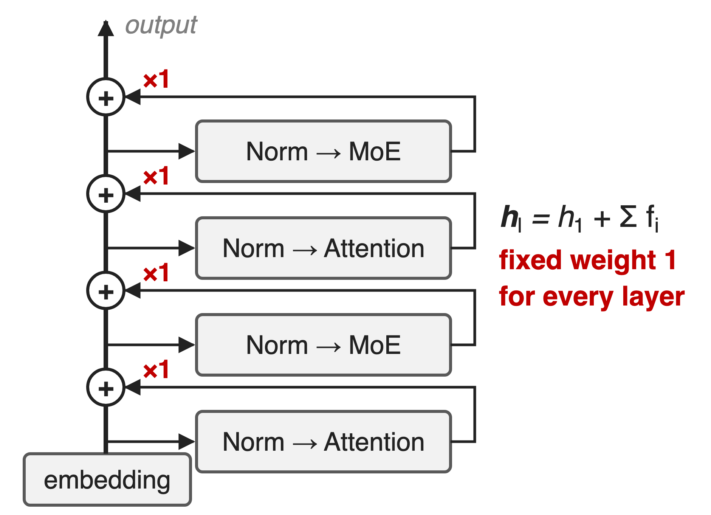{right 50%}
- PreNorm LLMs: h ← h + f(Norm(h))
- Each output is added with weight **1**
- Kimi K3 replaces this in all **93** layers
<!-- notes: In a PreNorm Transformer each attention or MLP sublayer reads a normalized copy of the residual stream and adds its output back with a fixed weight of one. Unrolled, the input to layer l is the embedding plus the plain sum of every earlier output. Kimi K3, a 93-layer 2.8T MoE, replaces this with Block Attention Residuals; the technique was introduced and measured in Moonshot's Attention Residuals report on Kimi Linear models. Sources: AttnRes §1-2; K3 §2.2 and Table 1. Sibling residual redesign: mHC, deck 61. -->

# Fixed residuals cost 1.25× compute
%% big: 1.25×
%% sub: compute a standard-residual (PreNorm) model needs to reach the validation loss of the same model with Block AttnRes
%% source: Attention Residuals, arXiv 2603.15031, §5.1 and Fig. 4 (scaling-law fit over five sizes, 194M–528M active)
<!-- notes: Moonshot trained five model sizes three ways with identical, baseline-tuned hyperparameters and fit loss-versus-compute power laws. The curves have the same slope, but the standard-residual baseline sits higher: at 5.6 PFLOP/s-days it reaches 1.714 where Block AttnRes reaches 1.692, which is what a baseline with 1.25 times the compute would reach. So the fixed residual sum is paying a quarter more compute for the same loss. Source: AttnRes §5.1, Fig. 4, Table 2. -->

# Standard residuals mix depth with fixed 1s
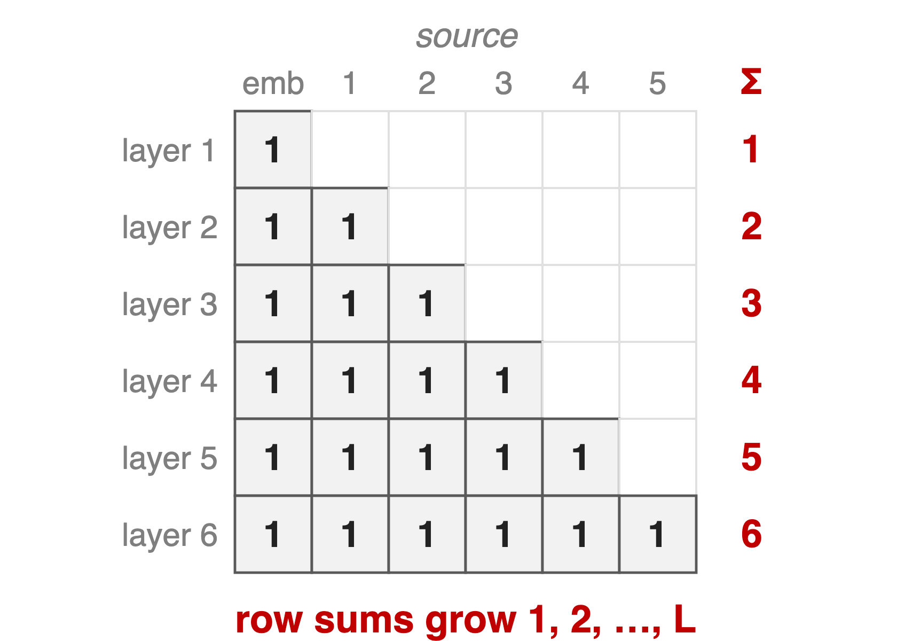{right 50%}
- Each layer sees **one** running sum
- No way to re-read an early layer
- PreNorm: magnitude grows **O(L)**, diluting layers
<!-- notes: Write every layer's input as a weighted sum over earlier outputs; for a standard residual the weight matrix is all ones below the diagonal. Each row adds one more unit term, so under PreNorm the hidden state grows roughly linearly with depth and each layer's contribution is diluted; deeper layers must learn ever larger outputs to stay influential. In the 48B experiment the baseline's per-block output magnitude climbs steadily with depth while gradients pile up in the earliest layers. And because each layer only sees the running sum, information blended away early cannot be selectively recovered later. Sources: AttnRes §1, §2, §6.2, Fig. 5. -->

# Static depth weights do not help
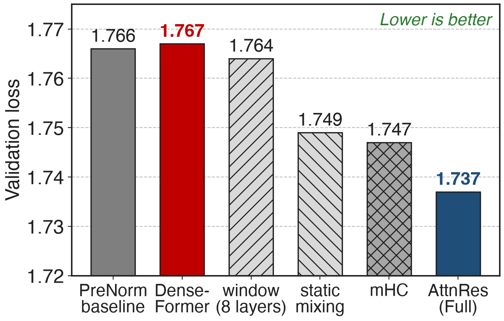{right 58%}
- DenseFormer: all layers, fixed weights
- mHC: input-dependent, but **34d** I/O per layer
- What helps: content-dependent selection
%% caption: 16-layer model, identical hyperparameters and compute (AttnRes paper, Table 4)
<!-- notes: Same 16-layer model, same compute. DenseFormer already gives each layer access to every earlier output, but with learned static coefficients: 1.767, no better than the baseline's 1.766. Attending only to the most recent 8 layers gets 1.764. Learned input-independent mixing weights reach 1.749. mHC, which keeps 4 residual streams with input-dependent mixing, reaches 1.747 but reads and writes 34 d-vectors per layer. Full AttnRes reaches 1.737 with one query vector per layer. The lesson: access alone is not enough; the weights must depend on the content. Sources: AttnRes Table 4, Table 1. mHC: deck 61. -->

# Insight: depth is a short sequence; attend over it
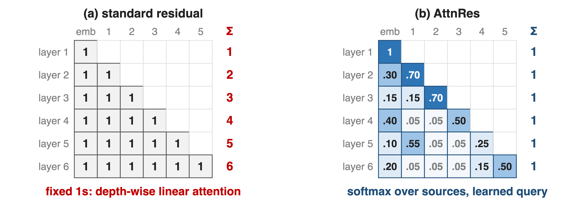{full}
> Residuals are depth-wise linear attention with weights 1; at L < 1000, softmax over depth is cheap
<!-- notes: The residual recurrence over depth looks exactly like an RNN over time: one state, updated additively. Transformers replaced that recurrence over time with softmax attention. Depth is short, under a thousand layers, so the same move is affordable here: let each layer attend over the embedding and all earlier outputs with softmax weights that sum to one, computed from a learned query. The left matrix is the standard residual, every weight one; the right is AttnRes, where each row is a distribution the model learns per token. Values on the right are illustrative. Sources: AttnRes §3, §6.1-6.2. -->

# K3 attends over 9 depth sources per layer
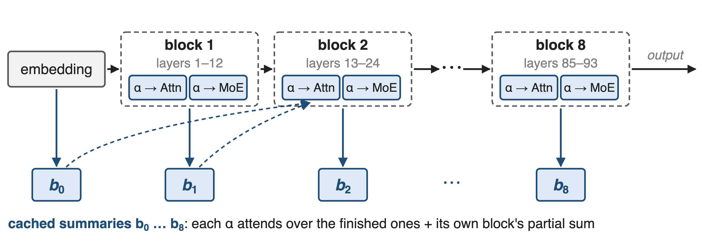{full}
%% caption: 93 layers in 8 blocks of 12 (last block 9) plus the embedding · an AttnRes op before every attention and MoE sublayer, and one at the output
<!-- notes: Kimi K3 groups its 93 layers into 8 blocks of 12 layers, the last one partial. When a block finishes, its summed output is cached once as a block summary, and the embedding is summary zero. Every attention and every MoE sublayer starts with an AttnRes op that attends over the finished summaries plus the running partial sum of its own block, so at most 9 cached summaries plus one partial. The final output also aggregates all blocks. The next three slides zoom in: the op, the blocks, and the pipeline plumbing. Sources: K3 §2.2 and Fig. 2; Hugging Face config attn_res_block_size = 12, modeling_kimi_linear.py. -->

# ❶ One learned query per layer picks its sources
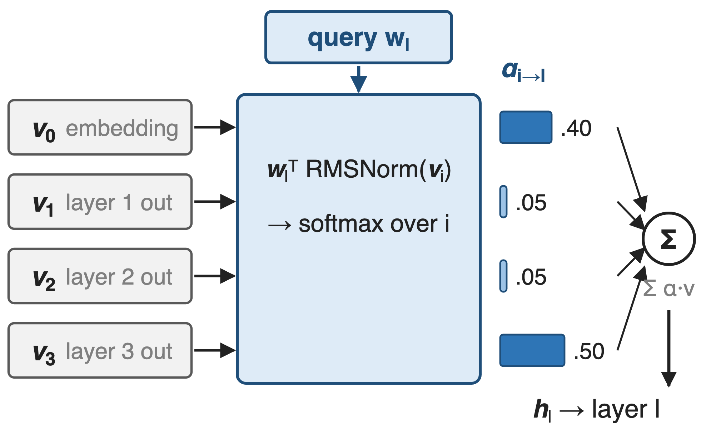{right 55%}
- Keys: RMSNorm of each source
- Query: one learned vector, zero-initialized
- Input: softmax-weighted sum of sources
<!-- notes: For layer l the values are the embedding and the outputs of all earlier layers; the keys are the same vectors passed through RMSNorm, so a layer with naturally large outputs cannot dominate. The query is a single learned d-dimensional vector per layer, not computed from the token, and it starts at zero so training begins from an equal-weight average. The softmax weights then mix the raw values. Cost: one d-vector and one RMSNorm per layer. Here layer 4 puts .40 on the embedding and .50 on layer 3: illustrative numbers. An input-dependent query lowers loss further, 1.731 versus 1.737, but costs a d by d projection per layer. Sources: AttnRes Eq. 2-4, §5, Table 4. -->

# ❷ Blocks cut depth state from L to N
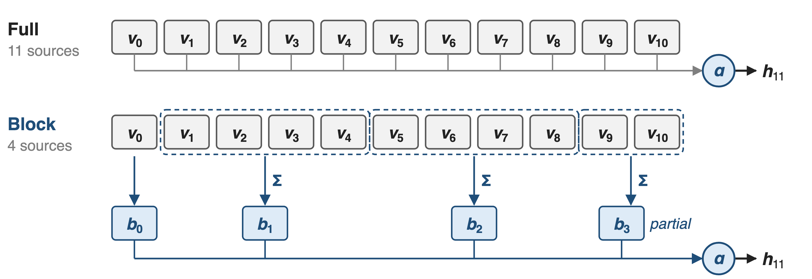{full}
> About 8 blocks keep most of the gain: memory and pipeline traffic drop from O(Ld) to O(Nd)
<!-- notes: Full AttnRes must keep every layer output alive for every later layer, and ship them all across pipeline stages: O(L d) per token. Block AttnRes sums the outputs inside each block with an ordinary residual and attends only over block summaries, the embedding, and the current block's partial sum. With 4-layer blocks in this picture, layer 11 sees 4 sources instead of 11. In the block-size sweep, blocks of 2, 4 and 8 layers all land near 1.746 against 1.737 for Full and 1.766 for the baseline; 16 and 32 drift back toward baseline. N equal to L is Full AttnRes, N equal to 1 is a standard residual. Sources: AttnRes §3.2, Eq. 5-6, Fig. 6. -->

# ❸ Pipeline stages send only new blocks
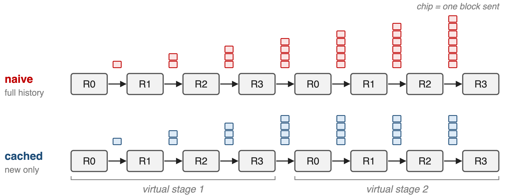{full}
%% caption: Interleaved pipeline, P = 4 ranks, V = 2 virtual stages, one new block per chunk (schematic of AttnRes Eq. 7–8)
<!-- notes: Under interleaved pipeline parallelism each stage needs all block summaries so far. Sent naively, the history grows with every transition. But a rank that ran an earlier virtual stage still holds the blocks it saw then, so later transitions only carry the roughly P new blocks; peak traffic per transition drops from O(C) to O(P), a V-fold cut, and overlaps with 1F1B compute. Activation checkpointing keeps per-layer activation memory equal to a standard Transformer. At inference a two-phase schedule batches all S queries of a block against the cached summaries in one pass, then merges each layer's partial sum by online softmax; K3 runs the inter-block kernel on a side stream and fuses the merge and RMSNorm into the tensor-parallel all-reduce. Sources: AttnRes §4.1-4.2, Alg. 1; K3 §5.2.2, §5.4.2. -->

# Block AttnRes lowers loss at all five sizes
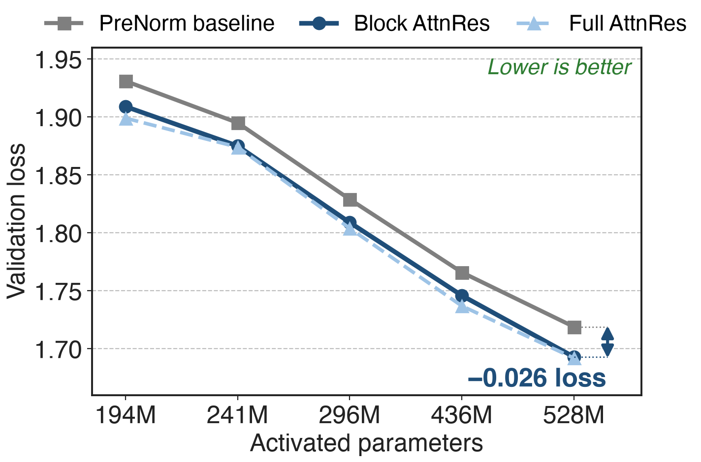{right 58%}
- **−0.020** to **−0.026** loss
- Fitted: baseline needs **1.25×** compute
- Full AttnRes only **0.001** ahead at 528M
%% caption: Baseline-tuned hyperparameters, 8K context (AttnRes paper, Table 2)
<!-- notes: At every one of the five sizes, from 194M to 528M activated parameters, Block AttnRes beats the baseline by 0.020 to 0.026 in validation loss, even though all hyperparameters were tuned for the baseline. Translated through the fitted scaling laws, that is the 1.25 times compute advantage. Full AttnRes is slightly better at small scale, but the gap to Block shrinks to 0.001 at the largest size. mHC-lite, not plotted, lands between: 1.694 at the largest size. Sources: AttnRes Table 2, §5.1. -->

# +7.5 GPQA-Diamond on a 48B MoE
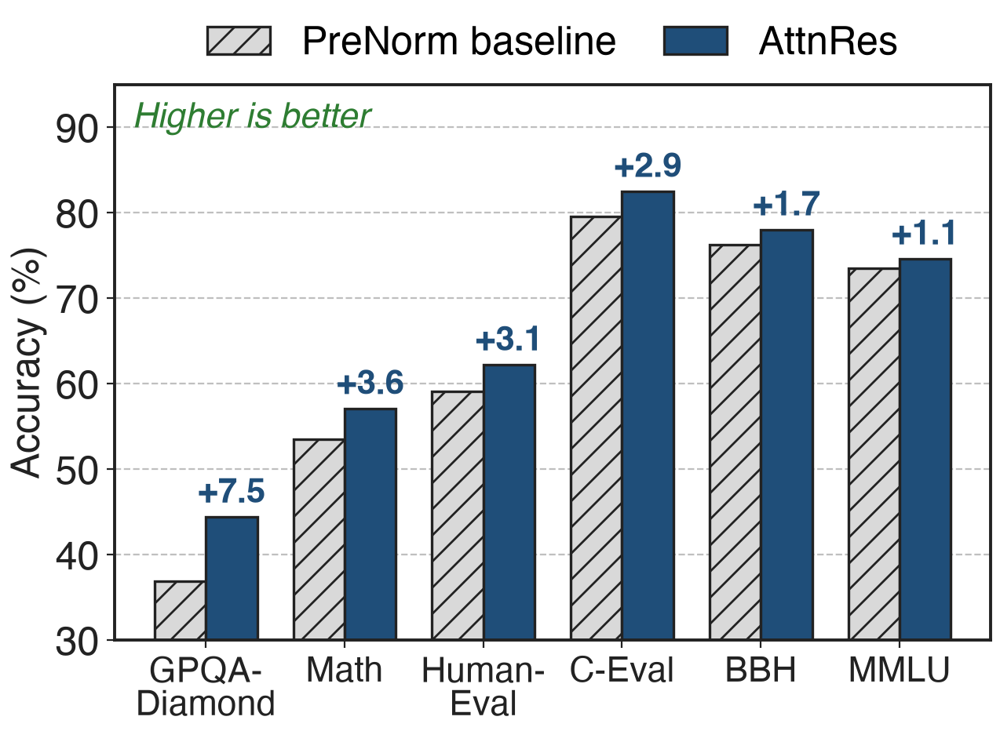{right 58%}
- Kimi Linear **48B** / **3B** active, **1.4T** tokens
- Matches or beats on all **15** benchmarks
- Biggest gains: multi-step reasoning, code
%% caption: AttnRes paper, Table 3 (6 of 15 benchmarks shown)
<!-- notes: The large-scale test integrates Block AttnRes into Kimi Linear, 48B total and 3B activated parameters, 54 layers in 9 blocks plus the embedding, trained on 1.4T tokens with the same recipe as the baseline. AttnRes matches or beats it on all 15 benchmarks: GPQA-Diamond +7.5, Math +3.6, HumanEval +3.1, C-Eval +2.9, BBH +1.7, MMLU +1.1; MMLU-Pro is unchanged at 52.2. The paper reads the pattern as better depth-wise information flow helping compositional tasks. Training dynamics agree: output magnitudes stay bounded per block and gradients spread more evenly across depth. Source: AttnRes §5.2, Table 3, Fig. 5. -->

# Overhead: under 4% training, 2% inference
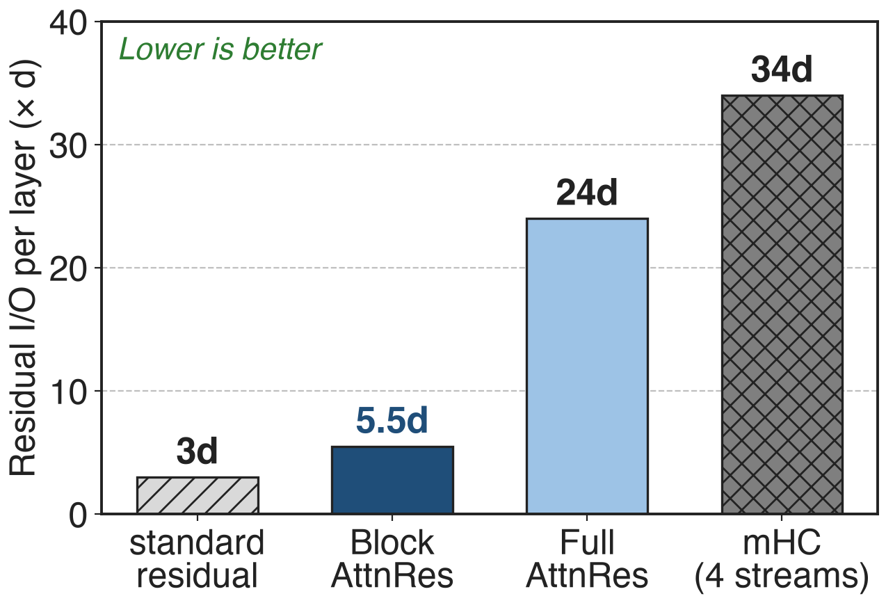{right 55%}
- Block AttnRes: **5.5d** per layer vs **3d**
- Training with pipelines: **< 4%** end-to-end
- Inference latency: **< 2%**
%% caption: Typical L = 128, N = 8, S = 16; mHC with 4 streams (AttnRes paper, Table 1, §4)
<!-- notes: Per token and layer the residual path of a standard model reads two vectors and writes one, 3d. With the two-phase schedule Block AttnRes needs 5.5d, Full AttnRes 24d, and 4-stream mHC 34d, about six times Block AttnRes. Measured end to end, Block AttnRes adds negligible training time without pipeline parallelism and under 4 percent with it, and under 2 percent inference latency on typical workloads. Sources: AttnRes Table 1, §4.1, §4.2. -->

# The price: coarser blocks, pipeline plumbing
%% layout: two-col
- Block **1.746** vs Full **1.737** loss
- Token-dependent query: **1.731**, costs d×d
- Needs block cache in PP + fused kernels
|||
- Prefill cache: **15 GB** at 128K tokens
- Prefers deeper models: more latency
- !!No K3-specific ablation!! published
<!-- notes: Blocks give up some of Full AttnRes's gain, 1.746 versus 1.737 on the 16-layer model. A token-dependent query would be better still, 1.731, but needs a d by d projection and sequential memory access in decoding. The pipeline cache and two-phase kernels are real engineering. Storing block summaries for a 128K-token prefill with 8 blocks takes 15 GB, cut to about 1.9 GB per device by sequence sharding and under 0.3 GB with 16K chunked prefill. AttnRes shifts the best shape toward deeper, narrower models, which costs inference latency. Finally, K3 adopts Block AttnRes but publishes no ablation of it; all numbers come from the AttnRes report. Sources: AttnRes Table 4, §4.2, §5.4.1. -->

# Summary
- Fixed residuals: **1.25×** compute for the same loss
- ==Insight==: depth is short, so attend over it
- K3: **9** block sources per op, cached pipeline sends
- **+7.5** GPQA-Diamond; **< 4%** train, **< 2%** inference overhead
%% qr: https://arxiv.org/abs/2603.15031
<!-- notes: Attention Residuals completes, for depth, the move from recurrence to attention: one learned query per layer, softmax over earlier outputs, blocks to keep the state small, and pipeline caching to keep it cheap. Related decks: 61 (mHC, the other residual redesign), 05 (Kimi Delta Attention), 57 and 56 (K3's MoE layer and its balancing). Sources: AttnRes report; K3 §2.2. -->
