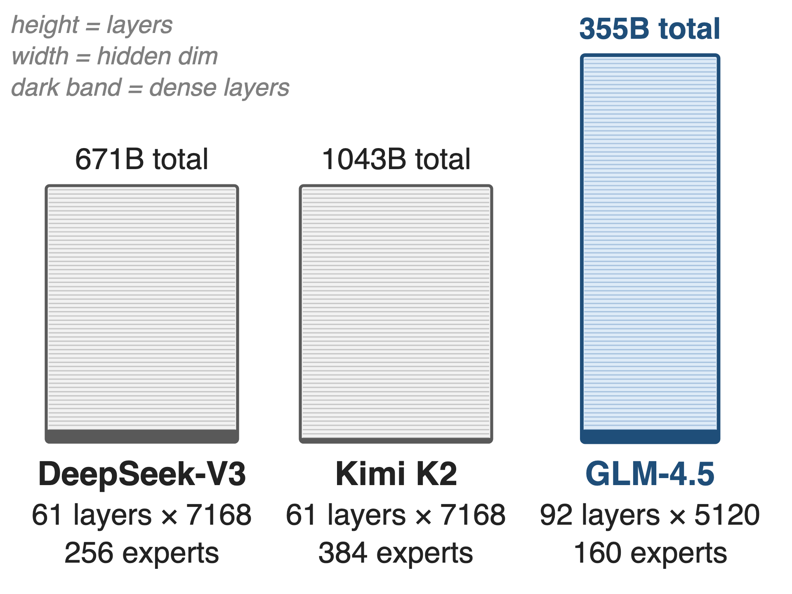
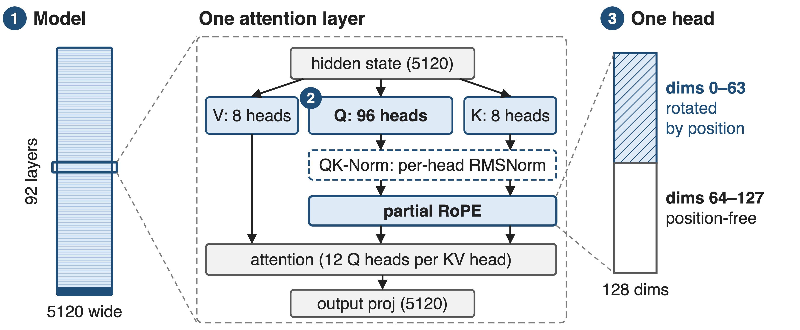
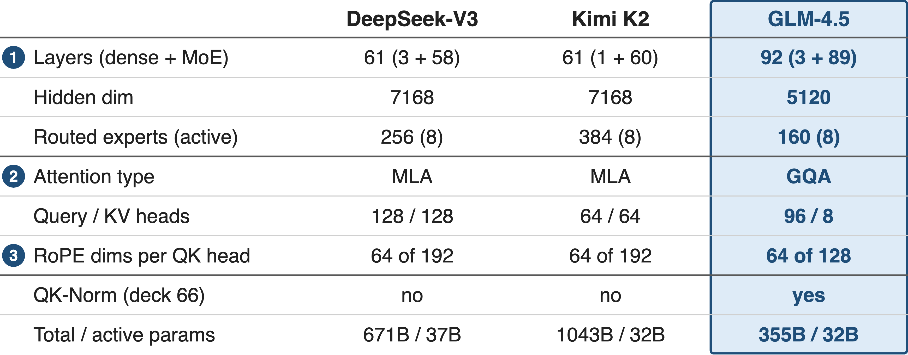
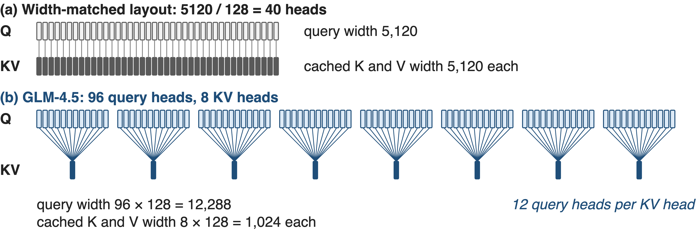
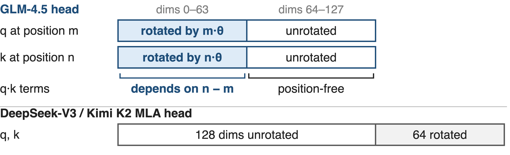
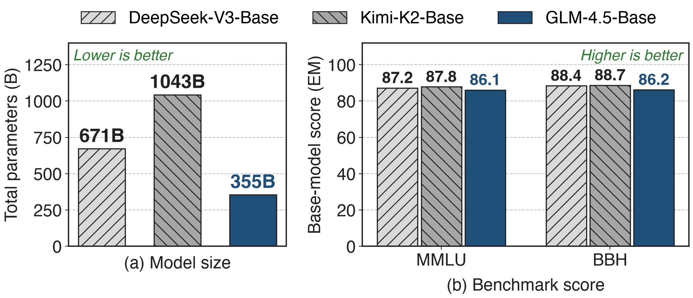
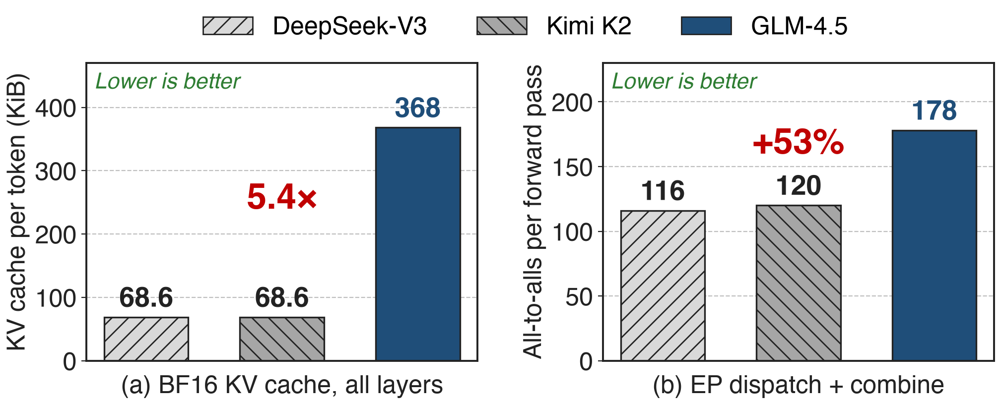

# Three ~32B-active MoEs, three different shapes
{right 55%}
- Similar budget: **32–37B** active per token
- DeepSeek-V3, Kimi K2: **61** layers × **7168**
- GLM-4.5: **92** layers × **5120**, only **160** experts
<!-- notes: Three open MoE models activate roughly the same 32 to 37 billion parameters per token, but they are built very differently. DeepSeek-V3 and Kimi K2 share one template: 61 layers, 7168 wide, multi-head latent attention. GLM-4.5 is drawn to scale here: half again as many layers, 29 percent narrower, and fewer routed experts. Sources: GLM-4.5 tech report (arXiv 2508.06471) Table 1; DeepSeek-V3 §4.2; Kimi K2 Table 2. -->

# Width costs weights: K2 holds 1,043B
%% big: 1,043B
%% sub: total parameters behind Kimi K2's 32B active: 2.9× GLM-4.5's 355B
%% source: GLM-4.5 tech report, arXiv 2508.06471, Table 1 (Kimi K2's own Table 2: 1.04T total, 32.6B active)
<!-- notes: Every one of those parameters has to sit in GPU memory during training and serving, even though only 32 billion are touched per token. Kimi K2 needs 1,043 billion; DeepSeek-V3 671 billion; GLM-4.5 355 billion for the same 32 billion active. The ratio 2.9 is 1043 over 355 (derived). The GLM paper sells exactly this: one third of K2's parameters. Sources: GLM-4.5 Table 1 and §1; K2 Table 2. -->

# Loss-only search rewards width, punishes heads
%% layout: two-col
- **More experts** (K2 sparsity law)
- Same loss at **1.69×** fewer FLOPs
- !!256 → 384 experts, 1.04T weights!!
|||
- **More heads** (K2 ablation)
- Only **0.5–1.2%** lower validation loss
- !!+83% inference FLOPs!! at 128K: cut to **64**
> Both choices were judged by validation loss alone
<!-- notes: Kimi K2 shows how the wide template gets chosen. Its sparsity scaling law says that at a fixed active budget, sparsity 48 reaches validation loss 1.5 with 1.69 times fewer FLOPs than sparsity 8, so K2 went from 256 to 384 experts and 1.04 trillion weights. Its head ablation says doubling heads lowers validation loss by only 0.5 to 1.2 percent, while at 128K context going from 64 to 128 heads costs 83 percent more inference FLOPs, so K2 halved DeepSeek-V3's 128 heads. DeepSeek-V3 itself picked its head count for H800 efficiency. Neither experiment looks at reasoning. Sources: K2 §2.3, p.6-7, Fig. 5-6; GLM-5 report p.5 on the H800 roofline. -->

# Insight: depth and heads buy reasoning, not loss
- Deeper models showed **better reasoning**
- **2.5×** more heads: same training loss, higher **MMLU / BBH**
--
> Loss is the wrong yardstick: spend the active budget on depth and heads
<!-- notes: GLM-4.5's architecture section reports two findings from its own ablations. First, deeper models exhibited better reasoning capacity. Second, and counterintuitively, 2.5 times more attention heads did not improve training loss, yet consistently improved reasoning benchmarks such as MMLU and BBH. So the metric K2 used to cut heads cannot see this benefit. Caveat: the paper publishes no numbers for either ablation. Source: arXiv 2508.06471 §2.1, p.2-3; same text on the z.ai GLM-4.5 blog. -->

# GLM-4.5 reshapes the model at three levels
{full}
%% caption: Block order as in transformers' modeling_glm4_moe.py: projections, QK-Norm, partial RoPE, GQA attention
<!-- notes: Three changes, one per zoom level. One: the model is 92 layers of 5120 instead of 61 of 7168. Two: inside each attention layer there are 96 query heads but only 8 key-value heads. Three: inside each head, only the first 64 of 128 dimensions get rotary position encoding. QK-Norm, a per-head RMSNorm on queries and keys, sits between the projections and RoPE; it is deck 66. Sources: GLM-4.5 Table 1; HF config zai-org/GLM-4.5; transformers Glm4MoeAttention.forward. -->

# ❶ Same active budget, 31 more narrower layers
{full}
%% caption: GLM-4.5 Table 1; DeepSeek-V3 §4.2; Kimi K2 Table 2; RoPE dims from the public HF configs
<!-- notes: Read the GLM column against the other two. Hidden width drops from 7168 to 5120, 29 percent narrower, and routed experts drop to 160, so each layer is far cheaper in weights; the savings buy 89 MoE layers instead of 58 or 60, 31 more layers in total. Active parameters stay at 32 billion and total parameters fall to 355 billion. Attention also changes: GQA instead of MLA, 96 query heads but 8 KV heads, 128-dim heads, and QK-Norm. Derived: 92 minus 61 is 31; 1 minus 5120/7168 is 0.29. Deep-dive on depth via residuals: deck 59; fine-grained experts: deck 58. -->

# ❷ 96 query heads share just 8 KV heads
{full}
> 2.4× the width-matched head count (paper: "2.5×"); cached KV stays at 8 heads
<!-- notes: A 5120-wide model with 128-dim heads would normally have 5120 over 128, that is 40, heads. GLM-4.5 uses 96, which is 2.4 times that; the paper rounds to 2.5. The query projection is therefore 12,288 wide, 2.4 times the hidden size. Grouped-query attention keeps the cost at inference down: 12 query heads share each of 8 key-value heads, so only 1,024 dimensions of K and of V are cached per layer. All numbers are from Table 1 and the HF config; the 40-head baseline is derived. -->

# ❸ Partial RoPE rotates only half of each head
{full}
> Each head keeps a 64-dim channel that matches content at any distance
<!-- notes: With partial_rotary_factor 0.5, RoPE rotates the first 64 of each head's 128 dimensions by position; the other 64 pass through untouched. So a query-key score is the sum of a term that depends on the relative position and a term that depends only on content. MLA in DeepSeek-V3 and K2 makes the same split by construction: 128 unrotated plus 64 decoupled RoPE dimensions. GLM-4.5 gives no ablation for this choice; prior work argues that low-frequency RoPE dimensions get used as semantic channels and that a position-free channel helps (Barbero et al., ICLR 2025), and GPT-NeoX rotated only 25 percent of dimensions. GLM-4.5 also raised the RoPE base from 10K to 1M at the 32K stage. Sources: HF config; transformers apply_rotary_pos_emb; DeepSeek-V3 §4.2; GLM-4.5 §2.4. -->

# A third of K2's weights, within 2.5 points
{full}
%% caption: GLM-4.5 Table 2 (GLM's internal eval). Not an ablation: 23T vs 14.8T vs 15.5T training tokens
<!-- notes: The fair comparison for an architecture is the base model before post-training. GLM-4.5-Base scores 86.1 on MMLU and 86.2 on BBH, against 87.8 and 88.7 for Kimi-K2-Base and 87.2 and 88.4 for DeepSeek-V3-Base, so it trails K2 by 1.7 and 2.5 points with 34 percent of K2's parameters and 53 percent of DeepSeek-V3's. This is not a controlled ablation: training data, tokens and optimizer all differ. After post-training, GLM-4.5 ranks third of twelve models on the twelve ARC benchmarks; on SWE-bench Verified it scores 64.2 against K2's 65.4. Sources: GLM-4.5 Table 2 p.14, §1, Fig. 1, Table 5 p.16. -->

# The bill: 5.4× KV cache, 53% more all-to-alls
{full}
%% caption: Analytic, from published configs (BF16 KV cache; 2 all-to-alls per MoE layer). Dispatched bytes per token: only +10%
<!-- notes: Depth and GQA are not free for systems. Per token of context, GLM-4.5 caches 92 layers times K and V times 8 heads times 128 dimensions in BF16, 368 KiB, while MLA caches a 576-dim latent per layer, 68.6 KiB for DeepSeek-V3 or K2: 5.4 times more, mostly from GQA rather than depth. And every MoE layer does a dispatch and a combine, so 89 MoE layers mean 178 all-to-alls per forward pass versus 116 for DeepSeek-V3. The bytes barely change because each token is narrower (3.65M vs 3.33M dispatched elements), but each collective is smaller and there are more synchronization points. All analytic; derivations in notes/sources.md. EP overlap: deck 11. -->

# GLM-5 cut depth to 78 and moved to MLA
%% layout: two-col
- **GLM-5**: 744B total, 40B active
- **78** layers, to cut EP communication
- MLA for memory; **64** heads, **6144** wide
|||
- **Open questions**
- No published ablation numbers
- Shape confounded with data and Muon
> Stated reasons: fewer layers for EP traffic, MLA for memory
<!-- notes: The clearest maturity signal is the successor. GLM-5 grows to 744 billion total and 40 billion active, but reduces the layer count to minimize expert-parallel communication overhead (78 layers in its table and config; the text says 80), widens to 6144, moves to 256 experts, and replaces GQA with MLA for its memory savings, using 64 heads of 256 query-key dimensions. For GLM-4.5 itself, the depth and head claims have no published numbers, and its 23T tokens and Muon optimizer differ from both peers. Sources: GLM-5 report §2.1 p.4-5, Table 10; HF config zai-org/GLM-5. -->

# Summary
- Wide template: K2 holds **1,043B** weights for **32B** active
- ==Insight==: depth and heads buy reasoning that loss misses
- GLM-4.5: **92** × **5120**, **96** Q / **8** KV heads, half-RoPE
- **355B** total; base MMLU/BBH within **2.5** points of K2
%% qr: https://arxiv.org/abs/2508.06471
<!-- notes: GLM-4.5 spends the same 32 billion active parameters on a taller, narrower stack with many more query heads and a position-free half in every head, and lands within a few points of models two to three times its size. The price is a larger GQA KV cache and more EP collectives, which GLM-5 partly reversed. Related decks: 58 ultra-sparse MoE, 59 attention residuals for depth, 62 MTP layer, 65 MuonClip, 66 QK-Norm. Source: arXiv 2508.06471. -->
