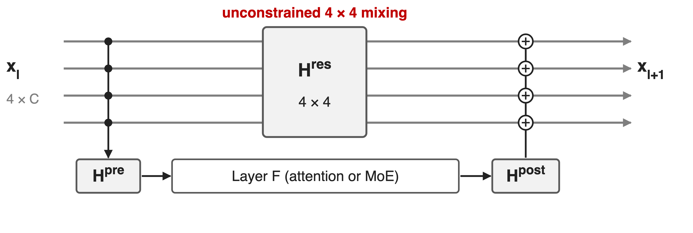
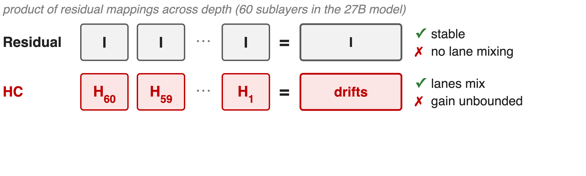
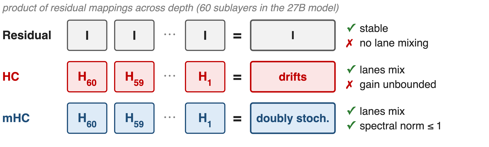
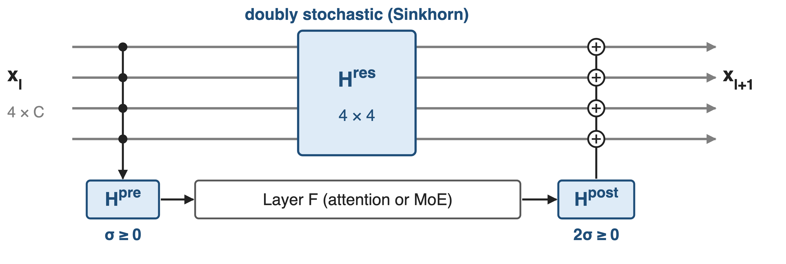
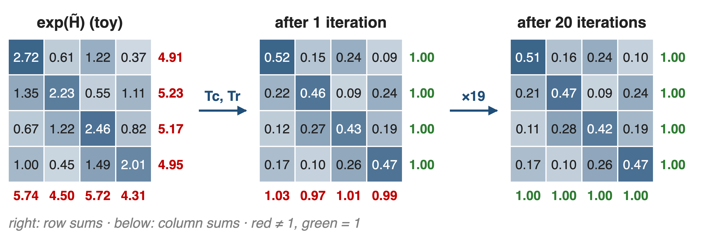
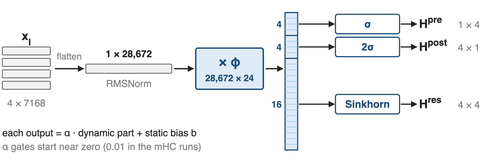
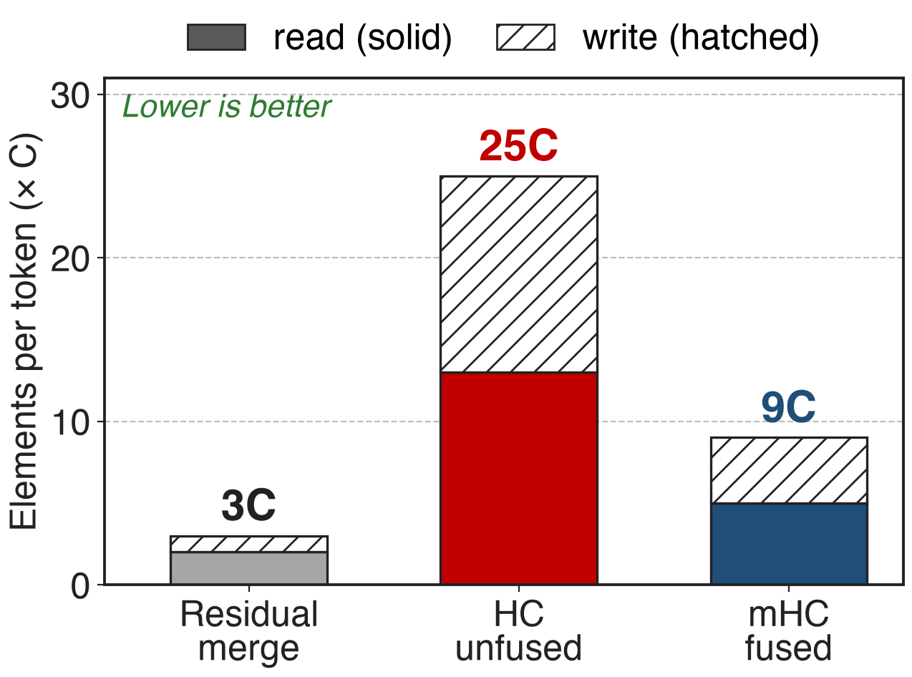
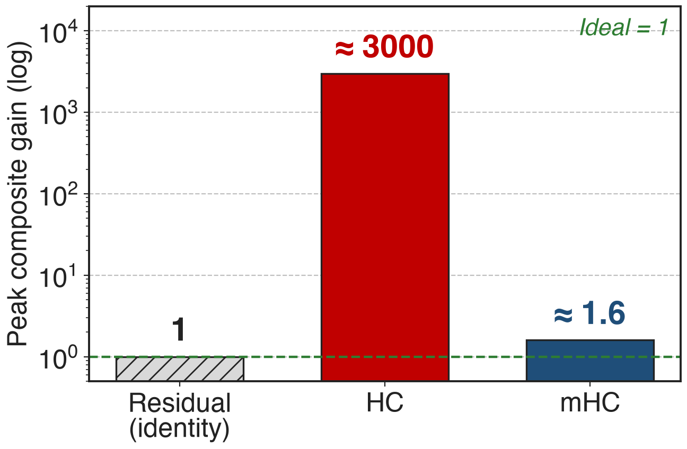
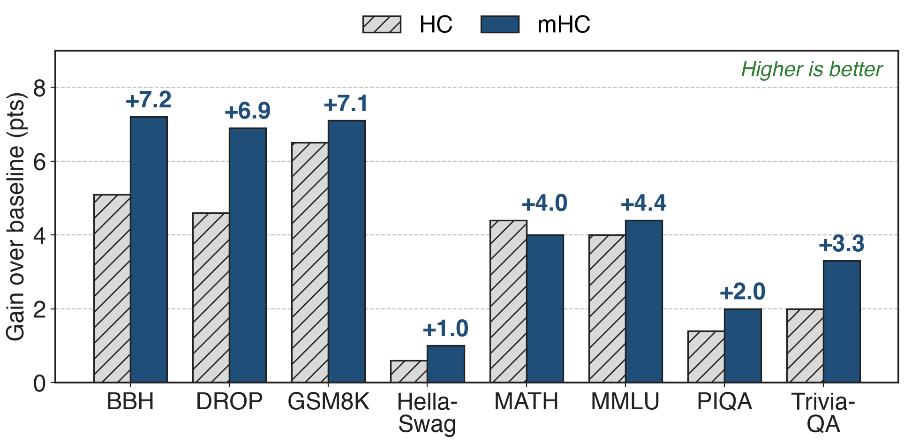

# Hyper-Connections widen the residual into 4 lanes
{full}
> The 4 × 4 lane mixing carries most of HC's gain, at almost no FLOPs
<!-- notes: Hyper-Connections keep n copies of the residual stream, here n = 4. Per layer, H^pre reads the lanes into the layer input, H^post writes the output back, and the 4 by 4 matrix H^res mixes the lanes: x(l+1) = H^res x(l) + H^post-transpose F(H^pre x(l)). The layer itself still sees a C-dimensional input, so FLOPs barely change. In the mHC ablation, H^res alone gives a 0.022 loss reduction of the 0.027 that full HC gives. DeepSeek-V4 uses the constrained version, mHC, with n = 4 in every block of V4-Pro and V4-Flash. Sources: mHC eq. 3, Table 1; V4 §2.2, §4.2.1. -->

# Unconstrained mixing amplifies signals ~3000×
%% big: ~3000×
%% sub: peak gain of HC's composite residual mapping in a 27B MoE (ideal: 1); the training loss surges near step 12k
%% source: mHC, arXiv 2512.24880, §3.1, Fig. 2 and Fig. 3(b) (27B model, n = 4)
<!-- notes: DeepSeek measured how much the product of all H^res matrices amplifies a signal, using the largest absolute row sum for the forward pass and column sum for the backward pass. For a 27B MoE with HC, that gain peaks near 3000 instead of 1, and the training loss surges around step 12k together with gradient-norm spikes. Source: mHC §3.1, Fig. 2 and 3. -->

# Identity is stable; free mixing compounds
{full}
> HC also moves 34C vs 3C residual elements per token, and 4× pipeline traffic
<!-- notes: The plain residual multiplies identities, so the product is the identity: stable, but the lanes never talk, which throws away most of HC's gain. HC learns each H^res freely, so the product over 60 sublayers drifts arbitrarily far from identity. The villain is the product, not any single layer. HC also hits the memory wall: per token and layer it reads 21C and writes 13C elements for the residual machinery versus 3C for a plain residual, and pipeline stages send n times more data. Sources: mHC eq. 2 and 4, §3.1-3.2, Table 2 (34C derived at n = 4, matching the Attention Residuals paper's 34d). -->

# Insight: doubly stochastic products stay bounded
{full}
> Rows and columns sum to 1: lanes still mix, but no product can amplify
<!-- notes: Restrict every H^res to the doubly stochastic matrices: non-negative, every row and every column sums to one. Such a matrix has spectral norm at most 1, so it cannot amplify; it conserves the mean across lanes; and the product of doubly stochastic matrices is again doubly stochastic, so the guarantee holds at any depth. Geometrically the set is the Birkhoff polytope, the convex hull of permutation matrices, so each layer mixes lanes by a convex combination of permutations. With n = 1 it collapses to the ordinary identity residual. Source: mHC §4.1; V4 §2.2. -->

# mHC projects each mapping onto a safe set
{full}
> V4: every block, n = 4 lanes, 20 Sinkhorn iterations per mapping
<!-- notes: mHC keeps HC's structure and adds three projections: H^res goes through Sinkhorn-Knopp to become doubly stochastic, H^pre through a sigmoid and H^post through two times a sigmoid so both stay non-negative and bounded, which avoids signals cancelling. The three mechanisms that follow are the projection, the parameterization that makes it input-dependent, and the systems work that keeps it cheap. Sources: mHC eq. 6-8; V4 eq. 6-8 and §4.2.1 (n_hc = 4, t_max = 20 for both models). -->

# ❶ Sinkhorn-Knopp balances rows and columns
{full}
> exp makes entries positive; alternating column and row scaling converges
<!-- notes: Sinkhorn-Knopp starts from M0 = exp of the raw matrix, so every entry is positive, then alternately divides each column by its sum and each row by its sum. The figure uses a made-up input: after one round the rows sum to 1 and the columns are within a few percent; after 20 rounds both are 1. mHC and V4 both run 20 iterations. In the backward pass a custom kernel recomputes the iterations on-chip. Sources: mHC eq. 9, §4.2, §4.3.1; V4 eq. 8. -->

# ❷ One 24-wide projection drives all mappings
{full}
> Mixing depends on the token, for a 28,672 × 24 projection in V4-Pro
<!-- notes: The four lanes are flattened and RMS-normalized, then a single projection phi produces n squared plus 2n = 24 numbers: 4 for H^pre, 4 for H^post, 16 for H^res. Each is a small learnable gate alpha times this dynamic part plus a static bias, before the sigmoid, two-sigmoid or Sinkhorn step. For V4-Pro the input is 4 × 7168 = 28,672 wide, so phi is 28,672 by 24 (derived); V4 notes this matmul's output dimension of only 24 needs a deterministic split-k for small batches. The static biases and gates are trained with AdamW, everything else with Muon. Sources: mHC eq. 7-8, 10-19; V4 eq. 3-8, §2.4, §3.3. -->

# ❸ Fused kernels cut merge traffic 25C → 9C
{right 60%}
- One kernel: post-mapping, lane mixing, merge
- Recompute mHC; store inputs at pipeline-stage boundaries
- DualPipe runs the merge on a high-priority stream
%% caption: Analytic, n = 4, per token, write-back step only
<!-- notes: Applying H^post and H^res and adding them separately reads 13C and writes 12C elements per token at n = 4; the fused kernel reads 5C and writes 4C. RMSNorm's division is moved after the small matmul, and most kernels are written in TileLang. Activations of the mHC kernels are dropped and recomputed in blocks of about the square root of nL over n plus 2 layers, aligned with pipeline stages, so only each block's input is stored. DeepSeek extends DualPipe so the n-times-larger stage-boundary traffic overlaps with compute. Sources: mHC §4.3.1 (25C to 9C), §4.3.2 eq. 20, §4.3.3; V4 §3.4.2. Fused kernels: deck 41. -->

# Composite gain drops from ~3000 to 1.6
{right 60%}
- 27B MoE, n = 4, 20 Sinkhorn steps
- No loss surge; gradient norm tracks baseline
- Final loss **−0.021** vs baseline
<!-- notes: With mHC the peak composite gain in the same 27B model stays near 1.6, three orders of magnitude below HC's roughly 3000. It is not exactly 1 because 20 Sinkhorn iterations only approximate a doubly stochastic matrix, so the backward gain drifts slightly. Training shows no loss surge, the gradient norm stays close to the baseline, and the final loss ends 0.021 below the baseline. Sources: mHC §5.2, §5.4, Fig. 5 and 7. -->

# mHC beats the baseline on all eight benchmarks
{full}
> 27B: BBH +7.2, DROP +6.9 over baseline; ahead of HC on 7 of 8
<!-- notes: Points gained over the 27B baseline, derived from the mHC paper's Table 4. mHC beats the baseline everywhere and beats HC on seven of eight tasks; on MATH, HC is slightly higher (26.4 vs 26.0). The compute-scaling runs at 3B, 9B and 27B keep the advantage with only marginal shrinkage. Source: mHC Table 4, §5.3. -->

# The cost: 6.7% step time, custom kernels
%% layout: two-col
- !!6.7%!! more training time at n = 4
- !!4×!! residual activations and stage traffic remain
|||
- 20 Sinkhorn steps only approximate the constraint
- Needs fused TileLang kernels (deck 41)
- Evidence: DeepSeek in-house runs only
<!-- notes: After fusion, recomputation and pipeline overlap, mHC still adds 6.7% training time at n = 4; V4 reports 6.7% of the overlapped 1F1B pipeline stage. The wider stream still means n times more residual state and pipeline traffic, handled by recomputation and overlap rather than removed. Twenty Sinkhorn iterations give an approximate projection, which the mHC-lite follow-up replaces with explicit convex combinations of permutations. The kernels are custom (deck 41: Mega mHC). All published results are DeepSeek's own models. Sources: mHC §1, §4.3, §5.4; V4 §3.4.2; mHC-lite abstract (arXiv 2601.05732). -->

# Summary
- HC's free lane mixing: composite gain **~3000×**, loss surges
- ==Insight==: doubly stochastic products cannot amplify
- Sinkhorn (**20** steps), σ / 2σ, fused kernels; **n = 4** in V4
- Gain **≈ 1.6**, loss **−0.021**, BBH **+7.2**; **6.7%** overhead
%% qr: https://arxiv.org/abs/2512.24880
<!-- notes: mHC keeps what makes Hyper-Connections useful, learned mixing of a wider residual stream, and removes what makes them dangerous, by projecting the mixing matrix onto a set whose products stay bounded. Related decks: 41 (Mega mHC fused kernels), 59 (Attention Residuals, another residual generalization), 64 (Muon, which trains mHC's matrices). Sources: mHC §3.1, §4.1, §5.2-5.4, Table 4; V4 §2.2, §3.4.2. -->
