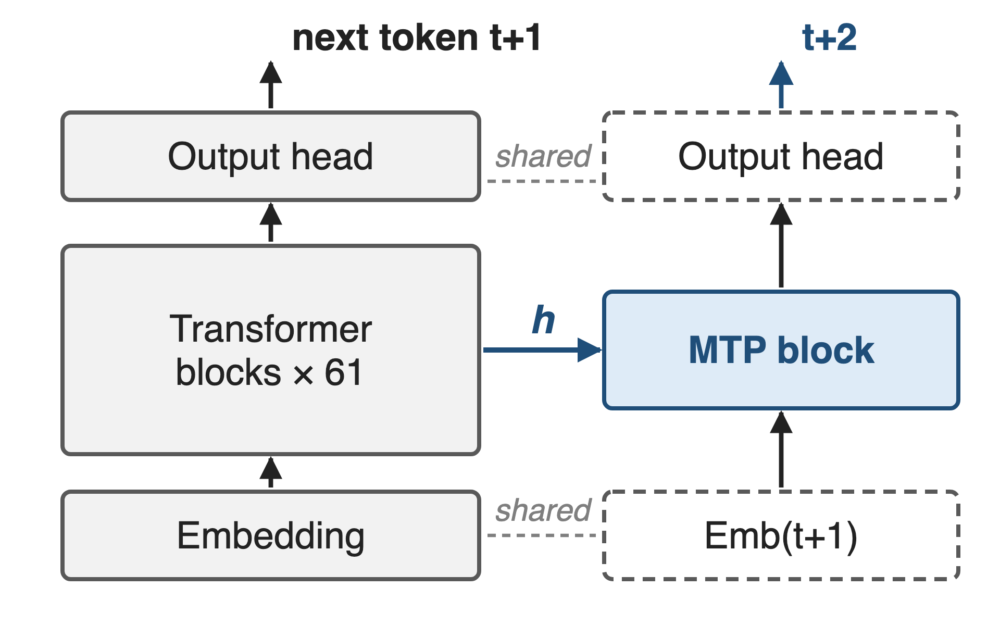
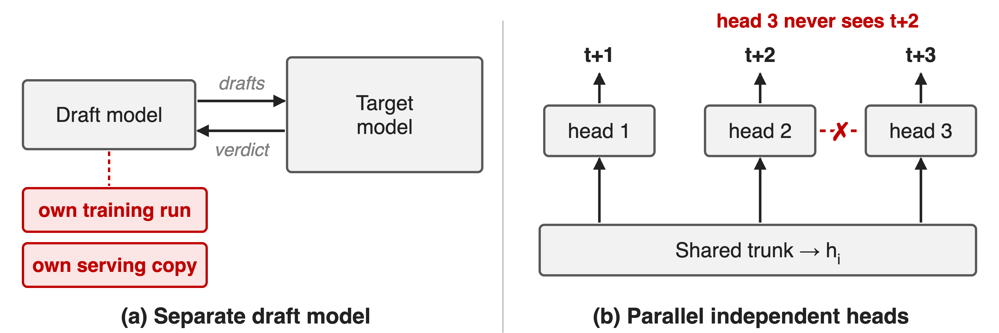
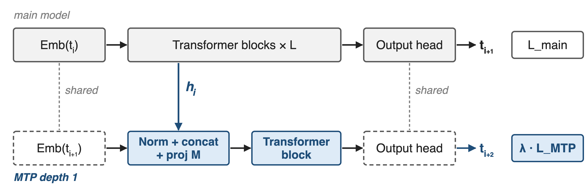
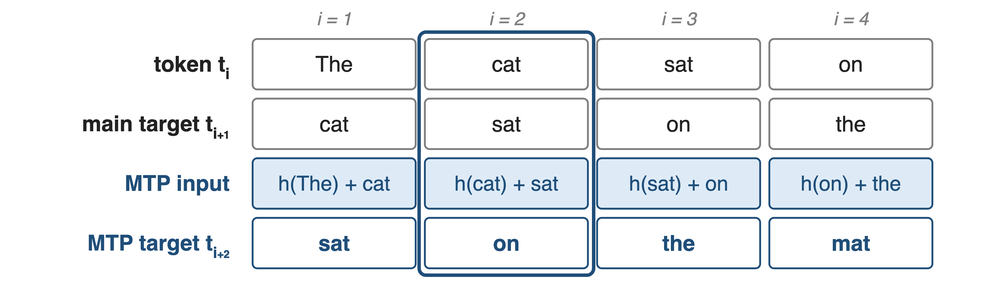
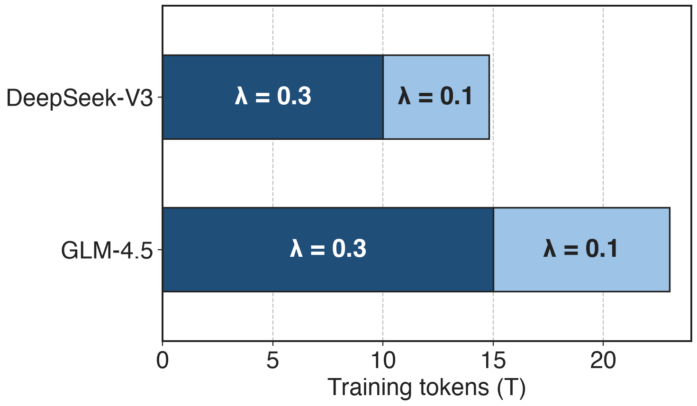
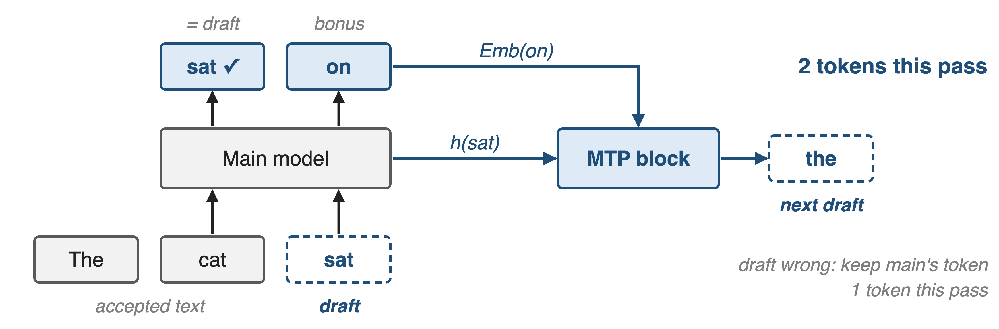
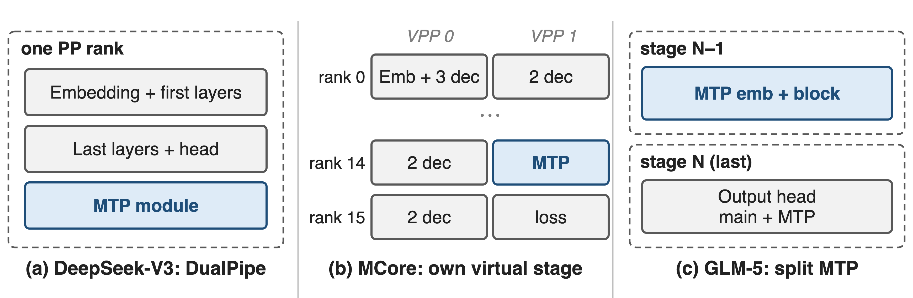
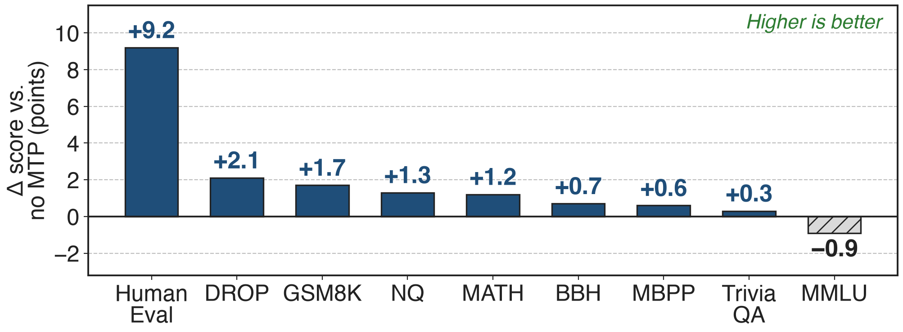
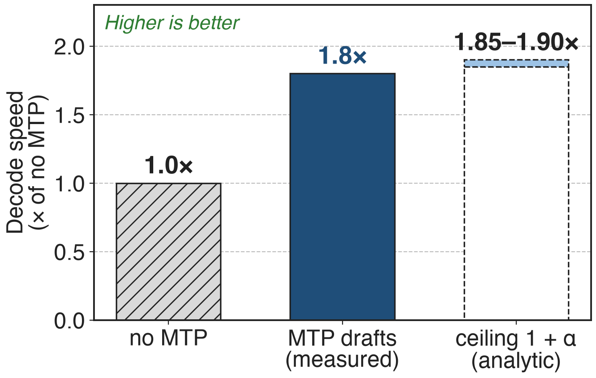
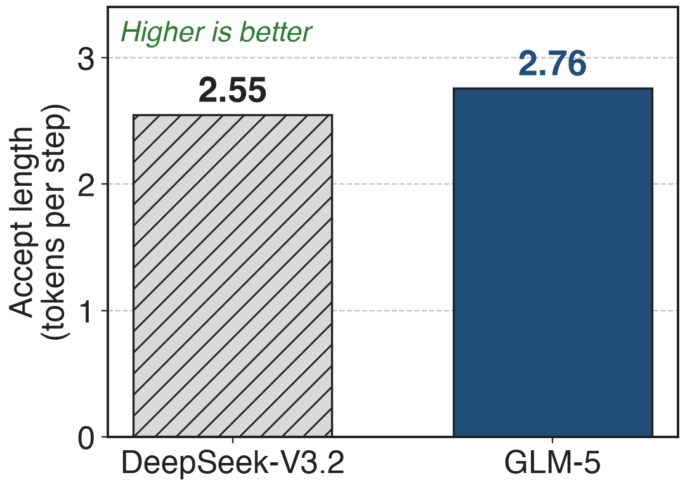

# Frontier MoEs ship one extra MTP layer
{right 55%}
- DeepSeek-V3/V4, GLM-4.5/5, Kimi K3: **1** MTP layer each
- DeepSeek-V3: **14B** of its **685B** params
- Megatron-Core: MTP + MLA + CP together
<!-- notes: Every recent frontier MoE we looked at trains with exactly one multi-token-prediction layer next to the main model: DeepSeek-V3 and V4, GLM-4.5 (where it is an MoE layer), GLM-5 and Kimi K3. It reads the main model's last hidden state and the next token, and predicts the token after next, reusing the main model's embedding and output head. In DeepSeek-V3 it is 14B of 685B parameters. Sources: DeepSeek-V3 arXiv 2412.19437 §2.2, §4.2; DeepSeek-V4 §2.1, §4.2.1; GLM-4.5 arXiv 2508.06471 §2.1 Table 1; GLM-5 Table 10; Kimi K3 architecture table; Megatron-Core paper arXiv 2603.07685 (671B + 14B); MoE README v0.12 (--mtp-num-layers 1) and v0.14 (CP support for MTP and MLA). -->

# Decoding still emits one token per pass
%% big: 1 token
%% sub: per forward pass through all 61 layers of DeepSeek-V3 (37B active), and next-token training gives each position one target
%% source: DeepSeek-V3, arXiv 2412.19437 §4.2; autoregressive decoding: arXiv 2211.17192 §1
<!-- notes: No paper isolates this as a measured number, so here is the structural count. Decoding K tokens takes K serial runs of the model: for DeepSeek-V3 every token pays a pass through 61 layers with 37B active parameters, and at small batch that pass is dominated by reading weights. Training has the mirror-image limitation: each position is supervised on one next token only. MTP attacks both. Sources: DeepSeek-V3 §4.2 hyper-parameters; Leviathan et al., arXiv 2211.17192, abstract and §1. -->

# Bolt-on drafters and parallel heads fall short
{full}
> One adds a second model; the other breaks the causal chain
<!-- notes: Classic speculative decoding pairs the target with a separate small draft model, which needs its own training run and its own serving copy, and drafts from a different model's view of the text. Earlier multi-token prediction (Gloeckle et al. 2024) attaches independent heads to one trunk and predicts t+1, t+2, t+3 in parallel; the head for t+3 never sees what t+2 is. DeepSeek-V3 chose a sequential design precisely to keep that causal chain. Sources: arXiv 2211.17192 §1-2; DeepSeek-V3 §2.2 ("Different from Gloeckle et al. ..."). -->

# Insight: train the drafter inside the model
- One extra block reads **h** and the next token
- It learns the token after next, during pretraining
--
> MTP drafts are accepted **85–90%** of the time: one block, two jobs
<!-- notes: The observation is measured, not assumed: given the main model's final hidden state and the token that actually came next, a single extra block predicts one token further well. Trained jointly, this block densifies the training signal, and afterwards it is a drafter that the main model accepts 85 to 90 percent of the time. Same weights, two jobs, nothing extra to train for serving. Source: DeepSeek-V3 §2.2 and §5.4.3. -->

# One MTP depth reuses embedding and head
{full}
%% caption: Loss = L_main + (λ / D) · Σ L_MTP,k (DeepSeek-V3 Eq. 25); dashed boxes reuse the main model's weights
<!-- notes: The main model runs as usual and predicts t i plus 1. The MTP depth takes the main model's last hidden state h i and the embedding of the next token, normalizes both, concatenates them, projects 2d back to d with a matrix M, runs one Transformer block, and uses the main model's own output head to predict t i plus 2. Its cross-entropy, averaged over depths and scaled by lambda, is added to the main loss. Only the projection and the block are new parameters. Source: DeepSeek-V3 §2.2, Eq. 21-25. -->

# ❶ Each depth chains h to the next token
{full}
> At i = 2, MTP gets h(cat) plus "sat" and must predict "on"
<!-- notes: Take the sentence "The cat sat on the mat". At position 2 the main model sees "cat" and is trained on "sat". The MTP block gets the hidden state at "cat" plus the embedding of the true next token "sat", and is trained on "on". In training the next token is the ground truth; at decode time it is the token the main model just produced. Because the MTP prediction conditions on t i plus 1, the causal chain is kept, unlike parallel heads. Source: DeepSeek-V3 §2.2, Eq. 21-24 and Fig. 3. -->

# ❷ λ weights the MTP loss: 0.3, then 0.1
{right 60%}
- Total: L_main + λ · L_MTP
- DeepSeek-V4: **0.3**, then **0.1** at LR decay
- Megatron-Core default: **0.1**
%% caption: Production settings, not a tuning result
<!-- notes: The MTP loss is an auxiliary objective, so it is weighted. All three production recipes use 0.3 for most of training and drop to 0.1 near the end: DeepSeek-V3 switches after 10T of its 14.8T tokens, GLM-4.5 after 15T of 23T, DeepSeek-V4 at the start of learning-rate decay. Megatron-Core's mtp_loss_scaling_factor defaults to 0.1 and is divided by the number of MTP layers. Sources: DeepSeek-V3 §4.2 p.23; GLM-4.5 §2.4; DeepSeek-V4 §4.2.2; Megatron-LM transformer_config.py and multi_token_prediction.py. -->

# ❸ At decode, MTP drafts and the model verifies
{full}
> Draft accepted: 2 tokens per pass; rejected: 1, same output either way
<!-- notes: At decode time the main model runs once over the last accepted token and the MTP draft. If its prediction at "cat" equals the draft "sat", the draft is accepted and the prediction at the draft position, "on", comes for free: two tokens from one pass. If not, we keep the main model's own token: one token, as without MTP. Either way the output follows the main model exactly, which is the speculative-decoding guarantee. The MTP block then reads h at "sat" and the embedding of "on" and drafts the next token. Sources: arXiv 2211.17192 §2-3; DeepSeek-V3 §2.2 "MTP in Inference", §5.4.3. -->

# ❹ MTP is heavy: give it its own stage
{full}
> MTP outweighs other modules in memory; placement balances stages
<!-- notes: MTP carries an embedding lookup, a full Transformer block and a vocabulary-sized output head, so dropping it onto the last pipeline stage unbalances memory. DeepSeek-V3's DualPipe puts the embedding and output head on the same rank so the MTP module shares their parameters and gradients physically. Megatron-Core's flexible layout gives MTP its own virtual stage, rank 14 of 16 for DeepSeek-V3. GLM-5 splits it: MTP embedding and block on the second-to-last stage, its output head with the main head on the last stage. Sources: DeepSeek-V3 §3.2; Megatron-Core paper Table 10, §7.7; GLM-5 §2.4.1. Pipeline layout deep dive: deck 67. -->

# MTP adds +9.2 HumanEval at equal inference cost
{full}
%% caption: DeepSeek-V3 ablation: 228.7B total / 20.9B active MoE on 540B tokens; MTP discarded at inference
> 8 of 9 benchmarks improve; MMLU drops 0.9
<!-- notes: DeepSeek trained the same 228.7B MoE on the same 540B tokens with and without a 1-depth MTP module, then discarded the module for evaluation, so inference cost is identical. HumanEval rises from 44.5 to 53.7, GSM8K from 72.3 to 74.0, DROP from 68.5 to 70.6; MMLU drops from 67.5 to 66.6; Pile bits-per-byte goes 0.658 to 0.657. At the 15.7B scale, 8 of 9 also improve. Bars are derived differences of the published scores. Source: DeepSeek-V3 §4.5.1, Table 4. -->

# 85–90% acceptance gives 1.8× decode speed
{right 60%}
- DeepSeek-V3, one MTP draft per pass
- Acceptance **85–90%**, stable across topics
- Ceiling 1 + α assumes free drafting
%% caption: Ceiling from Leviathan et al. Eq. 1 / Thm. 3.8 with one draft token (analytic)
<!-- notes: Used as a drafter, DeepSeek-V3's MTP token is accepted 85 to 90 percent of the time across generation topics, and decoding runs at 1.8 times the tokens per second. With one draft token the expected number of tokens per main-model pass is 1 plus alpha, so 1.85 to 1.90 is the ceiling if drafting and verifying cost nothing; the measured 1.8x sits just under it. Sources: DeepSeek-V3 §5.4.3; Leviathan et al. arXiv 2211.17192 Eq. 1 and Theorem 3.8. -->

# Shared 3-step MTP drafts longer: 2.76 vs 2.55
{right 50%}
- Trained **1** deep, drafted deeper: later drafts fail more
- GLM-5 shares **3** MTP layers' weights in training
- **4** steps; cross-model, private prompts
<!-- notes: Drafting several tokens with a module trained for one step creates a train-inference mismatch: the second and later drafts are accepted less often. GLM-5 trains with the parameters of 3 MTP layers shared, so the draft still costs one layer of memory but has practiced predicting further ahead. At 4 speculative steps its accept length is 2.76 tokens per step against 2.55 for DeepSeek-V3.2, about 8 percent more. This compares two different models on GLM's private prompt set, so read it as indicative, not as an ablation. Source: GLM-5 arXiv 2602.15763 §2.1, Table 2. -->

# The cost: 2% params, extra compute, draft depth
%% layout: two-col
- !!+14B params!! in DeepSeek-V3 (~**2%**)
- !!Extra block + vocab head!! every training step
|||
- !!≤ 1 MTP layer!! with MCore EP overlap
- Deeper drafts need more: shared weights or EAGLE-3 tuning
<!-- notes: MTP is not free in training: DeepSeek-V3's module is 14B parameters, about 2 percent of 685B (derived), and every step runs one more Transformer block and one more pass through the vocabulary-sized head. Megatron-Core's batch-level EP overlap currently allows at most one MTP layer. A one-deep module drafts one token well but degrades when drafting further; GLM-5 shares weights over 3 depths, and Kimi K3 fine-tunes its MTP layer into an EAGLE-3-style draft unrolled for 7 steps. The gains are on most benchmarks, not all: MMLU drops 0.9 in the ablation. Sources: Megatron-Core paper p.13; DeepSeek-V3 §2.2, Table 4; Megatron-LM transformer_config.py; GLM-5 §2.1; Kimi K3 §4.1. -->

# Summary
- Decode: **1** token per pass; training: **1** target per position
- ==Insight==: one block on h + next token both trains and drafts
- **+9.2** HumanEval at equal inference cost (228.7B)
- **85–90%** acceptance → **1.8×** decode speed
%% qr: https://arxiv.org/abs/2508.06471
<!-- notes: An MTP layer turns one extra Transformer block into two things: an auxiliary objective that improves the main model at equal inference cost, and a drafter that ships with the checkpoint. It is the default in DeepSeek-V3/V4, GLM-4.5/5 and Kimi K3, and Megatron-Core supports it with MLA and context parallelism. The QR points to GLM-4.5, this landscape row's reference; the mechanism and numbers come from DeepSeek-V3. Related decks: 04 (GLM-5 IndexShare and MTP acceptance), 11 (1F1B EP overlap, which limits MTP to one layer), 67 (pipeline layout). -->
