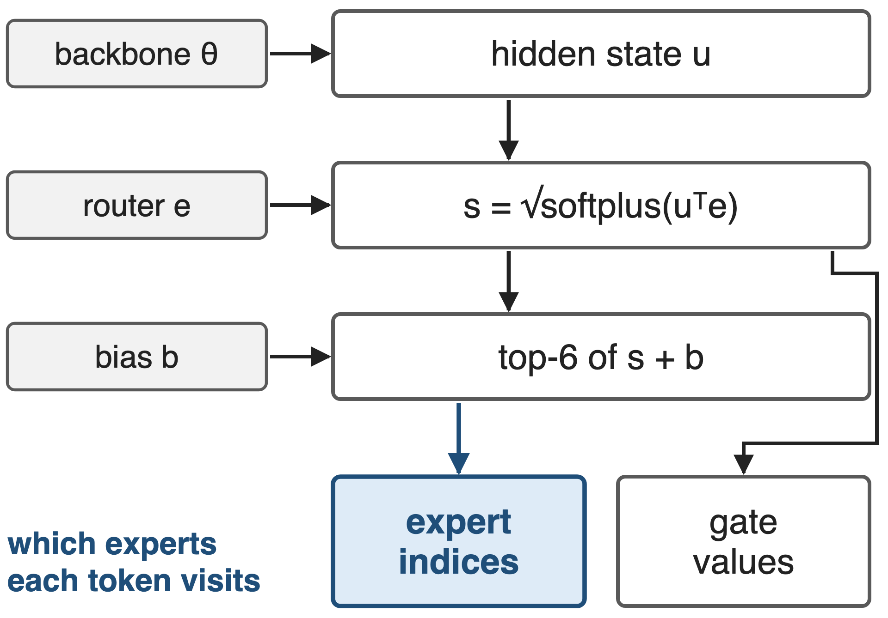
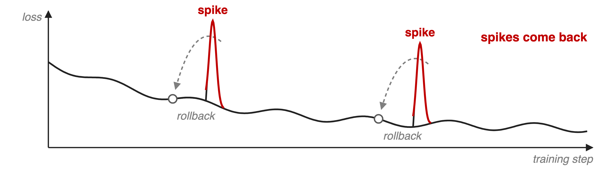
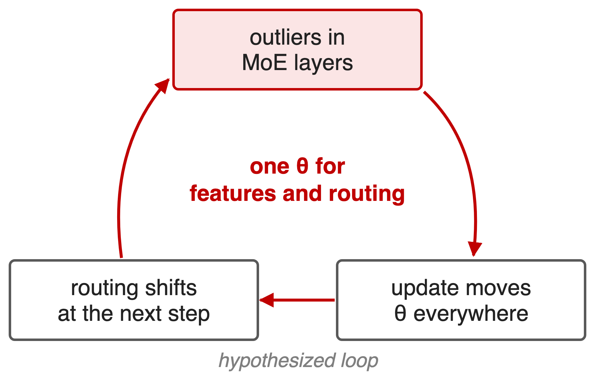
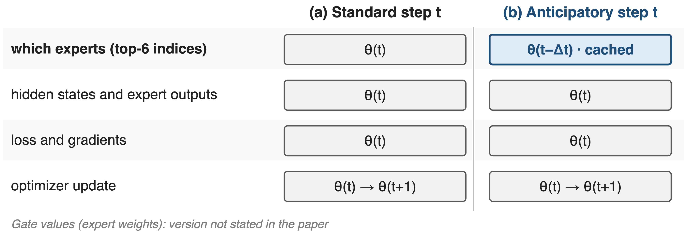
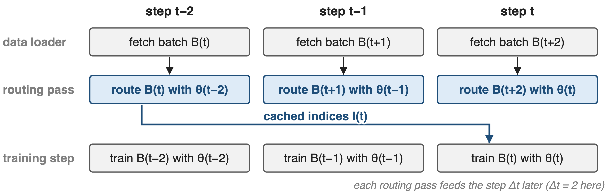
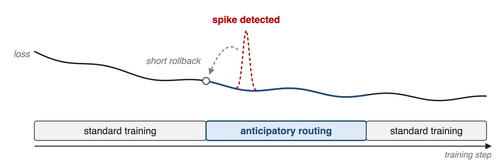
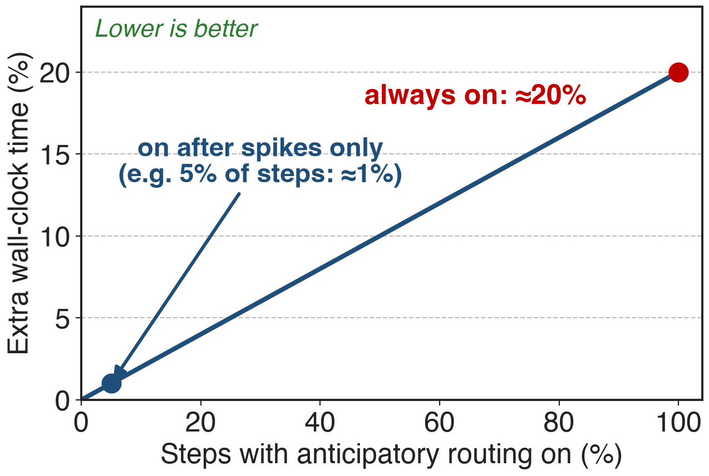
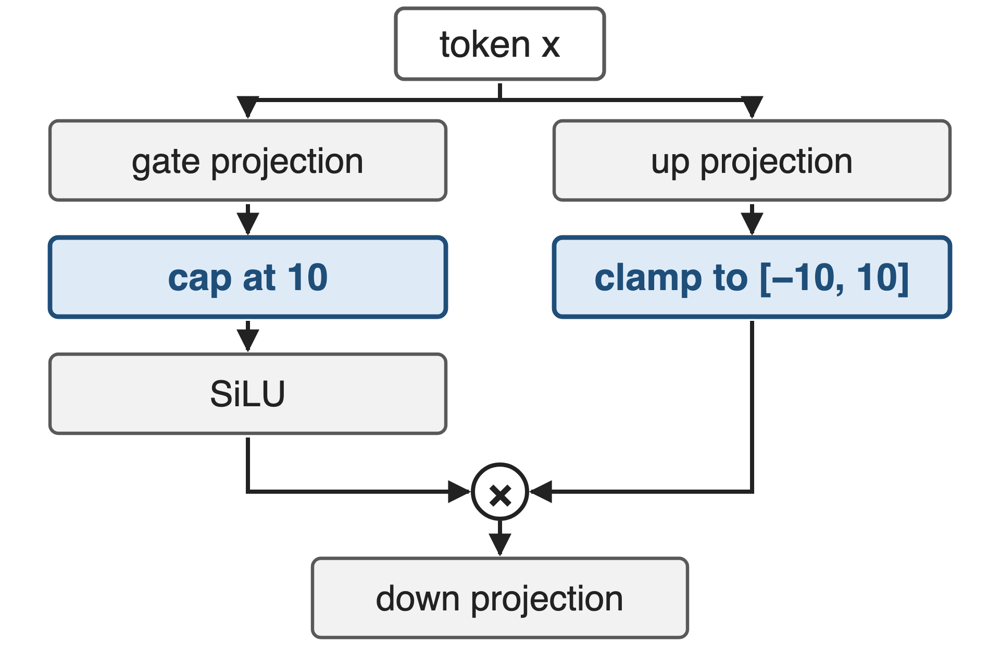

# The router picks experts from current parameters
{right 50%}
- V4-Pro: **1.6T** params, **384** experts, top-**6**
- **33T** tokens, batches up to **94.4M** tokens
- Expert choice depends on backbone, router and bias
<!-- notes: In every MoE layer of DeepSeek-V4 the router scores each token against every expert with a square-root-softplus affinity, adds a per-expert load-balancing bias, and keeps the top 6. So the expert indices depend on three things: the hidden state produced by the backbone below, the router's expert centroids, and the bias. The gate values that weight the expert outputs come from the affinities, without the bias. In standard training all of these come from the current parameters. The first 3 MoE layers use hash routing and have no learned router. Sources: DeepSeek-V4 §2.1, §4.2.1-4.2.2; DeepSeek-V3 §2.1.2 eqs. 12-16. -->

# Rollbacks restore the run, not the stability
{full}
%% caption: Schematic; DeepSeek publishes no spike sizes, counts or lost compute
> Spikes track outliers in MoE layers, and routing appears to amplify them
<!-- notes: DeepSeek reports notable instability in training the trillion-parameter V4 models. Rolling back to an earlier checkpoint restored the training state, but only temporarily: the loss spikes came back, because a rollback does not remove the cause. Empirically, every spike was tied to outliers in the MoE layers, and the routing mechanism itself appeared to make those outliers worse. There is no published measurement of spike size or frequency, so this slide is a schematic, not a number. Source: DeepSeek-V4 §4.2.3. -->

# Routing and features update in lockstep
{right 50%}
- Standard step: one θ(t) for features and routing
- An update that creates outliers also re-routes tokens
> DeepSeek calls the exact mechanism an open question
<!-- notes: The structural suspect is synchronous coupling. The same parameters decide both what a layer computes and which experts each token visits, so an update that pushes a MoE layer towards outliers also changes the routing at the very next step, which may feed further outliers. DeepSeek describes this as a vicious cycle induced by routing, but states that a theoretical understanding is still missing; the loop drawn here is a hypothesis, not a measured chain. Sources: DeepSeek-V4 §4.2.3 and §6. -->

# Insight: let routing lag the backbone by Δt
- Empirical: decoupling backbone and router updates
- Training becomes markedly more stable
--
> Compute with θ(t), but choose experts with θ(t−Δt)
<!-- notes: DeepSeek found that breaking the synchrony between the backbone's updates and the routing network significantly improves training stability. The concrete form: at step t, every feature is computed with the current parameters, but the routing indices are computed with the parameters from Δt steps earlier. An update can then no longer change routing at the very next step. Source: DeepSeek-V4 §4.2.3. -->

# Step t computes with θ(t), routes with θ(t−Δt)
{full}
> Only one row changes: which experts each token visits
<!-- notes: This is the precise contract. In a standard step everything comes from theta t. In an anticipatory step the top-6 expert indices come from a cache computed with theta t minus delta t; hidden states, expert outputs, loss, gradients and the optimizer update all use theta t, and the update still produces theta t plus one. The paper only says routing indices; it does not say whether the gate values that weight the selected experts are recomputed with theta t, so the figure leaves them out. The paper does not publish delta t. Source: DeepSeek-V4 §4.2.3. -->

# ❶ Routing indices are computed Δt steps early
{full}
> θ(t−Δt) is already in memory at step t−Δt: no second copy of the model
<!-- notes: Running the router with old parameters naively would mean keeping or reloading a second copy of the model. Instead, DeepSeek fetches the data of step t early, at step t minus delta t, when theta t minus delta t is the resident model, runs a single routing-only forward pass over it, and caches the indices; that is why it is called anticipatory. At step t, training uses the cached indices. DeepSeek orchestrated this extra pass inside the pipeline schedule and overlapped it with expert-parallel communication. Delta t = 2 is only for the drawing. Source: DeepSeek-V4 §4.2.3. -->

# ❷ Anticipatory mode turns on only after a spike
{full}
> Detect a spike, roll back briefly, route anticipatorily for a while, then return
<!-- notes: Even after the infrastructure work the lookahead pass costs about 20 percent extra wall-clock time, too much to pay for a whole 33-trillion-token run. So an automatic detector watches for loss spikes; when one occurs it triggers a short rollback and switches anticipatory routing on; after running in this mode for a certain period, training returns to standard routing. The paper gives no detector threshold, rollback length or mode duration. Source: DeepSeek-V4 §4.2.3. -->

# ≈20% slower while on, near zero overall
{right 55%}
- About **20%** extra wall-clock while active
- Active only after detected spikes
- DeepSeek: spikes averted, quality unchanged
> Pay for the lookahead only while a spike is being handled
%% caption: Analytic: overhead ≈ 20% × active fraction; the 5% point is illustrative
<!-- notes: The published numbers are an overhead of about 20 percent of wall-clock time while the mode is active, and a negligible overall overhead with the spike-triggered policy, with loss spikes averted and no loss in model performance. Because the mode is only on for a fraction of the steps, the run-level cost is roughly 20 percent times that fraction; the chart is that formula, and the 5 percent example is illustrative since DeepSeek does not report how often the mode was on. Source: DeepSeek-V4 §4.2.3. -->

# V4 pairs it with SwiGLU clamping
{right 50%}
- Clamping removes outliers directly
- Linear part clamped to **[−10, 10]**, gate capped at **10**
- Used throughout V4-Flash and V4-Pro training
<!-- notes: Anticipatory routing attacks the routing-induced cycle; the second technique attacks the anomalous values themselves. Throughout the training of both V4 models, DeepSeek clamped the linear component of every SwiGLU to between minus 10 and 10 and capped the gate component at 10, which eliminated outliers without hurting performance. The Notion row credits mHC and Muon as partners, but in the paper's stability section the partner is SwiGLU clamping; mHC and Muon are separate levers (decks 61 and 64). The fused Mega MoE kernel applies the same clamp (deck 14). Source: DeepSeek-V4 §4.2.3. -->

# The cost: an extra pass, rollbacks, no theory
%% layout: two-col
- !!≈20%!! extra wall-clock while active
- Prefetch batches Δt steps ahead, cache indices
- Needs a spike detector and rollbacks
|||
- Δt and thresholds unpublished
- No ablations or spike statistics
- Why it works: still open
<!-- notes: While on, the mode costs about 20 percent wall-clock. It needs a data loader that runs delta t batches ahead, storage for the cached indices, and the checkpoint-and-rollback machinery plus an automatic spike detector. DeepSeek publishes neither delta t nor the detection rule, and no ablation or spike statistics, and says the underlying principles of both Anticipatory Routing and SwiGLU clamping are insufficiently understood. Sources: DeepSeek-V4 §4.2.3 and §6. -->

# Summary
- V4 loss spikes recurred after plain rollbacks
- ==Insight==: route with θ(t−Δt), compute with θ(t)
- One cached routing pass, on only after spikes
- **≈20%** while on, **negligible** overall
%% qr: https://arxiv.org/abs/2606.19348
<!-- notes: Anticipatory routing is a targeted way to break the coupling between what a MoE layer computes and where its tokens go, paid for only when a spike shows up. Related decks: 55 (loss-free balance routing), 61 (mHC), 64 (Muon at scale), 43 (deterministic kernels, which make spikes reproducible to study), 14 (Mega MoE with clamped SwiGLU). Source: DeepSeek-V4 §4.2.3. -->
