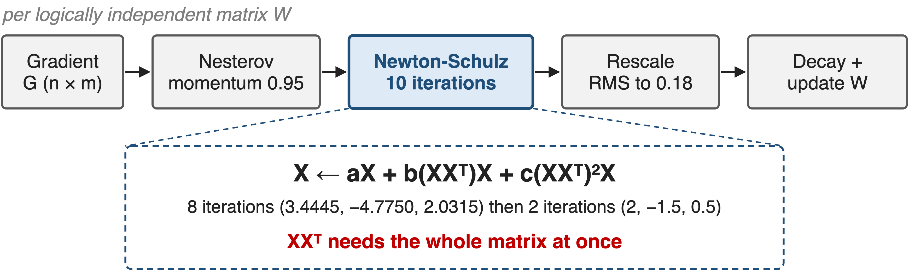
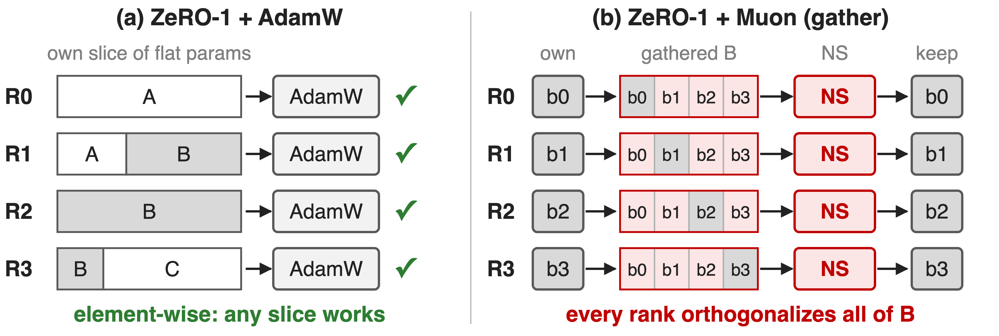
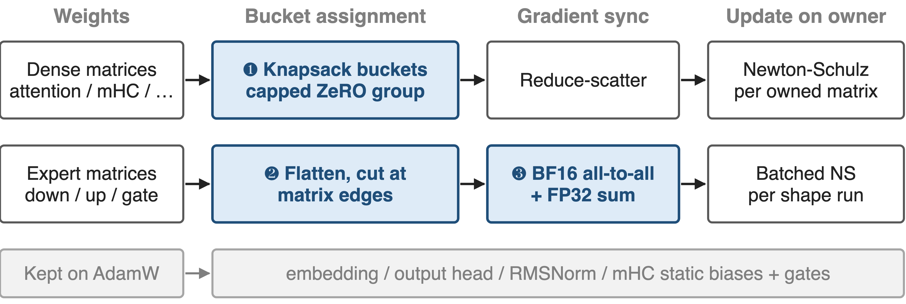
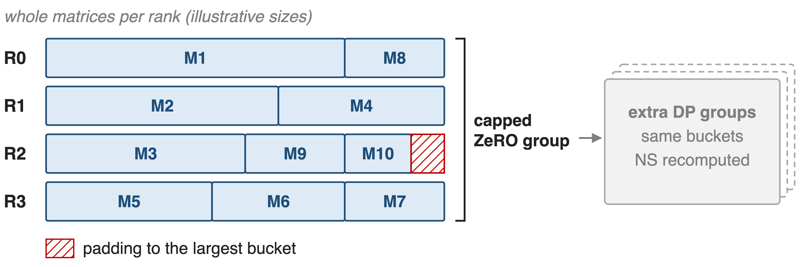
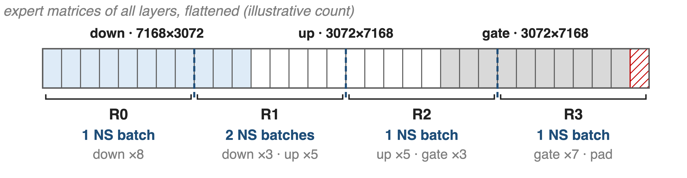
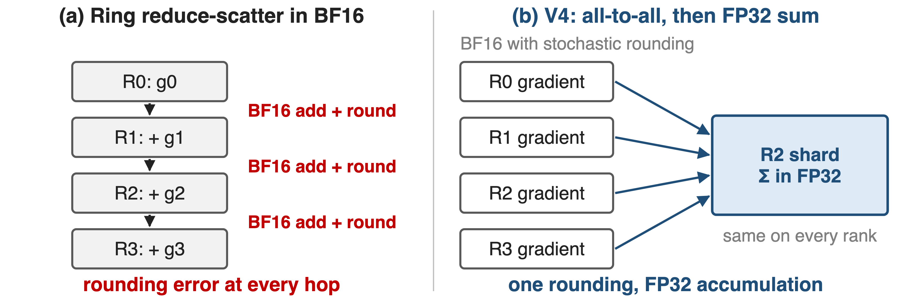
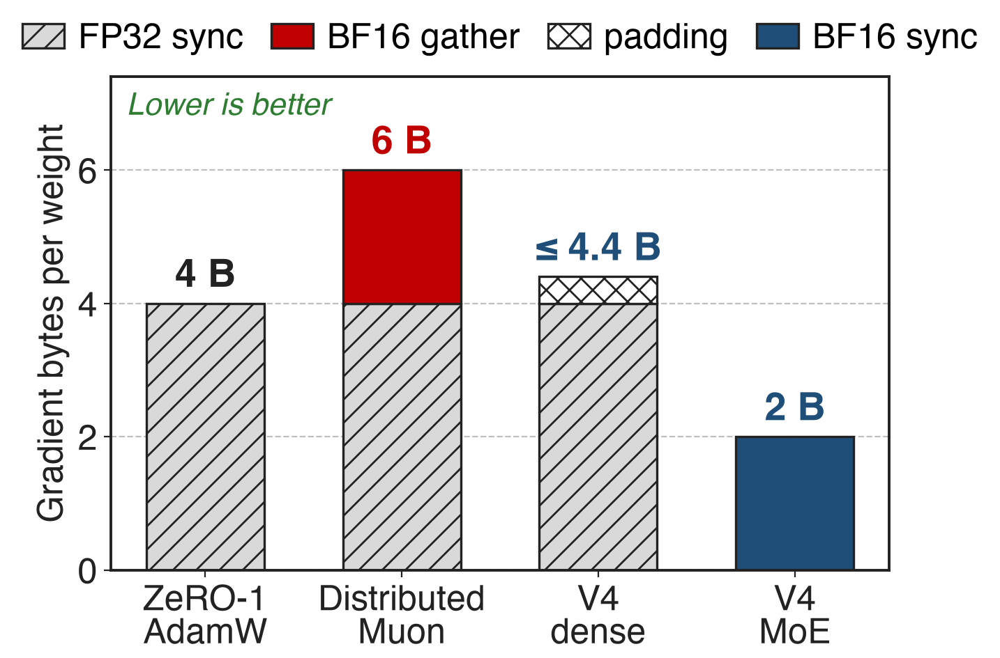

# Muon updates each weight matrix as one unit
{full}
> Muon trains V4, K2 and GLM-5; Moonlight measured ~2× AdamW's efficiency
<!-- notes: DeepSeek-V4 uses Muon for every module except the embedding, the output head, RMSNorm weights and the static biases and gates of mHC, which stay on AdamW. Per matrix: Nesterov momentum 0.95, ten Newton-Schulz iterations (eight fast ones with coefficients 3.4445, -4.7750, 2.0315, then two settling ones with 2, -1.5, 0.5), rescale the update RMS to 0.18 so AdamW hyper-parameters carry over, then weight decay 0.1 and the update. The key point for systems: X times X-transpose mixes every row and column, so the update needs the whole matrix. Sources: V4 §2.4, Algorithm 1, §4.2.2; Moonlight abstract (~2× compute efficiency, ~52% of AdamW's FLOPs); K2 MuonClip (deck 65); GLM-5 App. A. -->

# Gathering for Muon costs up to 1.25× traffic
%% big: 1.25×
%% sub: DP traffic of ZeRO-1 "Distributed Muon" vs. ZeRO-1 AdamW, and every rank still runs Newton-Schulz on the full matrix
%% source: Moonlight, arXiv 2502.16982, §2.3 (4 + 2 + 4 vs. 4 + 4 bytes per weight); GLM-5, arXiv 2602.15763, §2.4.1
<!-- notes: The first public ZeRO-1 port of Muon, Moonlight's Distributed Muon, keeps ZeRO's element-wise slices and adds a gather: each rank collects the full gradient matrix, runs Newton-Schulz on all of it, and throws away everything but its own slice. Per weight that is an FP32 reduce-scatter, a BF16 gather and an FP32 all-gather, 10 bytes against AdamW's 8, so up to 1.25 times the traffic. Moonlight saw no noticeable latency at its scale; GLM-5 reports that naive versions that all-gather full parameters on every DP rank cause transient memory spikes and redundant communication. Sources: Moonlight §2.3; GLM-5 §2.4.1 p.9. -->

# ZeRO slices the matrices Muon needs whole
{full}
> ZeRO shards elements; Muon's unit of work is a matrix
<!-- notes: Left: ZeRO-1 flattens all parameters and cuts the vector into equal slices; matrix B ends up split over three ranks, which is fine because AdamW updates each element on its own. Right: Muon cannot update a slice, so every rank gathers B, orthogonalizes the whole matrix and keeps its quarter. The work is correct but repeated DP times, and the gathered copies cost memory and bandwidth. This granularity mismatch is the villain. Sources: Moonlight §2.3 Algorithm 1; V4 §3.4.1 first paragraph. -->

# Insight: shard by matrix, not by element
- V4-Pro: **70,455** expert matrices of **22M** weights each (derived)
- Far more matrices than ranks: whole ones balance by count
--
> Give each rank whole matrices; balance by packing, not by cutting
<!-- notes: A fine-grained MoE is made of a huge number of small, identical matrices: 385 experts per layer, 3 matrices each, 61 layers in V4-Pro, each 7168 by 3072. If every rank owns whole matrices, the reduce-scatter already delivers complete gradient matrices to their owner, so there is nothing to gather and Newton-Schulz runs once per matrix. The dense side has only a few matrices of uneven size, so it needs packing instead. Derived from V4 §4.2.1; principle from V4 §3.4.1. -->

# V4 routes dense and expert weights differently
{full}
> Every matrix lives whole on one owner, which runs its Newton-Schulz
<!-- notes: DeepSeek-V4's hybrid ZeRO strategy for Muon has three parts. ❶ Dense matrices are packed whole into per-rank buckets with a knapsack algorithm on a capped ZeRO group. ❷ Expert matrices are flattened and cut only at matrix boundaries across all ranks, and same-shape runs are orthogonalized in batches. ❸ Expert gradients travel in BF16 with stochastic rounding through an all-to-all and are summed in FP32. AdamW parameters are not part of this scheme. Source: V4 §3.4.1, §2.4. -->

# ❶ Knapsack packs whole dense matrices per rank
{full}
> At most 5 matrices per rank keeps padding under 10% of memory
<!-- notes: Dense matrices are few and differ in size, so V4 caps the ZeRO degree and uses a knapsack algorithm to give each rank a roughly equal load of whole matrices. Each bucket is padded to the largest bucket so a regular reduce-scatter works; with at most five matrices per rank the padding stays under 10% of memory. When data parallelism is larger than the cap, the extra DP groups hold the same buckets and recompute the Muon update, trading compute for bucket memory. Sizes in the figure are illustrative. Source: V4 §3.4.1 p.19-20. -->

# ❷ Expert matrices split only at matrix edges
{full}
> Same-shape neighbors merge into one batched Newton-Schulz call
<!-- notes: Each expert is optimized on its own. V4 flattens the down projections of all experts in all layers, then the up projections, then the gates, and pads the vector so it divides evenly across ranks without cutting any matrix. With so many experts there is no cap on the ZeRO degree and the padding is negligible. On each rank, consecutive parameters of identical shape are merged so Newton-Schulz runs as one batched call; up and gate share a shape, so they merge across their boundary. Counts in the figure are illustrative. Source: V4 §3.4.1 p.20. -->

# ❸ BF16 on the wire, FP32 in the sum
{full}
> Newton-Schulz stays stable in BF16, so expert gradients travel in BF16
<!-- notes: DeepSeek observed that Newton-Schulz remains stable with BF16 matrix multiplications, so the MoE gradients synchronized across data-parallel ranks are quantized to BF16 with stochastic rounding, halving their communication volume. A tree or ring reduce-scatter would then add partial sums with BF16 adders at every hop. Instead, an all-to-all exchanges the local BF16 gradients and each rank sums the pieces of its own shard in FP32. Source: V4 §3.4.1 p.20. -->

# Gradient traffic falls from 6 to 2 B/weight
{right 60%}
- No gather: owners receive whole matrices
- Expert sync in BF16: **half** the bytes
- Dense: padding under **10%**
%% caption: Analytic: gradient path only, one ZeRO group; FP32 = 4 B, BF16 = 2 B
<!-- notes: An analytic per-weight comparison on the gradient path, using Moonlight's byte accounting. ZeRO-1 AdamW reduce-scatters 4 bytes. Distributed Muon adds a 2-byte BF16 gather, 6 bytes. V4's dense buckets need no gather because each owner holds whole matrices, 4 bytes plus at most 10% padding. V4's expert gradients go in BF16, 2 bytes. The parameter all-gather is left out because V4 does not state its precision, and V4's extra DP groups add a reduction it does not quantify. Sources: Moonlight §2.3; V4 §3.4.1; derivation in notes/sources.md. -->

# GLM-5 removes the redundant all-gather instead
%% layout: two-col
- !!Naive Muon!!
- Every DP rank all-gathers full params
- Transient memory spikes, redundant traffic
|||
- ==GLM-5==
- All-gather only the shards each rank owns
- Overlap shard traffic with local compute
> Same rule as V4: no rank materializes what it does not own
<!-- notes: GLM-5 attacks the same waste from the other side of the step. Naive Muon implementations all-gather full model parameters on every data-parallel rank, causing transient memory spikes and redundant communication; GLM-5 restricts the all-gather to the shards each rank owns and overlaps it with local computation. Its pipeline ZeRO2 also keeps only a 1/dp gradient shard per stage plus two full accumulation buffers used in double-buffering. GLM-5 publishes no traffic or memory numbers for this. Source: GLM-5 §2.4.1 p.9. -->

# The cost: recompute, padding, BF16 trust
%% layout: two-col
- !!Recompute!!: dense NS repeated in every extra DP group
- !!Padding!!: under 10% only with ≤ 5 matrices per rank
|||
- !!BF16 trust!!: NS stability is observed, not proven
- AdamW still covers embedding, head, norms
- Tensor parallelism adds a BF16 gather
<!-- notes: Capping the dense ZeRO group means every extra DP group recomputes the same Newton-Schulz work. The under-10% padding holds in V4's setup where each rank owns at most five matrices; more ranks per group would mean fewer matrices each and more padding. BF16 gradients rest on the empirical observation that Newton-Schulz stays stable in BF16, and the two-phase all-to-all replaces the standard reduce-scatter collective. Embedding, head, RMSNorm and mHC biases still use AdamW. Moonlight notes that with TP each matrix also needs a BF16 gather across the TP group. Sources: V4 §3.4.1, §2.4; Moonlight footnote 5. -->

# Summary
- ZeRO slices matrices: up to **1.25×** traffic, NS on every rank
- ==Insight==: shard by matrix; **70,455** expert matrices balance by count
- Knapsack dense buckets (< **10%** padding); experts cut at matrix edges
- Expert gradients in BF16: **6 → 2** bytes per weight (analytic)
%% qr: https://arxiv.org/abs/2606.19348
<!-- notes: Distributed Muon at scale is a bucketing problem: make the unit of sharding the unit of the optimizer. Related decks: 65 (MuonClip), 58 (ultra-sparse MoE, where the 70k matrices come from), 49 (precision-aware optimizer), 70 (Megatron-FSDP). Sources: V4 §3.4.1; Moonlight §2.3; GLM-5 §2.4.1. -->
