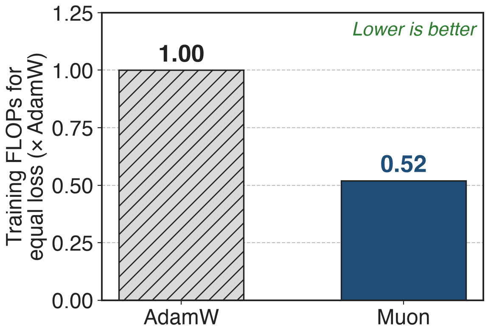
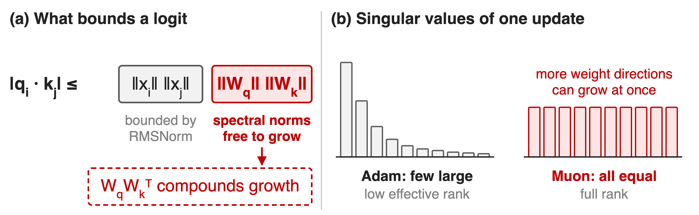
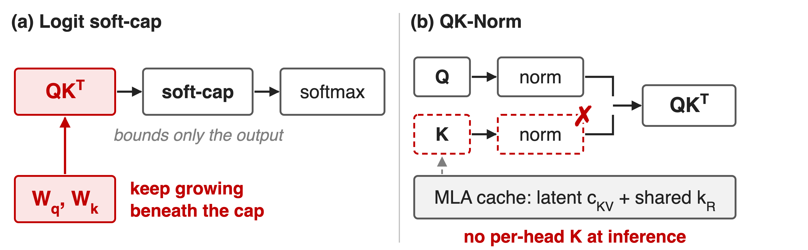
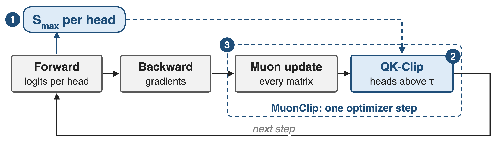
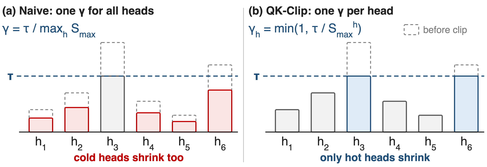
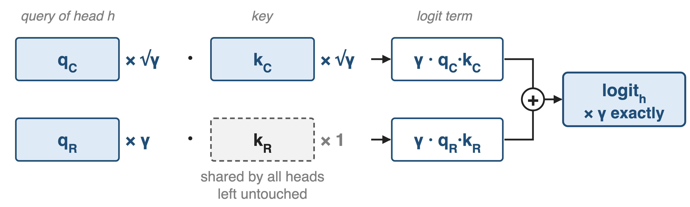
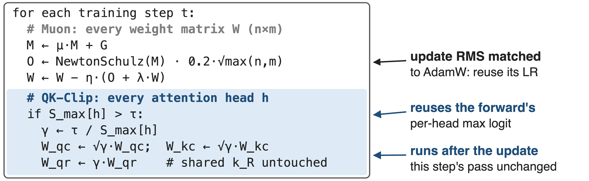
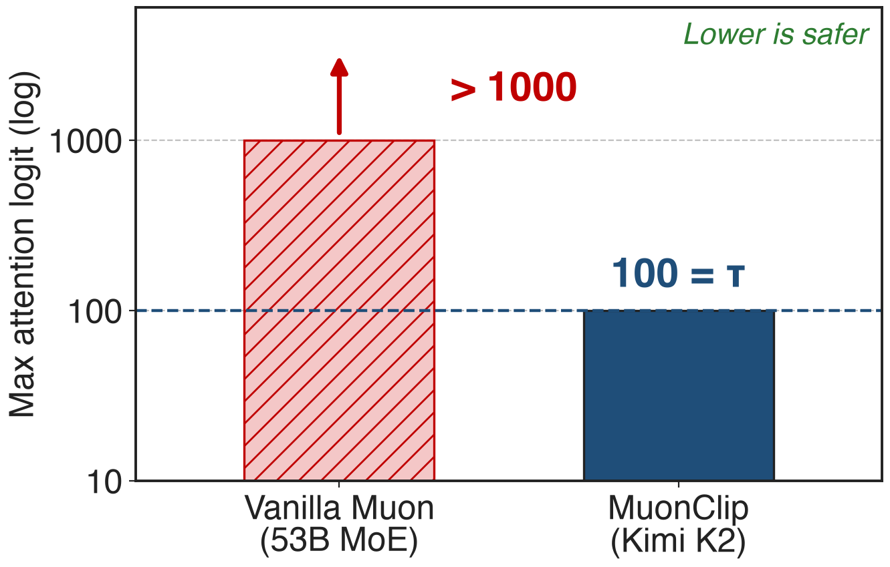
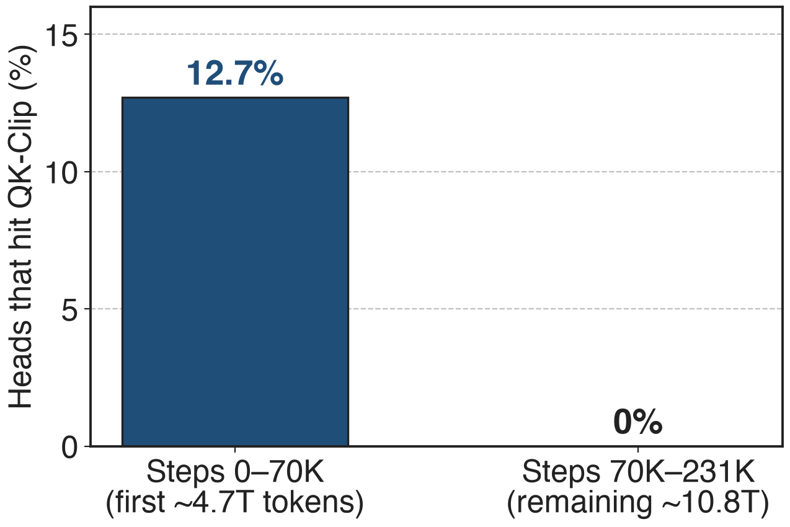

# Muon matches AdamW with half the FLOPs
{right 45%}
- Kimi K2: **1.04T** MoE, **32.6B** active
- **15.5T** tokens, all with Muon
- MLA attention: **61** layers × **64** heads
<!-- notes: Moonshot's Moonlight work showed that Muon, with weight decay and an update RMS matched to AdamW, reaches the same loss as AdamW with about 52% of the training FLOPs in a compute-optimal scaling law, roughly 2 times the efficiency. Kimi K2 bets its whole 15.5T-token pretraining on that: a 1.04T-parameter MoE with 32.6B active parameters and multi-head latent attention in all 61 layers, 64 heads each. Sources: Moonlight arXiv 2502.16982 abstract and Fig. 1a; K2 Table 2 and §2.5. -->

# Vanilla Muon drives max logits past 1000
%% big: > 1000
%% sub: max attention logit in a 53B-parameter MoE (9B active) trained with vanilla Muon, followed by loss spikes and occasional divergence
%% source: Kimi K2 report (arXiv 2507.20534), §2.1 and Fig. 2 (left)
<!-- notes: Scaling Muon up exposed one failure. In a mid-scale MoE with 53B total and 9B active parameters, the largest pre-softmax attention score quickly passes 1000, and the report says logits at that level usually bring significant loss spikes and occasional divergence. It happens more often with Muon than with AdamW in Moonshot's experiments. Source: K2 §2.1, Fig. 2 left. -->

# Muon inflates the weights that set logits
{full}
> RMSNorm bounds the inputs, so the growth must come from `W_q` and `W_k`
<!-- notes: Any logit is bounded by the input norms times the spectral norms of W_q and W_k. RMSNorm keeps the inputs bounded, so an exploding logit means those spectral norms grew. K2's appendix gives a hypothesis for why Muon does this more than Adam: a Muon update has all singular values equal, a full-rank update, while Adam's update is dominated by a few directions. A full-rank update is more likely to line up with the weight's own singular directions and push singular values up additively, and because the logit uses the product W_q W_k transpose, growth in either matrix compounds. Sources: K2 App. E, Eq. 2 to 6; bars are illustrative. -->

# Soft-cap and QK-Norm both fall short
{full}
> Needed: a fix on the weights that works with MLA's latent keys
<!-- notes: Two known fixes do not fit. A logit soft-cap squashes the score after the dot product is formed, so the query-key products and the weights behind them can still grow underneath the cap. QK-Norm normalizes per-head queries and keys, but MLA caches only a compressed latent and one shared rotary key and never builds per-head keys at inference, so there is nothing to normalize. GLM-4.5, which uses grouped-query attention, does use QK-Norm with Muon; that alternative is deck 66. Sources: K2 §2.1 p.3; DeepSeek-V3 §2.1.1; GLM-4.5 §2.1. -->

# Insight: fix the weights, not the logits
- Logit is bilinear: √γ on `W_q` and `W_k` scales it by **γ**
- Forward already computes each head's max logit
--
> After each update, rescale `W_q`, `W_k` only for heads above τ
<!-- notes: Two facts make the fix cheap and exact. First, a logit is q dot k, which is bilinear in the two weight matrices: multiply both by the square root of gamma and every logit of that head is multiplied by exactly gamma. Second, the forward pass already finds the maximum logit of every head for the softmax. So instead of touching activations, QK-Clip uses that measured maximum to shrink the weights of the offending heads right after the optimizer update. Source: K2 §2.1. -->

# MuonClip adds one clip after every Muon step
{full}
%% caption: ❶ per-head trigger · ❷ MLA-aware rescale · ❸ fused into the optimizer step
<!-- notes: One training step. The forward pass computes logits per head and records S_max for each head, the maximum over the whole batch. Backward produces gradients as usual. The optimizer then applies the Muon update to every matrix, and immediately after it QK-Clip rescales the query and key weights of every head whose S_max exceeded the threshold tau. The next step's forward sees the clipped weights. Source: K2 §2.1 and Algorithm 1. -->

# ❶ Only heads above τ get clipped
{full}
%% caption: Illustrative logits. Per-head clipping keeps cold heads untouched.
<!-- notes: The naive version computes one gamma from the hottest head in the model and scales every head by it, which also shrinks heads that were perfectly healthy. Moonshot observed that only a small subset of heads explodes, so QK-Clip computes gamma per head, the minimum of one and tau over that head's S_max. Heads below tau get gamma equal to one and are not touched at all. The report frames this as minimal intervention, avoiding over-regularization of other heads. Sources: K2 §2.1 p.3, App. D. -->

# ❷ MLA splits the scale: √γ, √γ, γ
{full}
> Both terms shrink by γ; the shared `k_R` stays intact for other heads
<!-- notes: In MLA a head's query has a content part q_C and a rotary part q_R; its key has a head-specific content part k_C and a rotary key k_R that one projection produces for all heads. Scaling W_qc and W_kc by the square root of gamma shrinks the content term by gamma. The rotary key cannot be touched without affecting every other head, so the whole factor gamma goes onto W_qr. Both terms shrink by gamma, so the head's logit shrinks by exactly gamma. Sources: K2 §2.1 and Algorithm 1 lines 13-15; DeepSeek-V3 §2.1.1. -->

# ❸ The clip runs inside the optimizer step
{full}
> One optimizer, MuonClip: Muon, weight decay, RMS matching, QK-Clip
<!-- notes: This is K2's Algorithm 1, paraphrased. The Muon part is momentum, Newton-Schulz orthogonalization, scaling by 0.2 times the square root of the larger matrix dimension so the update RMS matches AdamW's and AdamW learning rates carry over, then decoupled weight decay. The QK-Clip part reuses S_max from the forward pass and touches only the attention projections of heads above tau. It does not change the current step's forward or backward computation; it acts on the weights the next step will use. Sources: K2 Algorithm 1, §2.1; Moonlight §2.2. -->

# Max logit capped at 100, not >1000
{right 55%}
- K2 cap: **τ = 100**
- Logits decay below the cap after ~**30%** of steps
- No retuning of τ during the run
%% caption: Different model scales; the vanilla bar is a lower bound
<!-- notes: Same currency as the pain slide. With vanilla Muon the 53B mid-scale MoE passes 1000; Kimi K2 with MuonClip and tau equal to 100 rises to the cap of 100 and is held there, then after about 30% of training steps the maximum logits decay into a normal range on their own, without any change to tau. The two runs differ in scale, and the first bar only says "more than 1000". Source: K2 §2.1 and Fig. 2. -->

# K2 trained 15.5T tokens with zero spikes
%% big: 0
%% tone: ours
%% sub: loss spikes in Kimi K2's 15.5T-token pretraining (per-step loss, no smoothing or sub-sampling)
%% source: Kimi K2 report (arXiv 2507.20534), abstract and Fig. 3
<!-- notes: The headline result: the per-step training loss of Kimi K2 over all 15.5 trillion tokens, plotted without smoothing or sub-sampling, shows no spikes. Source: K2 abstract, §2.1, Fig. 3. -->

# QK-Clip switched itself off after 70K steps
{right 55%}
- Active early: **12.7%** of heads hit τ
- After 70K steps: all heads below τ, a no-op
- τ = **30** on a 3B MoE: negligible loss change
%% caption: Step-to-token conversion uses the 67M-token batch (derived)
<!-- notes: QK-Clip was transient. In the first 70,000 steps, 12.7% of K2's attention heads, about 500 of 3,904, triggered it at least once; after that every head stayed below 100 and the clip never fired again. 70K steps at 67M tokens per step is about 4.7T tokens, 30% of the run, consistent with Fig. 2. A small ablation with an aggressive tau of 30 on a 0.5B-active, 3B-total MoE showed negligible effect on the loss curve and no statistically significant downstream degradation. Sources: K2 App. D, Fig. 12; §2.5 for the batch size. -->

# The cost: a threshold, a lag, MLA surgery
%% layout: two-col
- !!New knob τ!!: 100 in K2, 30 in the ablation
- Acts from the next step only
- Needs each head's max over the global batch
|||
- No-harm evidence: one 3B ablation, self-deactivation
- Non-MLA attention: QK-Norm is simpler (deck 66)
- K3 keeps the clip, adds per-head Muon
<!-- notes: QK-Clip adds a threshold; K2 used 100 and the ablation 30, and the report gives no sweep. It is a post-hoc correction: the step in which a head first exceeds tau runs with the large logit, and the clip affects the following steps. S_max is defined over the whole batch, which implies that a distributed implementation must combine each head's maximum across data-parallel shards (our reading of the definition). The evidence that clipping does not hurt quality is one small-scale ablation plus the fact that it switched itself off in K2; there is no full-scale ablation. For grouped-query or standard attention, QK-Norm, as in GLM-4.5, is the simpler fix (deck 66). Kimi K3 keeps K2's weight clipping and adds per-head Muon orthogonalization. Muon at scale: deck 64. Sources: K2 §2.1, App. D; GLM-4.5 §2.1; K3 §2.5, §3.3. -->

# Summary
- Vanilla Muon: max attention logit **> 1000** at 53B scale
- ==Insight==: logits are bilinear in `W_q`, `W_k`: rescale weights per head
- K2: capped at **τ = 100**, **12.7%** of heads clipped, then off
- **0** loss spikes across **15.5T** tokens on a **1.04T** MoE
%% qr: https://arxiv.org/abs/2507.20534
<!-- notes: MuonClip keeps Muon's roughly 2 times token efficiency and removes its logit-explosion failure with a small, exact, self-deactivating weight rescale, adapted to MLA's shared rotary key. Related decks: 64 (distributed Muon at scale), 66 (QK-Norm, the activation-side alternative), 06 (K2's schedule and context extension). Sources: K2 §2.1, App. D, Fig. 2-3; Moonlight. -->
