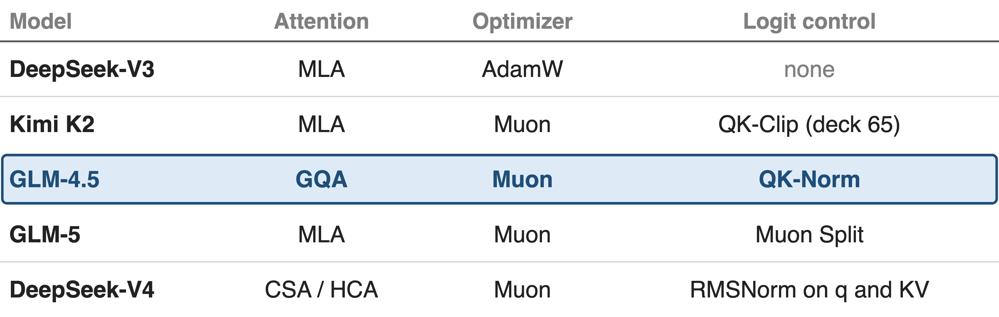
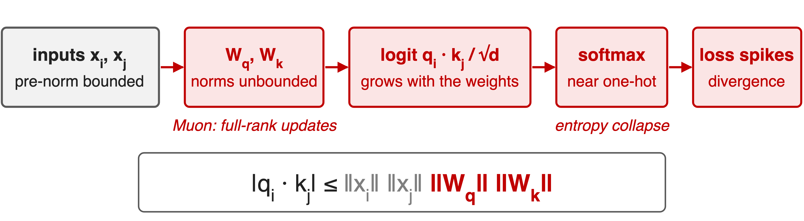
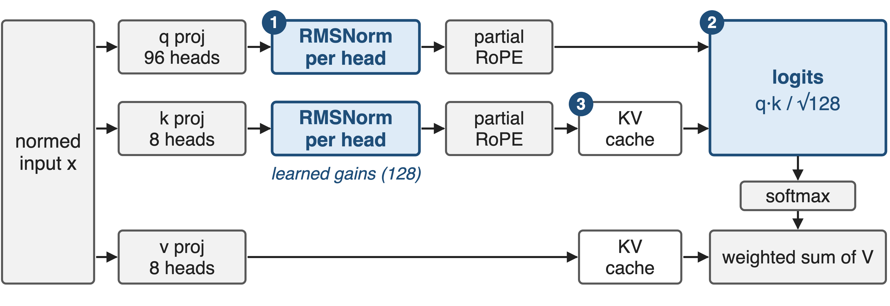
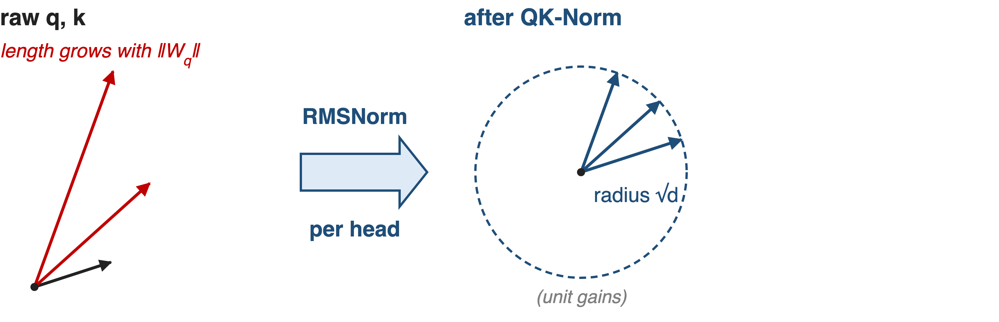
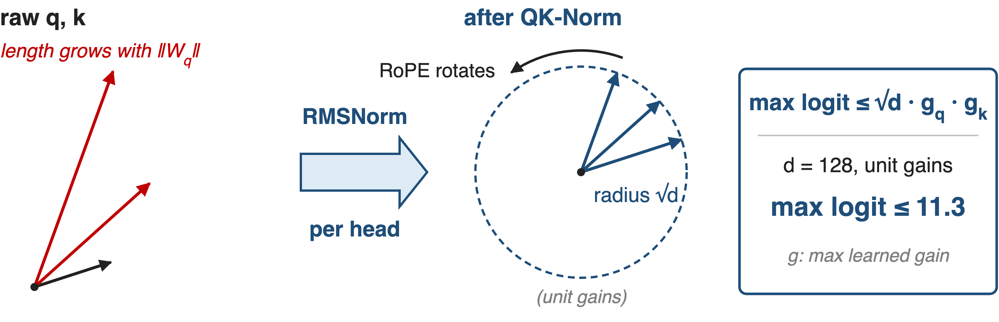
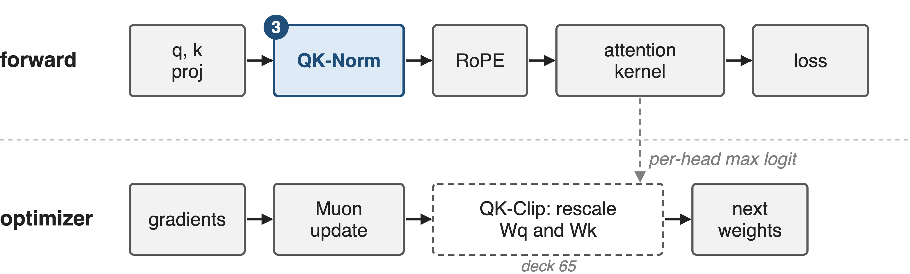
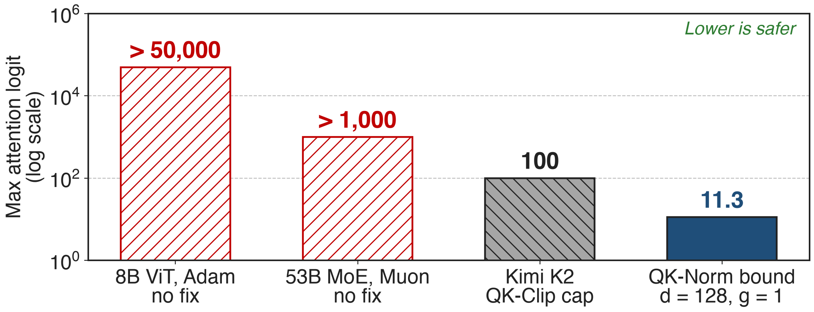
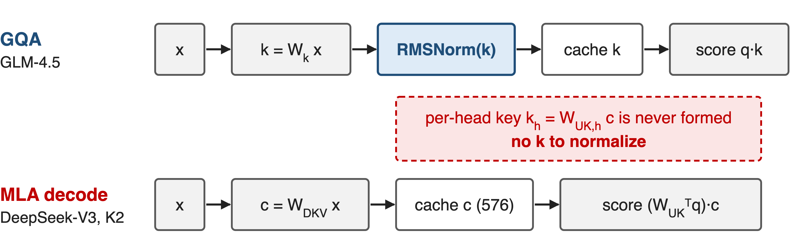

# Muon-era MoEs all carry a logit control
{full}
> GLM-4.5 trains a 355B MoE with Muon and bounds logits with QK-Norm
<!-- notes: GLM-4.5 is a 355-billion-parameter MoE with 32 billion active, pre-trained on 23 trillion tokens with Muon on every weight matrix except embeddings, biases and RMSNorm weights. Its architecture section adds QK-Norm "to stabilize the range of attention logits", and in its comparison table it is the only model with it. The neighbours show that every Muon-trained model needs some logit control: Kimi K2 clips weights with QK-Clip, GLM-5 uses Muon Split, DeepSeek-V4 normalizes queries and KV entries and drops QK-Clip. Sources: GLM-4.5 §2.1, §2.4, Table 1; K2 §2.1; GLM-5 §2.1; DeepSeek-V4 §2.3.3 and p.14; DeepSeek-V3 §4.2 (AdamW). -->

# Muon lets attention logits run past 1,000
%% big: > 1,000
%% sub: max attention logit of a 53B-total MoE trained with vanilla Muon: loss spikes, occasional divergence
%% source: Kimi K2 tech report, arXiv 2507.20534, §2.1 and Fig. 2 (mid-scale run, 9B activated / 53B total)
<!-- notes: Moonshot trained a mid-scale MoE, 9 billion activated and 53 billion total parameters, with plain Muon. The largest pre-softmax attention logit quickly passed 1,000; at that level they saw significant loss spikes and occasional divergence. They also report that this explosion happens more often with Muon than with AdamW. GLM-4.5 uses Muon too, so this is the failure QK-Norm has to prevent. Source: K2 §2.1, Fig. 2 left. -->

# Nothing in the attention block bounds Wq, Wk
{full}
> 8B ViT with Adam: logits above 50,000, one-hot attention, divergence
<!-- notes: The logit is q dot k over root d. Its size is bounded by the norms of the two inputs times the norms of the two projection matrices. Pre-norm keeps the inputs bounded, but nothing in the forward pass bounds W_q or W_k. Wortsman et al. found the growth comes from the lengths of q and k, not from their alignment. K2 hypothesises Muon makes it worse because its updates have all singular values equal, so they grow the spectral norm faster than Adam's low-rank updates. Large logits turn the softmax one-hot, attention entropy collapses, and the loss spikes. The ViT-22B team hit exactly this with Adam at 8B parameters: logits over 50,000 and a diverging loss within about 2,000 steps. Sources: K2 App. E p.30; Wortsman §3.1.1 p.4; ViT-22B §2 p.2 and App. B p.23. -->

# Lower LR, soft-caps and clipping act too late
- **Lower the LR** (ViT-H: 1e-3 → 4e-4): stable, !!but loses accuracy!!
- **Soft-cap logits** (Gemma 2): !!q·k keeps growing!! under the cap
- **Clip Wq, Wk** (QK-Clip, deck 65): !!needs per-head max logits!!
--
> All three react after q·k has grown; none removes the weight norm
<!-- notes: The obvious fixes treat the symptom. The original ViT lowered its learning rate from 1e-3 to 4e-4 at ViT-H to stay stable; ViT-22B shows models with QK normalization keep 1e-3 and gain more with scale, likely because of the higher rate. Gemma 2 soft-capped logits; K2 notes the dot products can still grow excessively before the cap, and Gemma 3 replaced soft-capping with QK-norm. K2's QK-Clip rescales W_q and W_k after each step when a head's max logit exceeds a threshold, which works but needs per-head max-logit statistics from the forward pass and an optimizer hook. Sources: ViT-22B App. B; K2 §2.1; Gemma 3 §2. QK-Clip deep dive: deck 65. -->

# Insight: RMSNorm cancels the weight norm
- `RMSNorm(c·q) = RMSNorm(q)` for any scale c > 0
- Apply it to q and k **after** the projection
--
> The weight norms drop out of the logit: bounded by construction
<!-- notes: RMSNorm divides a vector by its own root-mean-square, so multiplying the input by any positive constant changes nothing (up to the epsilon). If we normalize q and k after they leave W_q and W_k, whatever scale those matrices grow to is divided away before the dot product. This is a provable property of the operator, not a tuning result. Source: the RMSNorm definition in transformers' Glm4MoeRMSNorm; analytic. -->

# QK-Norm sits between projection and RoPE
{full}
%% caption: GLM-4.5 attention as implemented in transformers' modeling_glm4_moe.py; values are not normalized
<!-- notes: In GLM-4.5 the order is: pre-norm input, q, k and v projections with bias, then a per-head RMSNorm on q and on k over the 128 head dimensions with learned gains, then partial RoPE, then the KV cache and the scaled dot product with scale 1 over root 128. Values are never normalized. Badge 1 is the norm itself, badge 2 is the logit it bounds, badge 3 marks that the cached keys are already normalized, so decoding needs nothing extra. Sources: modeling_glm4_moe.py Glm4MoeAttention.forward; HF config use_qk_norm true, head_dim 128, 96 query and 8 KV heads. -->

# ❶ Per-head RMSNorm puts q and k on a sphere
{full}
> Every 128-dim q and k head ends at length √128 × gain, whatever the weights
<!-- notes: Left: without the norm, query and key vectors get longer as the projection weights grow. Right: per-head RMSNorm rescales each 128-dim head vector to length root d, about 11.3, times its learned gain. The statistics are per head; the 128 gain values are shared by all heads of the layer, one vector for q and one for k. Analytic, from the RMSNorm formula; with epsilon the length is at most root d. -->

# ❷ Logits bounded by √d times the gains
{full}
> Sharpness becomes a learned temperature: 2 × 128 gains per layer
<!-- notes: RoPE comes after the norm and is a rotation, so it keeps the length. By Cauchy-Schwarz, q dot k over root d is then at most root d times the largest q gain times the largest k gain: 11.3 at the unit initialisation for d equal to 128. Bounded is not flat: at 11.3, two keys in one row can still differ in weight by e to the 22.6, about 6.7 billion. To sharpen attention further the model must grow the gains, 256 parameters per layer that GLM-4.5 trains outside Muon, instead of growing two large matrices. Analytic; derivation in notes/sources.md. QKNorm's original form (Henry et al. 2020) uses l2 normalization and a single learnable scale. -->

# ❸ A forward-pass op, not an optimizer hook
{full}
> No statistics, no weight surgery; cached keys are already normalized
<!-- notes: QK-Norm is a per-token, per-head operation in the forward pass, applied before RoPE and before the KV cache, so attention kernels and the decode path see ordinary keys. QK-Clip instead lives in the optimizer step: it needs each head's max logit from the forward pass and rescales W_q and W_k when it exceeds tau. In K2, 12.7 percent of heads triggered it in the first 70,000 steps before it went quiet. Sources: modeling_glm4_moe.py; K2 §2.1 and App. D p.30. Deck 65 covers QK-Clip. -->

# Bound: 11.3 × gains, versus > 1,000 unchecked
{full}
%% caption: Measured bars are lower bounds from different models (ViT-22B App. B; K2 Fig. 2). QK-Norm: analytic bound at unit gains
<!-- notes: Same currency as the pain slide. Without a fix, logits passed 50,000 in an 8B ViT under Adam and 1,000 in a 53B MoE under Muon. K2's QK-Clip caps the max logit at tau equal to 100. QK-Norm's bound is analytic: root 128, 11.3, at the initial unit gains, growing only with the learned gains. The bars come from different models and the last two are ceilings, not measurements; GLM-4.5 does not publish its own logit curves. Sources: ViT-22B App. B p.23; K2 §2.1, Fig. 2; derivation in notes/sources.md. -->

# Runs that diverged without it now train
- **8B ViT**: diverged at LR 1e-3; with QK norm 1e-3 stays stable
- **1.2B LM** trains at LR **0.3** with qk-layernorm
- **Chameleon-7B** without it diverges ~**20%** into an epoch
> DeepSeek-V4 drops QK-Clip: RMSNorm on q and KV entries suffices
<!-- notes: The measured evidence comes from other labs. ViT-22B: the 8B model diverged without QK normalization and stays stable at learning rate 1e-3 with it. Wortsman et al. reproduce logit growth in small language models; with qk-layernorm training is stable across three orders of magnitude of learning rate, up to a 1.2B model at 0.3. Chameleon-7B diverged about 20 percent into an epoch without QK-Norm. And DeepSeek-V4, trained with Muon, applies RMSNorm to every query head and to its compressed KV entries and says this prevents logit explosion, so it does not use QK-Clip. Sources: ViT-22B App. B; Wortsman Fig. 1, §3.1.1; Chameleon §2.3 p.7; DeepSeek-V4 §2.3.3 p.12 and p.14. -->

# QK-Norm cannot reach MLA's absorbed keys
{full}
> MLA models bound logits elsewhere: QK-Clip (K2), Muon Split (GLM-5)
<!-- notes: QK-Norm needs each head's key vector. GQA computes, normalizes and caches it. MLA caches only a 512-dim latent plus a 64-dim shared RoPE key, and at decode it folds the per-head key up-projection into the query, so the per-head key is never formed and there is nothing to normalize. K2 states QK-Norm is not applicable to MLA for this reason and built QK-Clip. GLM-5 moved to MLA, has no QK-Norm in its attention, and reports stable logits without clipping thanks to Muon Split. Sources: DeepSeek-V3 §2.1.1; K2 §2.1; GLM-5 §2.1 p.5; GLM-5 HF config and modeling code. -->

# Cheap, but not a complete stability fix
%% layout: two-col
- **256** gains per layer
- One norm per head, before RoPE
- No kernel or optimizer change
|||
- !!Soft bound!!: gains can still grow
- !!Output logits!!: still need z-loss
- !!Not alone!!: OLMo 2 also reorders norms
> GLM-4.5 publishes no ablation or logit curves for QK-Norm
<!-- notes: The cost is tiny: two 128-dim gain vectors per layer, 23,552 parameters over GLM-4.5's 92 layers, and one extra normalization per head in the forward pass. The limits: the bound scales with the gains, so it is soft; it does nothing for the output softmax, where Chameleon and OLMo 2 still add z-loss; and in OLMo 2 QK-norm alone did not help, only together with reordered norms (gradient spike score 0.108 to 0.069); Chameleon-34B also needed norm reordering. GLM-4.5-Air trained without it. The Notion row credits QK-Norm with larger batch sizes; GLM-4.5 credits Muon for that. Sources: HF config/code; Chameleon §2.3; OLMo 2 §3.3.2-3.3.3; GLM-4.5 §2.4, Table 1. -->

# Summary
- Muon grows the Wq, Wk norms: max logit **> 1,000** unchecked
- ==Insight==: RMSNorm after the projection cancels the weight norm
- Per-head norm before RoPE: logit ≤ √d × gains = **11.3** at init
- Needs materialized keys: GQA yes, MLA no (deck 65)
%% qr: https://arxiv.org/abs/2508.06471
<!-- notes: QK-Norm moves the logit scale from two large, optimizer-driven matrices into 256 learned gains per layer, with no optimizer hook and no kernel change. It is the natural fix wherever keys are materialized (GLM-4.5, DeepSeek-V4); MLA models need QK-Clip or an optimizer change instead. Related decks: 65 MuonClip/QK-Clip, 60 GLM-4.5 model shape, 64 distributed Muon. Source: arXiv 2508.06471 §2.1. -->
