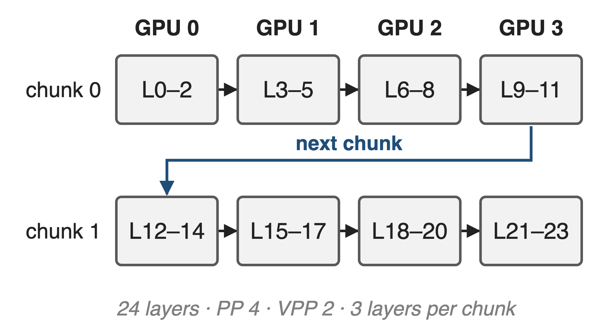
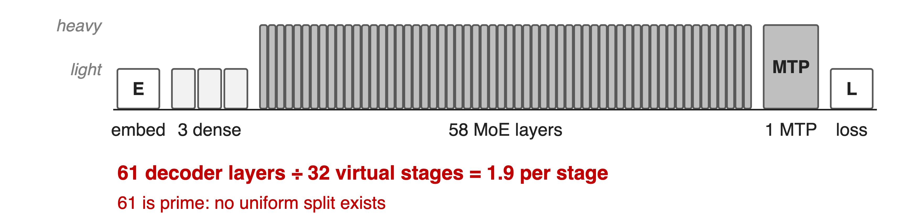
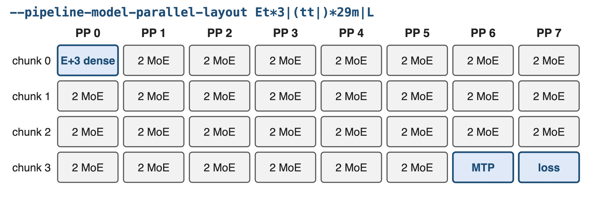
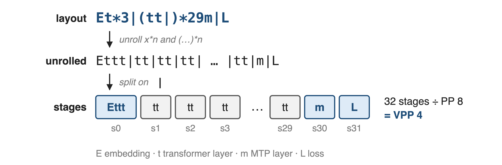
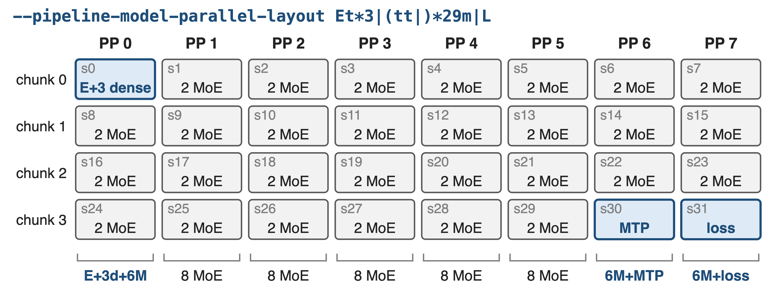
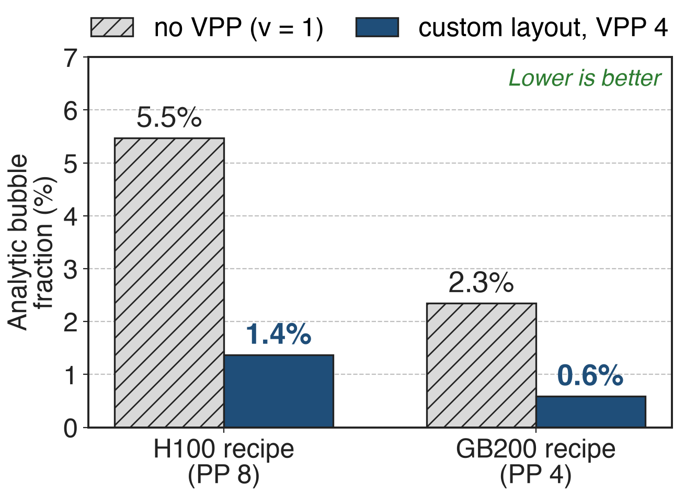

# Interleaving shrinks the pipeline bubble v-fold
{right 55%}
- Each GPU holds **v** chunks of layers
- Bubble ≈ (p − 1) / (v · m)
- Worth up to **10%** throughput (PTD-P, GPT-3 175B)
<!-- notes: Virtual pipeline parallelism, the interleaved 1F1B schedule, gives each GPU several non-contiguous chunks of layers. With p stages, m micro-batches and v chunks per GPU, the idle fraction drops from (p−1)/m to (p−1)/(v·m), at the price of v times more point-to-point traffic. PTD-P reports up to 10% higher throughput from interleaving on GPT-3 175B. Sources: arXiv 2104.04473 §2.2.2 and abstract; example layout from arXiv 2603.07685 §7.5. -->

# DeepSeek-V3 has 61 decoder layers: a prime
%% big: 61
%% sub: decoder layers, plus embedding, 1 MTP layer and loss: no uniform split over PP × VPP stages exists
%% source: Megatron-Core MoE report, arXiv 2603.07685, §7.5 and Table 10 (61 decoders + 1 MTP)
<!-- notes: Uniform VPP gives every virtual stage the same number of layers, so the layer count must be divisible by PP times VPP. 61 is prime. And the stack is not uniform anyway: three dense layers, 58 MoE layers, an embedding, a multi-token-prediction layer and the loss. Source: arXiv 2603.07685 §7.5; DeepSeek-V3 report §4.2 for the 3 dense layers. -->

# Uniform VPP splits by count, not by cost
{full}
> Light layers sit at both ends, heavy MoE in the middle, the heavy MTP at the tail
<!-- notes: This is the DeepSeek-V3 stack in pipeline order. The embedding, the three dense layers and the loss are light; each MoE layer and the MTP layer are heavy (cost classes as in the Megatron-Core report's Fig. 41). A rule that only counts layers cannot even divide 61 by 32 virtual stages, and if it could, the first and last stages would carry very different work. Sources: arXiv 2603.07685 §7.5, Fig. 41; heights are qualitative. -->

# Old knobs only nudge the edge stages
%% layout: two-col
- **Uniform VPP**
- `--num-layers-per-virtual-pipeline-stage`
- !!Needs layers divisible by PP · VPP!!
|||
- **Uneven-edge flags**
- First/last stage layer counts only
- Embedding or loss = !!one whole layer!!
> Needed: control over every stage's contents, not just its size
<!-- notes: Megatron's earlier options either demand an exact division (num-layers-per-virtual-pipeline-stage, with the layer count optionally bumped by one for embedding and one for loss) or let you change only the first and last pipeline stages (decoder-first/last-pipeline-num-layers). The account-for-embedding and account-for-loss flags treat those as one standard transformer layer, which is a coarse cost model. All of them are mutually exclusive with the new layout flag. Sources: transformer_config.py docstrings; arguments.py divisibility asserts. -->

# Insight: a pipeline is just a list of stages
- Each virtual stage holds some layers, in order
- Nothing requires equal counts
--
> Let the user write the list: group light layers, isolate heavy ones, any total works
<!-- notes: Interleaved scheduling does not care how many layers a chunk holds; it only needs the chunks in order. So instead of deriving the split from a count, Megatron-Core lets the user spell out every stage. Then a 61-layer model can use VPP, and the placement can follow cost: the report pairs the embedding with three dense layers, which it estimates cost about as much as two MoE layers, and gives MTP and loss their own stages. Source: arXiv 2603.07685 §7.5. -->

# One string places every layer on every chunk
{full}
%% caption: DeepSeek-V3 on 1,024 H100 (PP 8): embedding with 3 dense layers, MTP standalone, loss separated
<!-- notes: This is the layout Megatron-Core uses for DeepSeek-V3 on 1,024 H100s with PP8. One flag, --pipeline-model-parallel-layout, describes all 32 virtual stages. The first stage holds the embedding and the three dense layers, 29 stages hold two MoE layers each, the MTP layer gets a stage of its own and the loss gets the last stage. Source: arXiv 2603.07685 §9.2.2 and Table 17. The next three slides show how the string becomes this table. -->

# ❶ The string unrolls into one entry per stage
{full}
%% caption: Commas are cosmetic; empty stages are allowed; the stage count must be a multiple of PP
<!-- notes: The grammar has four layer letters: E embedding, t transformer layer, m MTP layer, L loss. A bar separates stages, x*n repeats a layer and (…)*n repeats a group. Megatron unrolls the repetitions, splits on bars and gets a flat list of stages. The number of stages divided by PP is the VPP size, so VPP is no longer a separate flag. Sources: docs pipeline_parallel_layout.md; PipelineParallelLayerLayout.parse_str_to_list; arguments.py. -->

# ❷ Stage s lands on rank s mod p
{full}
%% caption: Per-rank totals: d = dense layer, M = MoE layer (derived from the layout string)
<!-- notes: Stage i goes to virtual chunk i div PP on rank i mod PP: exactly the interleaved order of uniform VPP, so the schedule itself is unchanged. Reading down a column gives each GPU's load: rank 0 carries the embedding, three dense and six MoE layers; ranks 1 to 5 carry eight MoE layers; rank 6 swaps two MoE layers for the MTP layer, rank 7 swaps them for the loss. Source: PipelineParallelLayerLayout.__init__; totals derived from the string. -->

# ❸ Group light layers, isolate heavy ones
%% layout: two-col
- **Placement (by hand)**
- E + 3 dense: about 2 MoE
- MTP alone; loss alone
|||
- **Validator checks**
- E first, L last, once each
- MTP in its rank's last chunk
> The layout is checked against num_layers and mtp_num_layers before training starts
<!-- notes: The balance comes from the user: the Megatron-Core report groups the light embedding with three dense layers, roughly the cost of two MoE layers, and isolates the heavy MTP layer and the loss. The validator enforces structure: embedding first and loss last, exactly once; the number of t equals num_layers and the number of m equals mtp_num_layers; MTP comes after every decoder, sits in the last chunk of its rank, never on rank 0. An MTP stage on a rank other than the last is run as a standalone MTP stage. Sources: arXiv 2603.07685 §7.5; validate_layer_layout. -->

# VPP4 cuts the analytic bubble 4×: 5.5% → 1.4%
{right 60%}
- DeepSeek-V3 recipes: m = **128** micro-batches
- PTD-P model, balanced stages (analytic)
- Interleaving costs **v×** more P2P traffic
<!-- notes: Analytic, not measured: with the PTD-P formula and the recipes' settings (global batch 8192, micro-batch 1, data parallel 64, so 128 micro-batches per pipeline), the H100 recipe's bubble falls from 5.5% without interleaving to 1.4% with VPP 4; the GB200 recipe from 2.3% to 0.6%. The formula assumes balanced stages, which is what the custom layout is for. No source reports a measured with/without-layout comparison. Sources: arXiv 2104.04473 §2.2; arXiv 2603.07685 Table 17; derivation in notes/sources.md. -->

# Both DeepSeek-V3 recipes ship custom layouts
- 1,024 H100, PP 8: `Et*3|(tt|)*29m|L`: **368** TFLOPS/GPU
- 256 GB200, PP 4: `Et*4|(tttt|)*14tmL`: **1,048** TFLOPS/GPU
- VPP also unlocks 1F1B EP overlap when PP > 1 (deck 11)
<!-- notes: Both of Megatron-Core's best DeepSeek-V3 configurations use a custom layout with VPP 4: 32 stages on H100 and 16 on GB200, where the last stage holds one decoder, the MTP layer and the loss. The throughputs are for the full optimization stack, not the layout alone. VPP matters beyond the bubble: Megatron asserts a VPP size whenever EP all-to-all overlap runs with PP > 1, and the report finds the 1F1B overlap faster with larger VPP. Sources: arXiv 2603.07685 Table 17, §9.2.2, §4.2.3; transformer_config.py. -->

# The cost: balance by hand, v× more P2P
%% layout: two-col
- No cost model: you write the balance
- Larger VPP: more P2P traffic
- Flag marked experimental
|||
- MTP and encoder restrictions
- Excludes the other split flags
- FSDP + EP avoids PP design (deck 70)
<!-- notes: Nothing computes the per-layer costs for you; the report's own guidance is to balance VPP ranks and pick a middle VPP because larger VPP means more point-to-point communication. The docs mark the flag experimental. MTP must sit in a rank's last chunk and not on rank 0, encoder layers are unsupported, and the flag cannot be combined with the older split flags. If PP stage design is the pain, Megatron-FSDP with EP removes pipeline stages altogether. Sources: arXiv 2603.07685 §9.1.2 Guideline 3, §4.1.7; docs; validate_layer_layout; transformer_config.py. -->

# Summary
- Uniform VPP needs equal stages: DeepSeek-V3's **61** layers cannot split
- ==Insight==: a pipeline is a list of stages, so write the list
- One flag: `--pipeline-model-parallel-layout`; VPP = stages / PP
- H100 recipe: bubble **5.5% → 1.4%** (analytic); **368** TFLOPS/GPU stack
%% qr: https://arxiv.org/abs/2603.07685
<!-- notes: Asymmetric VPP turns pipeline partitioning into data: a string that lists every stage. It makes interleaving available for any layer count and lets cost, not count, decide placement. Related decks: 11 (1F1B EP overlap, needs VPP), 71 (parallel folding, same recipes), 70 (FSDP with EP). Sources: Megatron MoE README (the Notion reference, on the title slide); the QR points to arXiv 2603.07685, whose §7.5 and §9.2.2 describe the feature and the DeepSeek-V3 layouts. -->
