# Long sequences make attention dominate
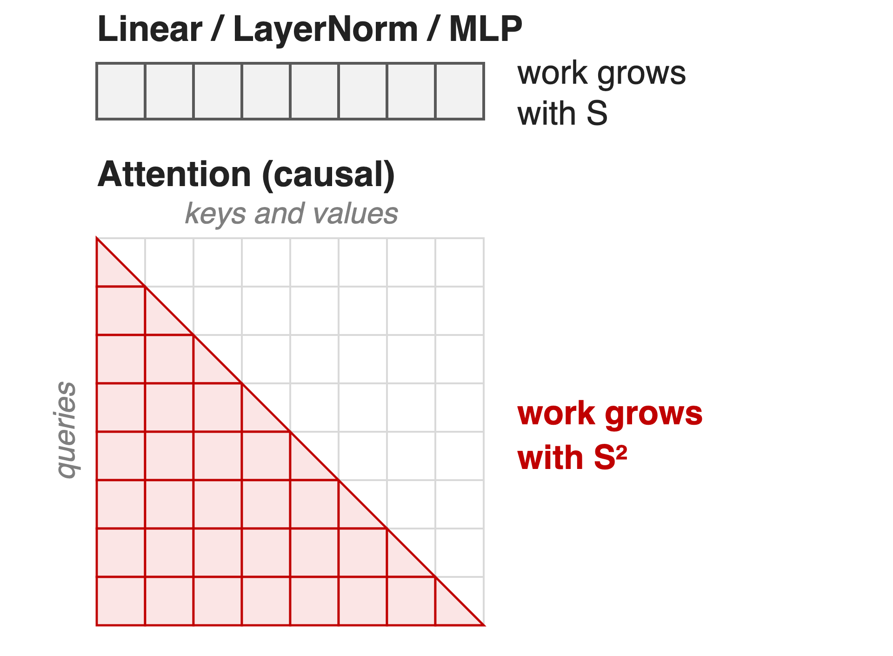{right 50%}
- Reasoning and RL runs: **16K–64K+** tokens
- At **64K**, attention is **69%** of FLOPs (10–15% when short)
- Activation memory grows ~linearly with sequence length S
<!-- notes: Reasoning models and RL-based training push sequences to 16K, 64K and beyond. Every activation a layer keeps for backward has a sequence dimension, so activation memory grows about linearly with S, while causal attention work grows with S squared. In the Megatron-Core MoE report's profile, scaled dot-product attention is 69% of FLOPs at 64K versus 10-15% for short sequences. Sources: arXiv 2603.07685 §6 and §6.1 (p.57); Megatron-LM context-parallel guide. -->

# Recomputing to fit long context costs ~30%
%% big: ~30%
%% sub: extra training time from full activation recomputation, the default way to avoid OOM on long sequences
%% source: Megatron-LM user guide, Context Parallelism, "Context Parallelism Benefits"
<!-- notes: When a long sequence does not fit, the standard fix is to drop activations in forward and recompute them in backward. The Megatron-LM context-parallel guide puts the overhead of full recomputation at about 30 percent. That is the cost this technique removes. Source: docs/user-guide/features/context_parallel.md. -->

# Both memory knobs slow training down
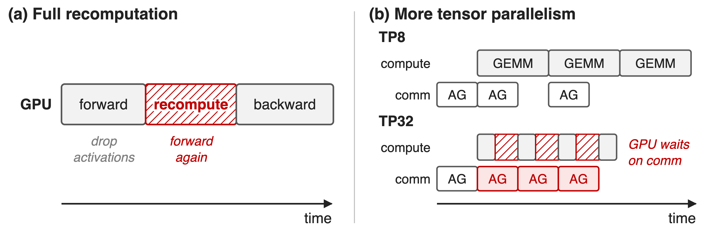{full}
%% caption: Schematic, not to scale. Megatron sequence parallelism splits only LayerNorm and Dropout activations
> More TP alone: 175B GPT at 32K drops to ≈0.85× of full recompute
<!-- notes: Option one, full recomputation, repeats the forward pass inside backward: about 30% more time. Option two, more tensor parallelism, also divides activation memory, but it slices every GEMM thinner while the per-layer TP collectives stay about the same size, so at some point the GPU waits on communication. In the guide's 175B GPT measurement at 32K, TP32 without CP runs at roughly 0.85x the speed of TP8 with full recomputation (value read from the guide's Fig. 2). Megatron's sequence parallelism does not help here: it only splits LayerNorm and Dropout activations and is tied to the TP degree. Sources: context_parallel.md text and Fig. 2. -->

# Insight: only attention mixes tokens
- Linear, LayerNorm, MLP: every token on its own
- Attention: each query needs earlier tokens' K and V
--
> Split the sequence: everything stays local except KV, and KV can move while attention computes
<!-- notes: Every module except attention has no inter-token operation, so if each GPU holds a slice of the sequence, those modules run unchanged on their slice. Attention is the only place a token needs data from other slices, and what it needs is K and V, not activations of every layer. Those KV blocks can be streamed between GPUs while the GPU computes attention on the block it already has. Source: context_parallel.md, "Context Parallel Overview". -->

# CP splits every activation along the sequence
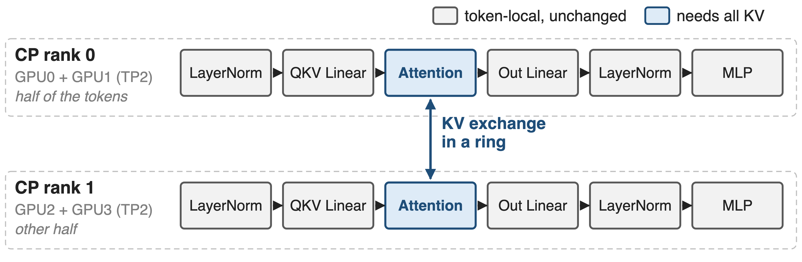{full}
%% caption: World size = TP × CP × PP × DP; --context-parallel-size N (MCore ≥ 0.5, TE ≥ 1.1). GPU0↔GPU2 and GPU1↔GPU3 swap KV
<!-- notes: This is the guide's TP2-CP2 example: four GPUs, each CP rank is a TP pair holding half of the tokens. LayerNorm, the linear layers and the MLP run on local tokens with no change; only attention exchanges K and V between a GPU and its counterpart in the other TP group. Activation memory per GPU drops by the CP degree, and so do compute and communication per GPU. Mechanisms: zigzag chunking, ring KV exchange, and topology-aware comm backends. Source: context_parallel.md Fig. 1 and "Enabling Context Parallelism". -->

# ❶ Zigzag chunks balance the causal triangle
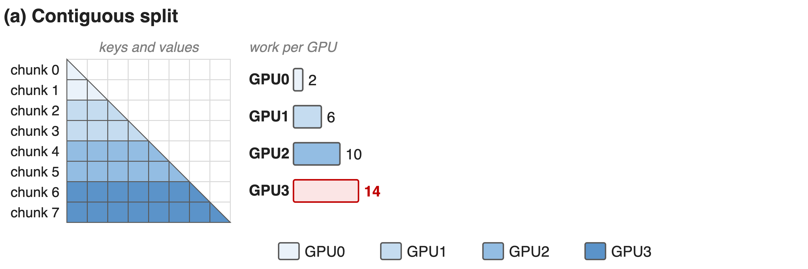{full}
%% caption: Work in chunk-block units (analytic). Sequence cut into 2 × CP chunks
--
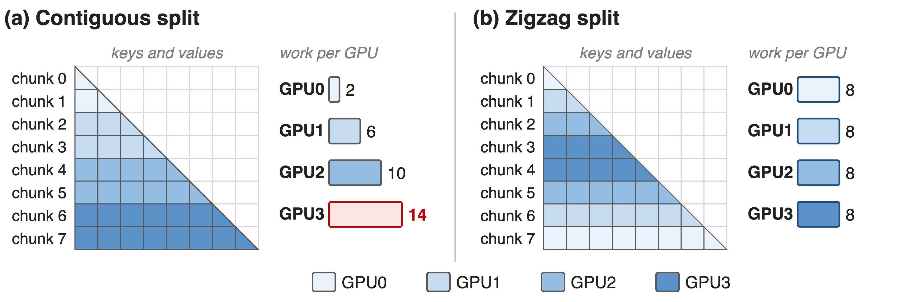{full}
%% caption: GPU r holds chunks r and 2CP−1−r, so every GPU does 8 units; sequence length must divide by 2 × CP
<!-- notes: With a causal mask, later queries attend to more keys. Cut the sequence into four contiguous pieces and the last GPU does 7 times the work of the first: 14 versus 2 block units, and everyone waits for it. Megatron instead cuts the sequence into 2 x CP chunks and gives GPU r chunks r and 2CP-1-r, one early and one late, so every GPU does exactly 8 units. The arithmetic is in notes/sources.md; the assignment is _get_batch_on_this_cp_rank_per_sequence_balancing in megatron/core/utils.py, and arguments.py asserts seq_length % (2*CP) == 0. -->

# ❷ KV circulates in a ring under attention
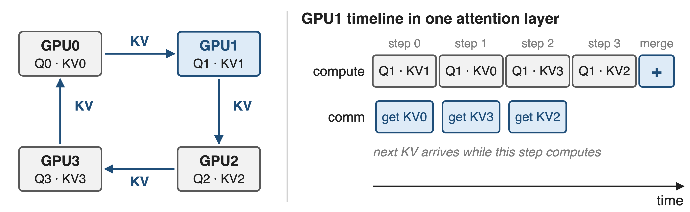{full}
> Backward sends KV around again and returns dKV; only local KV is stored, and GQA/MQA shrink the bytes
<!-- notes: Each GPU starts with its own Q and KV. In CP steps, the KV chunk moves one hop around the ring while the GPU computes attention of its Q against the KV it currently holds; partial outputs are merged with their softmax statistics at the end. With the zigzag layout every off-diagonal step is exactly half a block of work on every rank, so the ring stays in lockstep: Transformer Engine labels the steps diagonal, lower-triangle (all Q against the first half of KV) and upper-triangle (second half of Q against all KV). Backward re-circulates KV instead of storing it and reduce-scatters dKV the same way. Sources: context_parallel.md; TE AttnFuncWithCPAndKVP2P. -->

# ❸ Hierarchical CP matches comm to topology
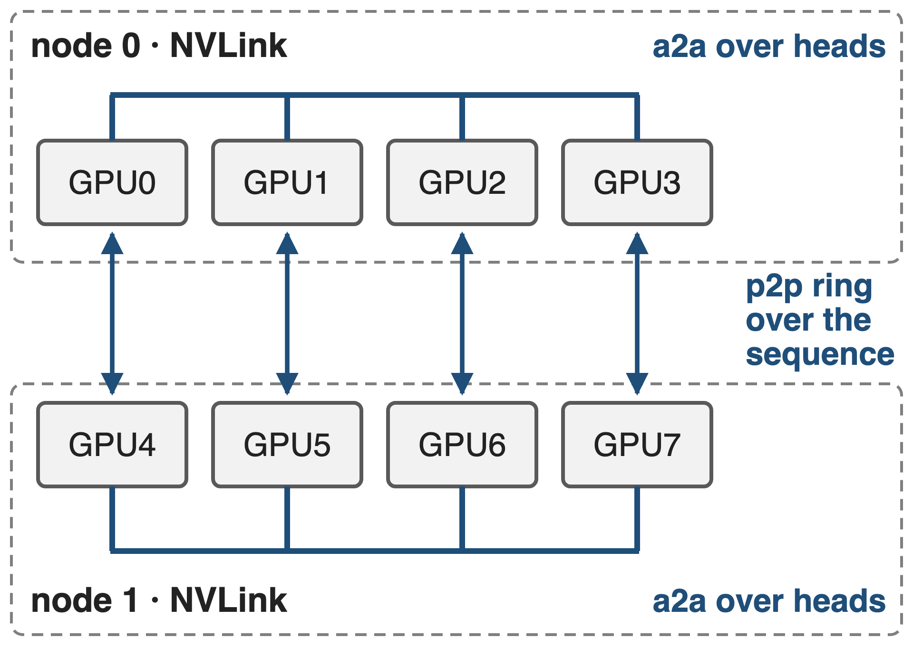{right 50%}
- `p2p` (default): ring, overlaps attention
- `a2a`: heads instead of tokens, like Ulysses
- `a2a+p2p`: a2a in NVLink, ring across nodes
<!-- notes: --cp-comm-type picks the backend, and it can differ per layer. p2p is the ring from the previous slide. all_gather gathers KV up front and exposes it (the Llama 3 approach). a2a converts sequence-sharded Q, K, V to head-sharded form before attention and back afterwards, like DeepSpeed Ulysses. a2a+p2p is hierarchical CP: heads split in the low-level group, sequence in the high-level group; it needs --hierarchical-context-parallel-sizes. The MCore report suggests a2a with TP inside a node and p2p across nodes as a starting point. Sources: arguments.py; TE context_parallel.py docstrings; arXiv 2603.07685 §6.3 p.58-59. -->

# At 32K, TP8 + CP4 runs ≈1.2× faster
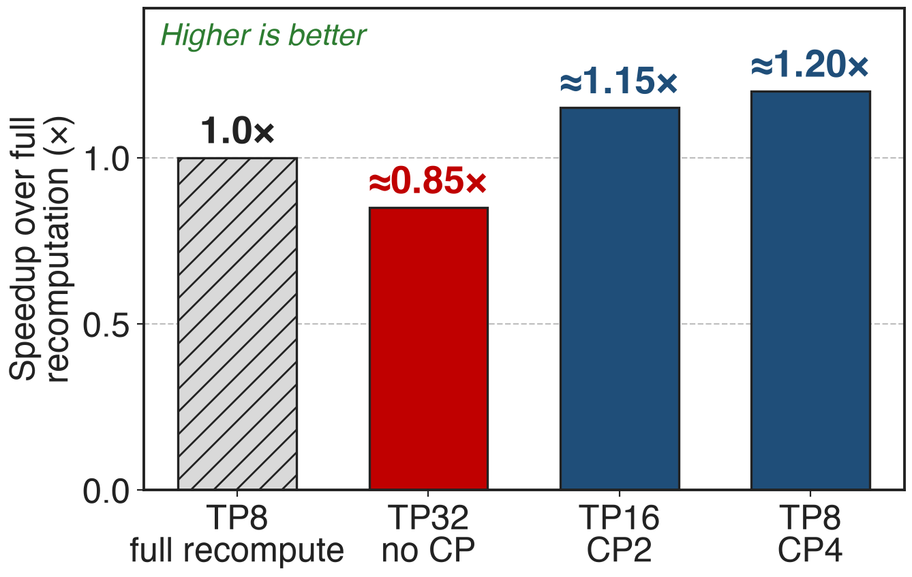{right 58%}
- 175B GPT, BF16, MHA
- FP8 + GQA: **≈1.3×** (TP8 CP4)
- At 16K: TP8 CP2 **≈1.25×**
<!-- notes: Against the TP8 full-recompute baseline, adding CP removes most of the recompute while keeping GEMMs large: TP16 CP2 reaches about 1.15x and TP8 CP4 about 1.2x at 32K, while TP32 without CP falls to about 0.85x. With FP8 and GQA, whose fewer KV heads mean fewer bytes per ring step, TP8 CP4 reaches about 1.3x. The guide prints no values, so these are read from its Fig. 2 (pixel-measured; see notes/sources.md). This answers the 30% pain in the same currency: speed relative to full recompute. -->

# Packed variable-length batches break static CP
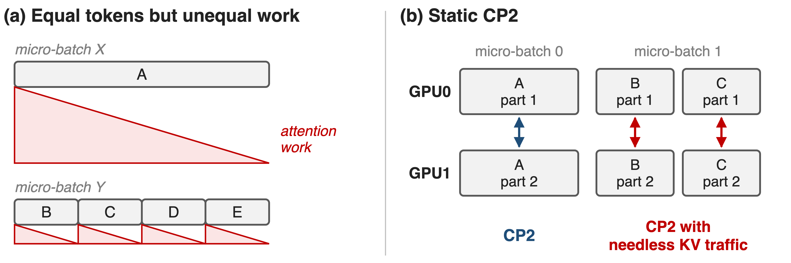{full}
> One CP size fits the longest sequence; short ones pay its KV traffic and DP ranks wait on the heaviest pack
<!-- notes: Post-training and multimodal data are packed: several sequences share a micro-batch in the THD layout. Equal token counts do not mean equal work: one 4K sequence costs about four times the attention of four 1K sequences (panel a). And because the CP size is fixed for the longest sequence, the short ones are split and exchange KV for no reason; with little compute per shard that traffic is exposed, especially across nodes. The report calls these DP imbalance and CP inefficiency. Sources: arXiv 2603.07685 §6.4.2 and Fig. 36-38; NVIDIA Dynamic-CP blog. -->

# ❹ Dynamic CP picks the CP size per micro-batch
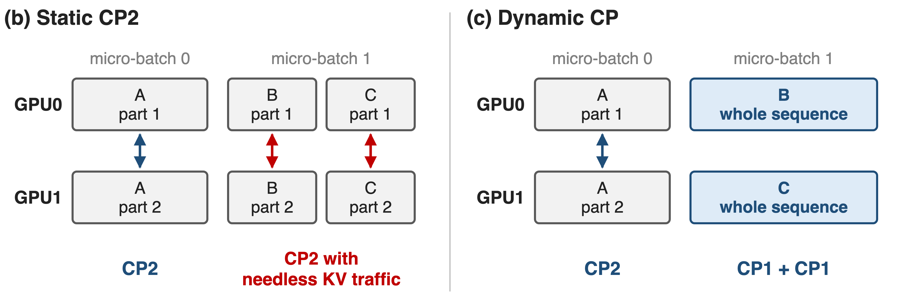{full}
> Resizing CP moves no weights or optimizer state: only token slices and the CP group change
<!-- notes: The key observation is that changing the CP size is cheap. It changes how tokens are sliced and which communicator attention uses; parameters and optimizer state stay where they are, unlike resizing TP or PP. So the long sequence A keeps CP2, while B and C each run whole on one GPU with CP1 and no KV exchange. On Megatron-LM main the feature is --hybrid-context-parallel with --max-seqlen-per-dp-cp-rank; the dev branch calls it --dynamic-context-parallel. Sources: arXiv 2603.07685 §6.4.2 p.60-62; PR #2054 and #2000. -->

# An async scheduler plans every micro-batch
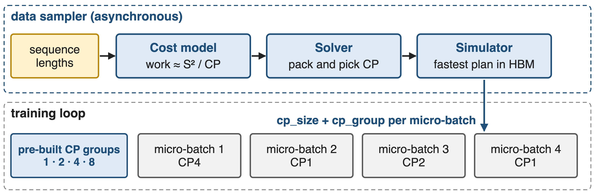{full}
%% caption: CP groups for every power of two up to DP × CP are built once at start-up; PackedSeqParams carries the choice
<!-- notes: A data-iterator wrapper collects the sequence lengths of the global batch. The cost model estimates each sample's work, in code roughly S squared over CP; the solver packs samples and assigns a CP size, the smallest power of two that keeps each shard under the per-rank length cap; the simulator picks the plan with the shortest pipeline time that fits memory. It runs asynchronously in the data sampler and only sweeps the micro-batch count from PP to a small multiple of PP. Sources: arXiv 2603.07685 p.62; Dynamic-CP blog; megatron/core/pipeline_parallel/hybrid_cp_schedule.py. -->

# Dynamic CP lifts throughput up to 1.48×
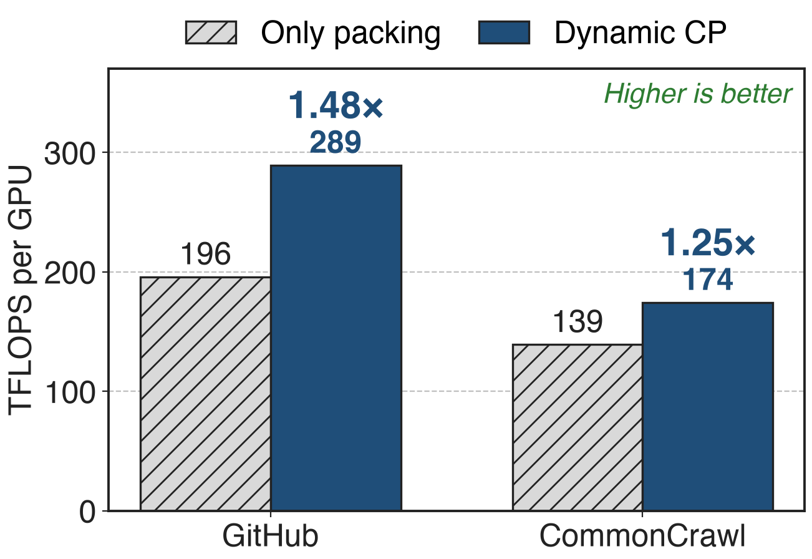{right 58%}
- Llama 13B, GBS 2048, PP8, CP8
- **> 35%** end to end at multi-thousand-GPU scale
- **35–60%** on highly imbalanced data
<!-- notes: On Llama 13B with global batch 2048, PP 8 and CP 8, Dynamic CP raises throughput from 195.88 to 289.32 TFLOPS per GPU on the GitHub dataset and from 139.17 to 174.39 on CommonCrawl, 1.48x and 1.25x. NVIDIA reports more than 35% end-to-end in a multi-thousand-GPU industrial setting, and the MCore report gives 35-60% for highly imbalanced data such as multimodal training. Sources: NVIDIA Dynamic-CP blog, Table 1 and text; arXiv 2603.07685 §6.4.2 p.62-63. -->

# The cost: comm must hide under attention
%% layout: two-col
- **Static CP**
- !!Exposed ring!! when shards are short or span nodes
- Weights not sharded: pair with TP or a sharded optimizer
|||
- **Dynamic CP**
- Power-of-2 groups, !!no CUDA Graphs!!
- FlashAttention preferred; no MLA yet; no FSDP + PP
<!-- notes: CP pays off only while each ring step has enough attention compute to hide the KV transfer, which is why short shards and inter-node rings expose it. CP divides activations but not weights; optimizer states shrink only with the distributed optimizer (MoE README memory table). Dynamic CP today: group sizes are powers of two, CUDA Graphs are not supported, and cuDNN fused attention recompiles on every new shape, so FlashAttention is preferred; MLA asserts it off, FSDP plus PP is not supported, and main-branch hybrid CP needs per-token loss and no PP. Sources: PR #2304 and #2000; multi_latent_attention.py; arguments.py. Linear-attention CP (KDA): deck 69. -->

# Summary
- Full recomputation for long context costs **~30%**
- ==Insight==: only attention mixes tokens; split the sequence, stream KV in a ring
- Zigzag chunks, ring overlap, hierarchical a2a+p2p: **≈1.2–1.3×** over recompute
- Dynamic CP per micro-batch: **1.48×** on packed data
%% qr: https://github.com/NVIDIA/Megatron-LM
<!-- notes: Context parallelism turns the one token-mixing operator into a ring exchange that hides under its own compute, and Dynamic CP makes the CP size a per-micro-batch decision for packed, variable-length data. Related decks: 69 (KDA context parallelism for linear attention), 71 (MoE parallel folding, which folds CP and EP onto the same GPUs), 51 (sequence packing), 52 (selective recomputation). Sources: Megatron-LM context_parallel.md; arXiv 2603.07685 §6; NVIDIA Dynamic-CP blog. -->
