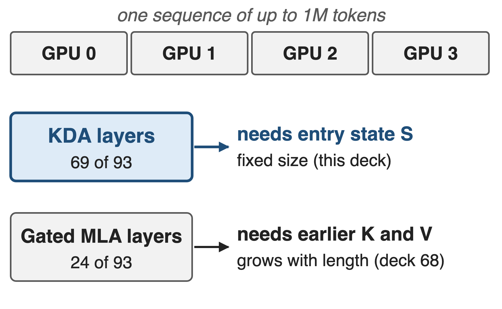
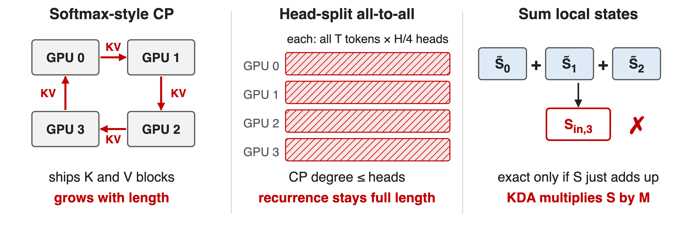
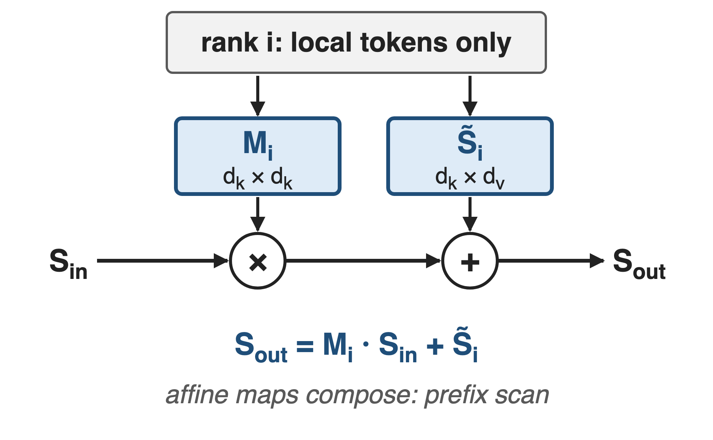
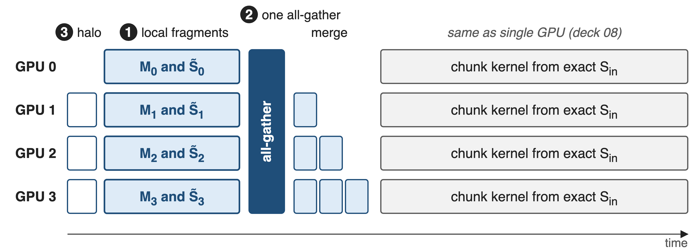
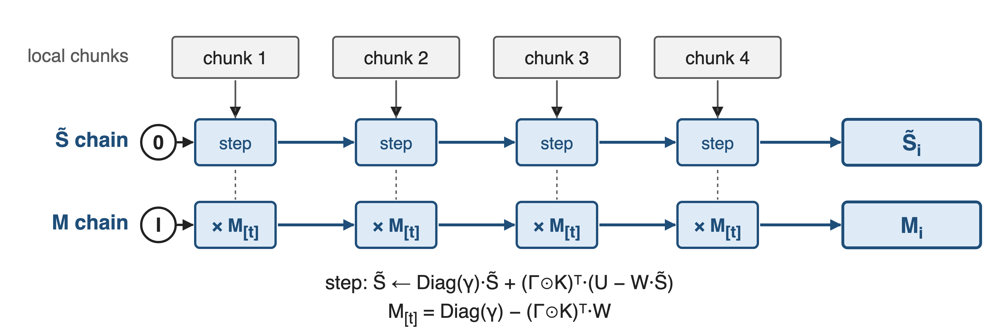
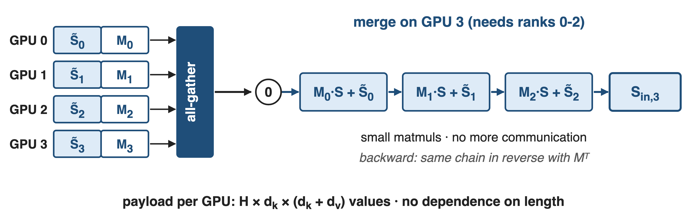
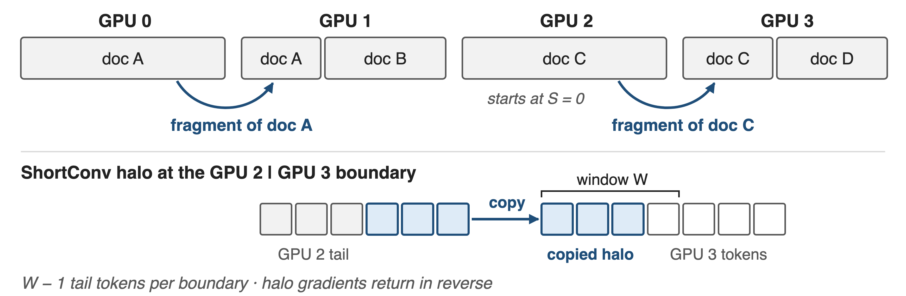
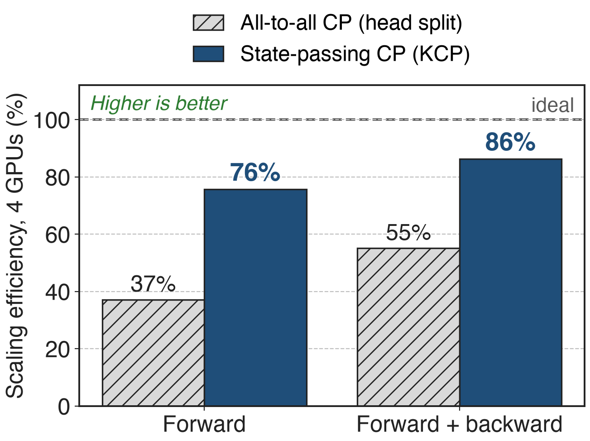
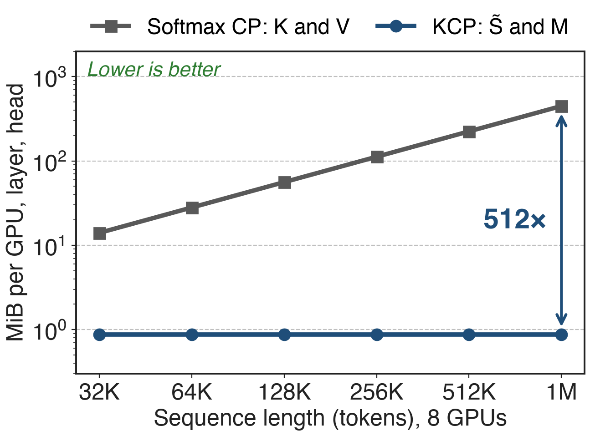
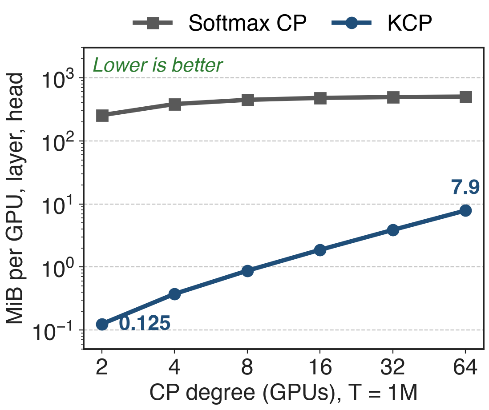

# K3 splits million-token sequences across GPUs
{right 50%}
- Context grows 8K → 1M during training
- Pre-training combines PP, EP, ZeRO and CP
- A KDA layer on GPU i needs only its entry state
<!-- notes: Kimi K3 trains with a context that grows from 8K to 1M tokens, and its pre-training stack combines pipeline, expert, ZeRO data and context parallelism. Context parallelism splits one sequence along its length, so the KDA layer on GPU i must somehow learn the state that the earlier GPUs' tokens produce. The Gated MLA layers have the usual softmax-attention problem, covered in deck 68. KDA math is in deck 05, its kernel in deck 08. Sources: K3 Sec. 3.4, 5.2, Table 1. -->

# Head-split CP gets 55% out of four GPUs
%% big: 55%
%% sub: scaling efficiency of head-split (all-to-all) context parallelism for KDA forward + backward on 4 GPUs; 37% for the forward pass alone
%% source: flash-linear-attention PR #691: 32K tokens, CP = 4, 64 heads, head dim 128, H800; efficiency = 1-GPU time / (4 × CP time)
<!-- notes: The obvious way to parallelize a linear-attention layer over the sequence is to all-to-all from a sequence split to a head split, the Ulysses pattern. Measured on KDA in the flash-linear-attention PR that implements KCP, that baseline reaches only 55 percent scaling efficiency on four H800s for forward plus backward at 32K tokens, and 37 percent for the forward pass: 36.19 ms on one GPU versus 16.42 ms on four. Each GPU still runs the full-length serial recurrence, just for fewer heads. Source: FLA PR #691 description. -->

# Three ways to split a sequence fall short
{full}
> KDA's update: new S = M · old S + β·k·vᵀ, with M = (I − β·k·kᵀ)·Diag(α) per token
<!-- notes: Softmax-attention CP, ring or all-gather, must ship key and value blocks whose size grows with the sequence. Head-split all-to-all caps the CP degree at the number of heads and does not shorten the recurrence. Linear-attention methods like LASP compute each rank's state from zero and sum the earlier ranks' states; that is exact only when the state just adds up. KDA's delta rule first multiplies the incoming state by a token-dependent matrix M_t, so a segment's effect depends on what enters it and summation is wrong. Sources: K3 Sec. 5.1.2 (refs LASP, LASP-2, Ring Attention); Megatron CP doc; PR #691. -->

# Insight: a segment is an affine map of S
{right 50%}
- M and the zero-start state need only local tokens
- Affine maps compose: a prefix scan
> Exchange two fixed-size fragments, never tokens or KV
<!-- notes: Unroll the recurrence over one rank's segment. Whatever state S_in enters, the state leaving is M_i times S_in plus S-tilde_i, where M_i is the product of all the per-token transitions and S-tilde_i is the state the segment would produce starting from zero. Both depend only on local tokens, so they can be computed before the entry state is known. Affine maps compose associatively, so the entry state of every rank is a prefix scan over these fragments. Source: K3 Sec. 5.1.2, Eq. 17. -->

# KCP: local fragments, one all-gather, local merge
{full}
%% caption: ❶ local fragments · ❷ one all-gather + in-order merge · ❸ documents and convolution halo (schematic widths)
<!-- notes: Per KDA layer, every GPU first receives the short-convolution halo from its predecessor, then builds its fragments M and S-tilde in parallel. One all-gather gives every GPU all fragments. GPU i then merges the fragments of the GPUs before it, a few small matmuls, which yields its exact entry state; from there it runs the ordinary chunkwise kernel of deck 08. The backward pass mirrors this in the opposite direction. Sources: K3 Sec. 5.1.2; FLA fla/ops/cp README. -->

# ❶ Each rank builds both fragments on its own
{full}
> For any entry state S: exit state = M·S + zero-start state (K3 Eq. 17)
<!-- notes: Concretely, a rank walks its local chunks twice in one pre-pass. S-tilde starts at zero and takes the ordinary chunk step: decay by Diag(gamma), then add the keys times U minus W S-tilde. M starts at the identity and is multiplied by each chunk's transition, Diag(gamma) minus the gated keys transposed times W. Here U and W are the per-chunk WY quantities from deck 05. No communication is needed for either. Source: FLA fla/ops/cp README, Pre-Process Forward; K3 Eq. 17. -->

# ❷ One all-gather, then a local in-order merge
{full}
> 96 heads × head dim 128 in FP32: 12 MiB per GPU per layer, at any length
<!-- notes: Each GPU contributes one tensor per layer: for every head, S-tilde, d_k by d_v, and M, d_k by d_k, which FLA keeps in FP32. One all-gather distributes them. GPU i starts from zero and applies S becomes M_j S plus S-tilde_j for each earlier fragment of the same document, in order. The backward pass runs the same chain from later ranks with transposed M. For a K3-sized layer, assuming 96 heads of dimension 128 (K3 has 96 attention heads; FlashKDA only supports 128), that is 96 times 128 times 256 values times 4 bytes, 12 MiB per GPU, derived. Sources: K3 Sec. 5.1.2; FLA README and chunk_delta_h.py; PR #691. -->

# ❸ Packed documents and convolution halos
{full}
> Merges never cross documents; only a rank's first sequence can continue
<!-- notes: Training batches pack many documents. A merge only chains fragments of the same document, so a document that starts on a GPU begins from zero, and only the first sequence on each GPU can continue from an earlier one; FLA exploits this to store a single initial state. KDA's short convolution before q, k and v also crosses the boundary: each GPU needs the last W minus 1 tokens of its predecessor, and their gradients go back in reverse. The FP32 M chain avoids error growth over many chunks. Sources: FLA fla/ops/cp README; PR #691 conv1d section. -->

# KCP keeps 86% efficiency on 4 GPUs
{right 55%}
- 32K tokens, 64 heads, H800 (FLA code)
- Fwd + bwd: 36.2 ms on 1 GPU → **10.5 ms** on 4
- **1.56×** faster than head-split CP
<!-- notes: Same currency as the pain. In the FLA PR benchmark, KDA forward plus backward drops from 36.19 ms on one H800 to 10.49 ms on four with state-passing CP, 86 percent scaling efficiency, against 16.42 ms and 55 percent for the head-split all-to-all baseline; that is 1.56 times faster, derived. Forward alone: 2.59 versus 5.28 ms, 76 versus 37 percent. This is FLA's independent open implementation, not Moonshot's internal KCP, and K3 itself publishes no KCP timings. Source: FLA PR #691; FLA cp README acknowledgments. -->

# Analytic: 512× less traffic than KV at 1M
{right 55%}
- Softmax CP gathers K and V: grows with length
- KCP gathers two fragments: fixed size
- 1M tokens, 8 GPUs: 448 vs 0.875 MiB per head
%% caption: analytic; head dim 128, BF16 K and V (MHA-equivalent) vs FP32 fragments
<!-- notes: Why it scales: a softmax-CP GPU must receive the keys and values of all other GPUs' tokens, 7/8 of the sequence times 2 times 128 values in BF16 per head, which grows linearly with length. KCP's payload is d_k times d_k plus d_v per head per GPU, independent of length. With 8 GPUs at 1M tokens that is 448 MiB versus 0.875 MiB per head and layer, a ratio of T over 256P, 512 times. MLA or GQA would shrink the KV side by a constant factor, but it still grows with length. Analytic, derived from the payload formulas in PR #691 and the Megatron CP doc. -->

# Costs: grows with GPU count, MLA still ships KV
{right 45%}
- Payload and merge grow with CP degree
- Extra pre-pass kernels; FP32 chain
- 24 MLA layers still need KV-exchanging CP
%% caption: analytic, T = 1M, head dim 128
> Public timings come from FLA's independent code (32K, 4 GPUs); K3 reports none
<!-- notes: KCP is not free. The all-gather payload grows with the number of CP ranks and the merge is serial over earlier ranks, so very large CP degrees add latency; the PR author notes this, and calls the outputs and gradients 'lossy' compared with the all-to-all path; FLA keeps the M chain in FP32 to limit error growth. It adds three pre-process operators per layer plus the convolution halo, and it does not support passing an initial or final state in CP mode. The hybrid's 24 Gated MLA layers still need a softmax CP scheme (deck 68). The chart is analytic: at 1M tokens the KCP payload grows from 0.125 MiB per head at 2 GPUs to 7.9 MiB at 64, still far below the 256 to 504 MiB of a KV all-gather. Sources: PR #691 Drawbacks; FLA cp README; K3 Table 1. -->

# Summary
- Head-split CP for KDA: **55%** efficiency on 4 GPUs
- ==KCP==: exit = M·entry + zero-start state; gather, merge locally
- **86%** efficiency (fwd + bwd); traffic independent of length
- Chain: KDA deck 05 · FlashKDA deck 08 · softmax CP deck 68
%% qr: https://arxiv.org/abs/2607.24653
<!-- notes: Splitting KDA by heads wastes almost half of four GPUs because every GPU still runs the full-length recurrence. KCP observes that a segment acts on its entry state as an affine map, computes the map's two fixed-size pieces locally, exchanges them in one all-gather and merges them in order. The open FLA implementation reaches 86 percent efficiency on four GPUs, and the traffic does not grow with sequence length, which is what lets K3 train KDA layers at a million tokens. Sources: FLA PR #691; K3 Sec. 5.1.2. -->
