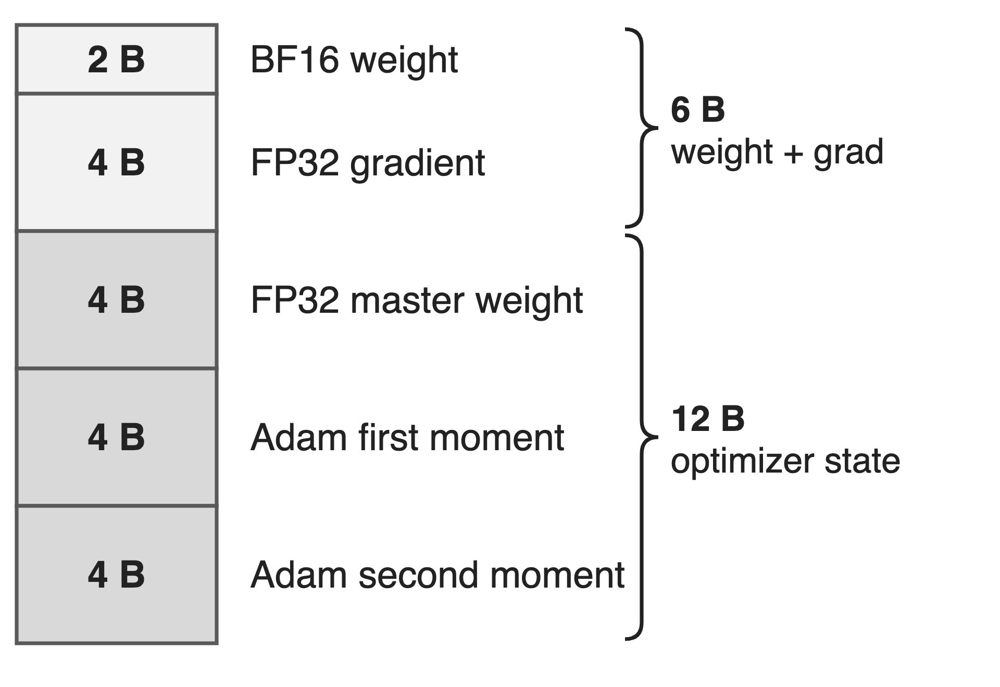
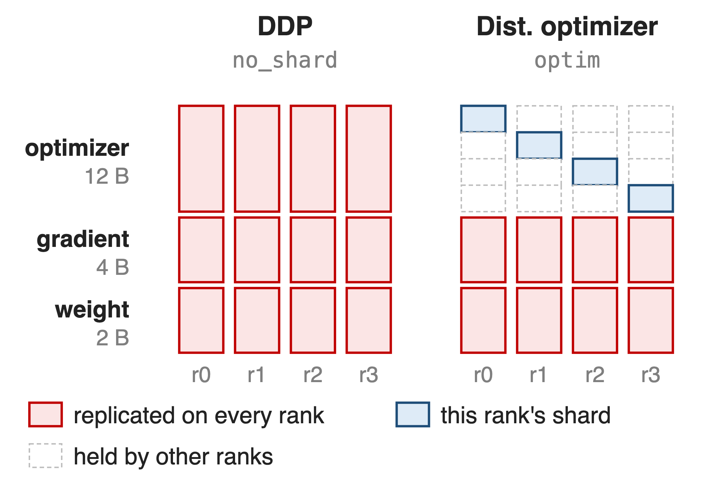
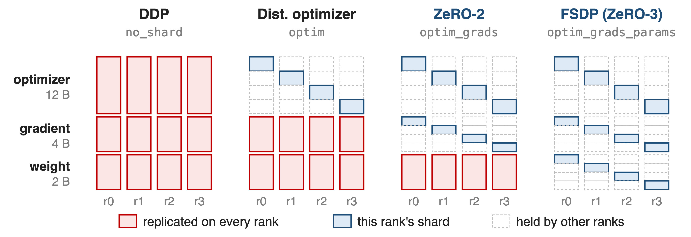
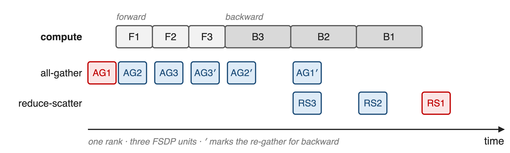
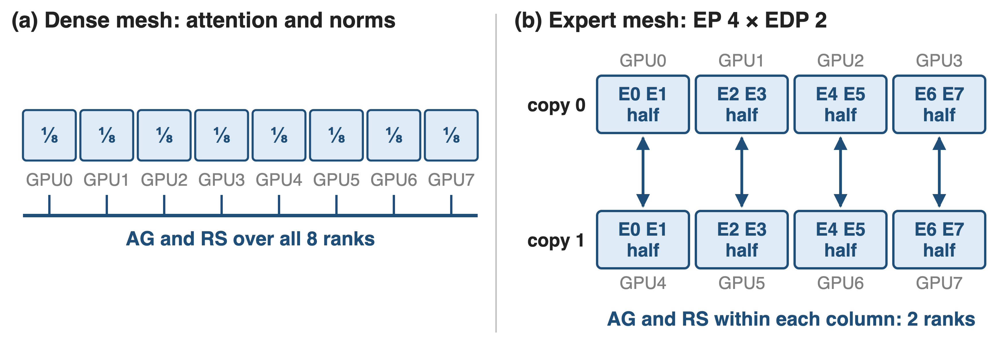
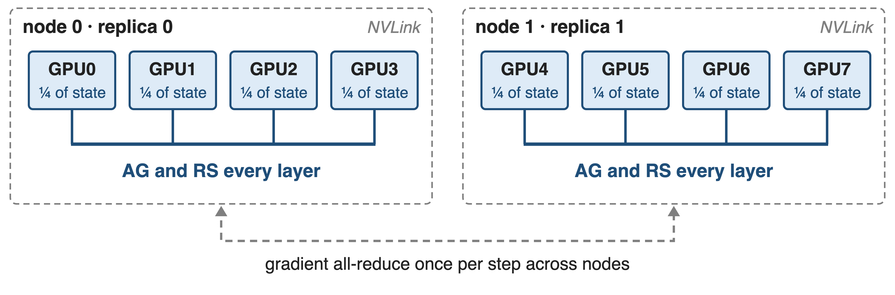
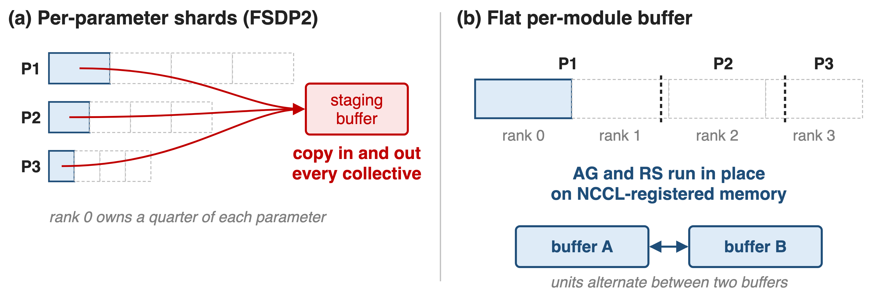
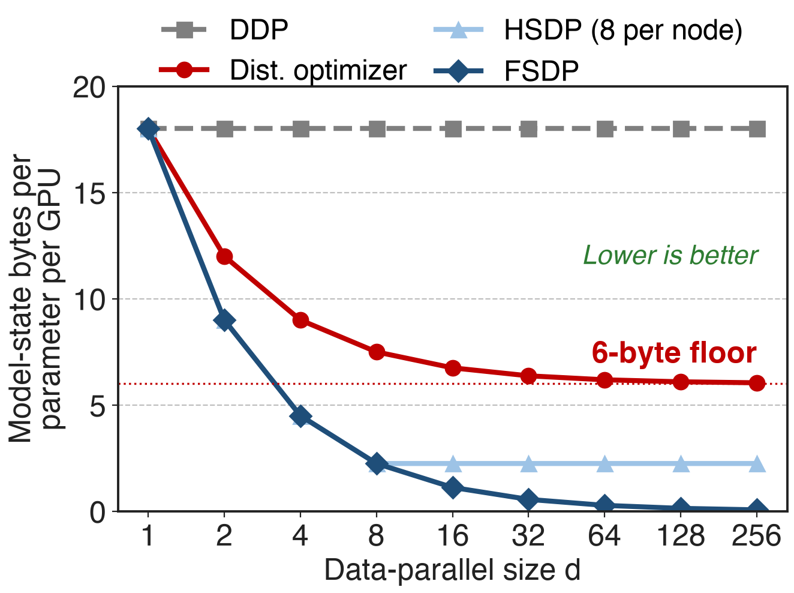
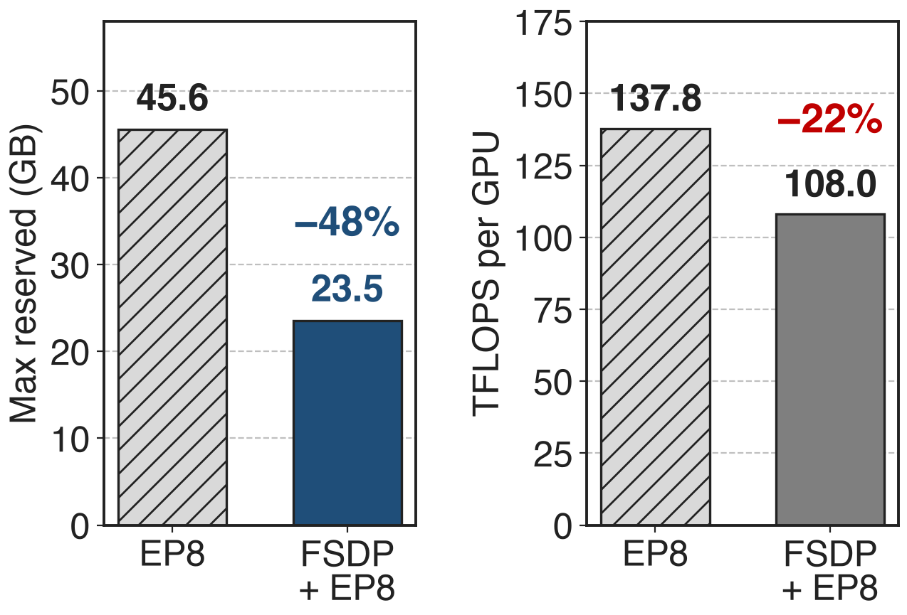

# Giant MoEs keep every expert's state resident
{right 50%}
- DeepSeek-V3: **685B** params, **37B** active (**18×** gap)
- Every parameter carries **18 B** of state
- Plain data parallelism copies all of it to every rank
<!-- notes: A fine-grained MoE activates a small slice of its parameters per token, but all of them must be stored and trained: DeepSeek-V3 has 685B parameters and 37B active, an 18x gap. With BF16 weights, FP32 main gradients and FP32 Adam, each parameter costs 18 bytes: 2 for the weight, 4 for the gradient, 12 for the master copy and the two moments. Plain DDP replicates all 18 bytes on every data-parallel rank. Sources: arXiv 2603.07685 §4.1.1 p.20; Megatron-LM dist_optimizer.md; ZeRO §3.1 (K = 12). -->

# Model state alone nearly fills an H100
%% big: 68.5 GB
%% sub: weights, gradients and optimizer state per GPU: DeepSeek-V3, BF16, 256 GPUs; activations add 131 GB; an H100 has 80 GB
%% source: arXiv 2603.07685, Table 3 (PP4 × VPP4 × EP64): 36.4 GB + 32.1 GB
<!-- notes: The MCore report's memory breakdown for DeepSeek-V3 on 256 GPUs with PP4, VPP4 and EP64 totals 199.5 GB per GPU. Activations are the largest part at 131 GB, but weights and gradients (36.4 GB) plus main weights and optimizer states (32.1 GB) already take 68.5 GB, almost a whole 80 GB H100. Every byte of model state that sharding removes becomes room for activations or a cheaper parallel layout. Source: arXiv 2603.07685 §4.1.1, Table 3, p.20; 68.5 is the sum. -->

# The distributed optimizer stops at 6 bytes
{right 52%}
- ZeRO-1 shards only the 12 B of FP32 state
- Weight + grad stay: **6 + 12/d** B
- !!More PP / EP / TP!!: bubbles, stage balancing, cross-node all-to-all
<!-- notes: Megatron's distributed optimizer shards the 12 bytes of FP32 master weights and Adam moments across the d data-parallel ranks, but every rank still holds the full BF16 weights and FP32 gradients: 6 + 12/d bytes per parameter, so no DP size gets below 6. The other way to save memory is model parallelism: DeepSeek-V3 used PP4 x VPP4 x EP64 on 256 GPUs. That brings pipeline bubbles, stage balancing around the MTP and output layers, and EP all-to-alls that may leave the NVLink domain, where bandwidth is 5-10x lower. Sources: dist_optimizer.md table; arXiv 2603.07685 §3.2.3 p.16 and §4.1.7 p.27. -->

# Insight: a rank needs each layer only briefly
- DP replicas hold identical model state
- Each rank computes one layer at a time
--
> Keep 1/d of everything; gather the next layer while this one computes. DP size becomes the memory knob
<!-- notes: Data-parallel ranks all hold the same weights, and each uses a given layer's weights only while it runs that layer. So every rank can keep a 1/d slice of weights, gradients and optimizer state, all-gather a layer right before it is needed and drop it right after, and reduce-scatter that layer's gradients. This is ZeRO-3 / FSDP: DDP's all-reduce decomposed into a reduce-scatter, a sharded optimizer step and an all-gather. If the gathers hide under compute, memory per GPU falls with the DP size instead of requiring PP or larger TP. Sources: Megatron-LM megatron_fsdp.md "FSDP Fundamentals"; ZeRO §5. -->

# One flag picks how much state to shard
{full}
%% caption: --use-megatron-fsdp --data-parallel-sharding-strategy {no_shard, optim, optim_grads, optim_grads_params}; checkpoints use --ckpt-format fsdp_dtensor
<!-- notes: Megatron-FSDP is one implementation of the whole ladder. no_shard is DDP; optim is the distributed optimizer, ZeRO-1; optim_grads adds gradient sharding, ZeRO-2; optim_grads_params is full FSDP, ZeRO-3, where each rank keeps one quarter of everything in this four-rank picture. Megatron-FSDP uses Megatron's DistributedOptimizer underneath, works with TP, CP and EP, and is also on PyPI as a standalone fully_shard API. The next three slides cover how it hides the gathers, how it treats experts, and how it maps to nodes. Source: megatron_fsdp.md "Data-Parallel Sharding Strategies". -->

# ❶ Gather each layer just in time
{full}
> Two persistent buffers alternate between units, so at most two units are ever un-sharded
<!-- notes: Each transformer layer is an FSDP unit. Before a unit's forward and again before its backward, Megatron-FSDP all-gathers its weights on a separate stream while the previous unit computes; after the backward it reduce-scatters the unit's gradients while the next backward runs. Only the very first gather and the last reduce-scatter are exposed. Double buffering assigns even and odd units to two persistent buffers, which caps the un-sharded memory at two units and lets the buffers be registered with NCCL. Sources: megatron_fsdp.md "FSDP Unit Modules", "Double Buffering"; arXiv 2603.07685 §4.1.7 p.28-29. -->

# ❷ Experts shard over their own replicas
{full}
> Dual DeviceMesh: dense modules shard over DP, experts over EDP, so expert collectives stay small
<!-- notes: EP already splits the experts, so sharding them again over the full DP group would be wrong. Megatron-FSDP keeps two DeviceMeshes: the primary one (DP, DP-outer, TP, CP) for attention and norms, and an expert mesh where FSDP is scoped to the expert-data-parallel group. In this eight-GPU example with EP 4, each expert pair has two copies, and FSDP splits each pair in half across exactly those two GPUs. FSDP sharding is always applied last, on top of the TP and EP shards. Sources: arXiv 2603.07685 §4.1.7 "FSDP+EP: Dual DeviceMesh Design" p.27; megatron_fsdp.md "Mixing FSDP & Model Parallelism". -->

# ❸ HSDP keeps per-layer traffic inside NVLink
{full}
%% caption: --num-distributed-optimizer-instances 2 sets the outer size; --outer-dp-sharding-strategy no_shard (HSDP) or optim (HFSDP)
> HFSDP also shards optimizer state across nodes and syncs it once per step
<!-- notes: Per-layer all-gathers and reduce-scatters are frequent, so HSDP keeps them inside the fast domain: model state is fully sharded within a node and replicated across nodes, and the replicas only all-reduce gradients once per optimizer step. HFSDP goes one step further: optimizer state is sharded across all ranks, at the price of one outer reduce-scatter and all-gather per optimizer step; its memory is optimizer/(inner x outer) + (gradient + weight)/inner. The dual mesh keeps separate outer groups for expert and dense parameters. HSDP for MoE arrived in MCore v0.13. Sources: megatron_fsdp.md "Data-Parallel Sharding Strategies", "Understanding Hybrid-FSDP"; MoE README What's New; arXiv 2603.07685 §4.1.7 p.27-28. -->

# ❹ Flat buffers make collectives zero-copy
{full}
> ~10% less comm overhead on Llama3 405B; comm kernels drop from 8–32 to 1–4 SMs on NVLink
<!-- notes: PyTorch FSDP2 shards each parameter evenly, so every collective first copies a rank's pieces into a staging buffer and back. Megatron-FSDP flattens all parameters of a unit into one buffer and cuts that buffer into equal contiguous shards, uneven per parameter, so collectives run directly on it. The two persistent buffers are registered with NCCL, which enables copy-free, low-SM symmetric kernels and SHARP offload. The MCore report measures about 10% lower communication overhead on Llama3 405B and an SM footprint of 1-4 instead of 8-32 SMs on NVLink. Sources: arXiv 2603.07685 §4.1.7 "Zero-Copy Communication" p.28, Fig. 11-12; megatron_fsdp.md "NCCL". -->

# Full sharding removes the 6-byte floor
{right 58%}
%% caption: Analytic: BF16 weight, FP32 grad, FP32 Adam; excludes two transient units and activations
- At d = 64: **6.19 B** vs **0.28 B** per parameter
- HSDP at 8 per node: **2.25 B**
- Memory falls with every rank you add
<!-- notes: This is the arithmetic of the ladder. DDP stays at 18 bytes. The distributed optimizer follows 6 + 12/d and flattens at 6. FSDP follows 18/d, so at 64 ranks it is 0.28 bytes against 6.19, about 22x less. HSDP with an 8-GPU inner group stops at 18/8 = 2.25 bytes but never gathers across nodes. HFSDP sits in between: 6/n + 12/d. The 6 + 12/d formula is from dist_optimizer.md; the other curves apply the strategy definitions to the same 18-byte split (notes/sources.md). -->

# FSDP + EP halves memory on Qwen3-30B-A3B
{right 58%}
- 32 H800, user report (Megatron-LM #2772)
- **−48%** peak reserved memory
- **−22%** TFLOPS: worth it only when memory binds
<!-- notes: A public user report gives the clearest end-to-end measurement: Qwen3-30B-A3B on 32 H800, EP8 versus Megatron-FSDP plus EP8, after a Transformer Engine FusedAdam fix. Peak reserved memory falls from 45,552 MB to 23,548 MB, 48% less, while throughput drops from 137.8 to 108.0 TFLOPS, 22% less, because this model already fit. The freed memory pays off when it buys a better layout, a bigger micro-batch, or no PP. NVIDIA's own Megatron-Bridge card lists FSDP performance claims as doc-only, so treat this as one data point. Source: Megatron-LM issue #2772, comment of 2026-01-14. -->

# DeepSeek-V3 recipe drops pipeline parallelism
%% layout: two-col
- **N-D parallel (MCore tuned)**
- H100: TP2 · PP8 · EP64 · VPP4
- !!Stage balancing!!, MTP and output-layer placement
|||
- **Megatron-FSDP script**
- TP1 · EP8 · no PP · ZeRO-3
- Tune two knobs: EP size, sharding degree
<!-- notes: MCore's best DeepSeek-V3 configuration on 1,024 H100 uses TP2, PP8, EP64 and VPP4, and the report lists uneven stage balancing, MTP and output-layer placement and vision-encoder partitioning as PP pain points. The Megatron-FSDP example script for DeepSeek-V3 uses TP1, EP8, CP1, no PP and FSDP ZeRO-3, with HybridEP and selective recomputation, so configuration reduces to the EP size and the sharding degree. No public throughput comparison between the two exists yet. Sources: arXiv 2603.07685 Table 17 p.74 and §4.1.7 p.27; examples/megatron_fsdp/README.md. Parallel folding: deck 71. -->

# The cost: 1.5× traffic that must hide
%% layout: two-col
- ZeRO-3 moves **1.5×** plain DP's bytes
- Hiding it needs compute: !!bigger micro-batches!!
- !!Activations not sharded!!
|||
- fsdp_dtensor checkpoints; convert from torch_dist
- Double buffers cost memory, want uniform layers
- No Dynamic CP; Torch FSDP2 path experimental
<!-- notes: Plain data parallelism moves 2 Psi bytes per step (reduce-scatter plus all-gather); ZeRO-3 gathers weights again for backward, 3 Psi, 1.5x (ZeRO §7.2). Megatron-FSDP hides that only when each unit has enough compute, which often means a larger micro-batch and more activation memory, and FSDP does nothing for activations. Practical prerequisites: the fsdp_dtensor checkpoint format, with a converter from torch_dist; double buffers that need depth-wise symmetric units (a MaxPool allocator handles hybrid models); CUDA_DEVICE_MAX_CONNECTIONS unset, which may slow TP and CP; hybrid (dynamic) CP refuses Megatron-FSDP; Bridge marks Torch FSDP2 experimental. Related: deck 49 (precision-aware optimizer), deck 54 (optimizer offload), deck 28 (VeOmni). -->

# Summary
- DeepSeek-V3: **68.5 GB/GPU** of model state; the distributed optimizer floors at **6 B** per parameter
- ==Insight==: a rank needs each layer only briefly, so shard it and gather just in time
- Dual mesh for experts, HSDP inside NVLink, zero-copy buffers
- **18/d** bytes per parameter; **−48%** memory on Qwen3-30B-A3B
%% qr: https://github.com/NVIDIA/Megatron-LM
<!-- notes: Megatron-FSDP turns data parallelism into a memory lever for MoE: weights, gradients and optimizer state all shrink with the number of ranks, experts are sharded within their own replica group, and HSDP keeps the frequent collectives inside a node. The price is 1.5x data-parallel traffic that must be hidden behind compute. Sources: arXiv 2603.07685 §4.1.7 and Table 3; Megatron-LM megatron_fsdp.md and dist_optimizer.md; issue #2772. -->
