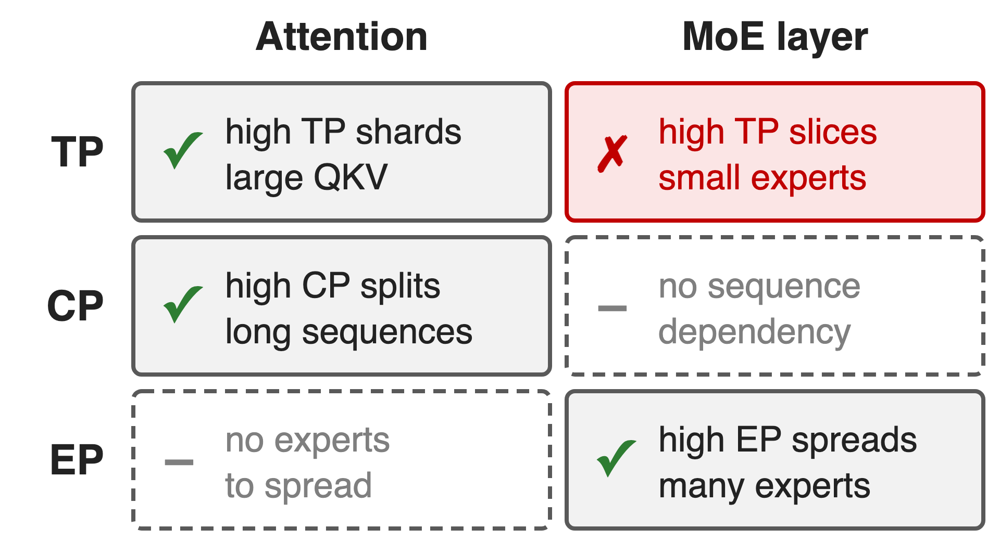
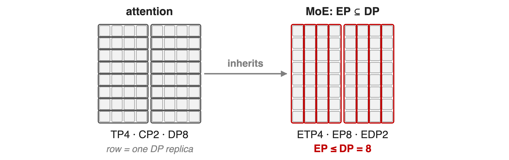
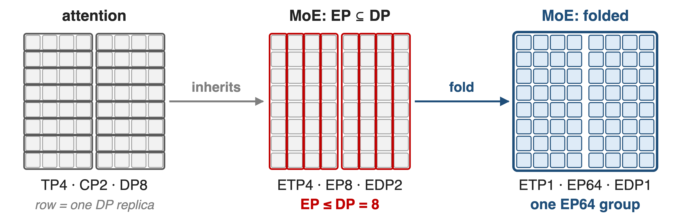
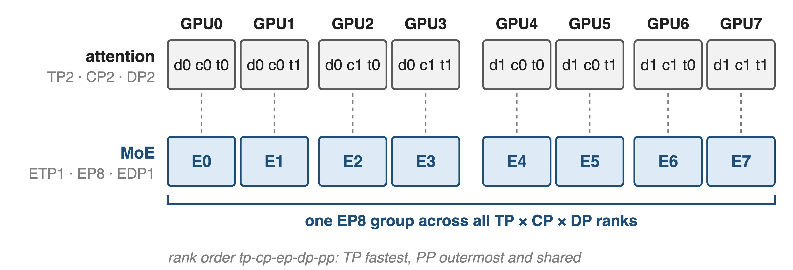
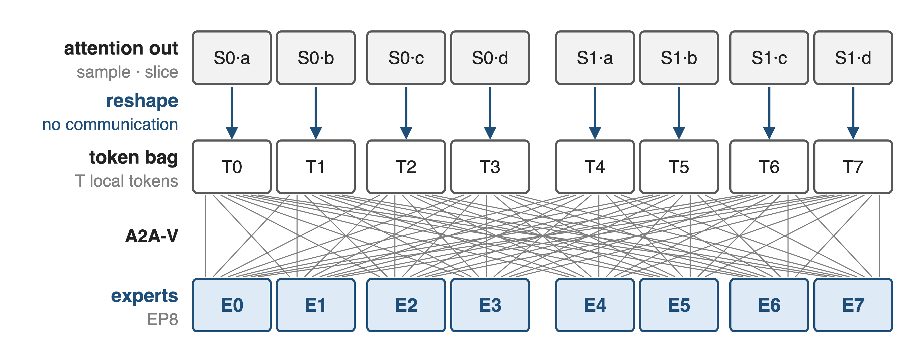
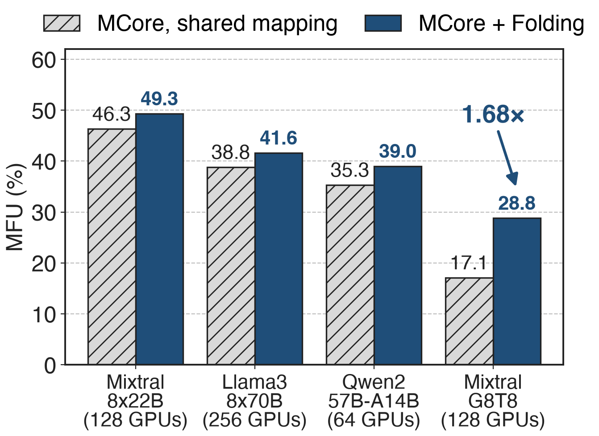
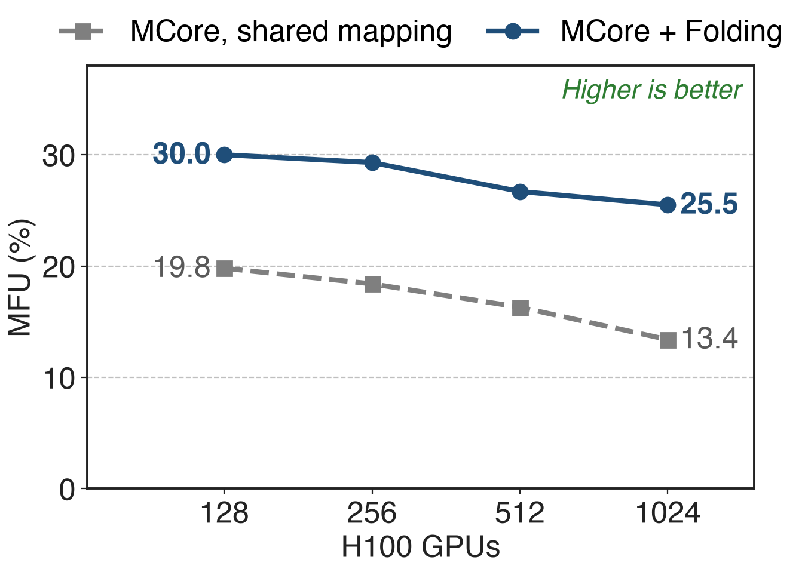

# Attention and experts want opposite parallelism
{right 55%}
- DeepSeek-V3: **685B** params, **37B** active (**18:1**)
- Experts must spread over many GPUs
- Attention wants TP and CP; experts want EP
<!-- notes: A transformer block now holds two very different layers. Attention has large QKV matrices and sequence-wide dependencies, so it likes high tensor and context parallelism. An MoE layer has many small experts and processes tokens independently, so it wants high expert parallelism and suffers from tensor parallelism. DeepSeek-V3 has 18 times more parameters than it activates per token, so the experts must be spread widely. Sources: arXiv 2603.07685 §3.2.1 table and Table 2 (§3.2.4). -->

# Fine-grained MoE stalls at 17% MFU
%% big: 17.1%
%% sub: MFU of the best Megatron-Core configuration for fine-grained Mixtral-8x22B-G8T8 on 128 H100 when attention and MoE share one mapping
%% source: MoE Parallel Folding, arXiv 2504.14960, Table 1 (BF16, global batch 256)
<!-- notes: This is the best configuration the authors found for a fine-grained MoE (64 experts, top-8) with standard Megatron-Core, where the MoE layer inherits the attention layer's mapping. The same model reaches 28.8% once the mappings are decoupled. Source: arXiv 2504.14960 Table 1 and Table 3. -->

# Sharing one mapping caps EP at DP
{full}
> 256 GPUs as TP4 · CP2 · DP8 · PP4: EP can never exceed the 8 DP replicas
<!-- notes: Each grid is the 64 GPUs of one pipeline stage of a 256-GPU job. Rows are data-parallel replicas; each row is split four ways by TP and two ways by CP. Prior MoE frameworks carve expert parallelism out of data parallelism, so the expert groups are the 8 columns: EP is at most 8, and the experts are also sliced four ways by TP. Example from arXiv 2603.07685 §3.3.3 and the Megatron MoE README. -->

# Neither knob setting fixes both layers
%% layout: two-col
- **Raise TP for attention**
- Experts slice into thin shards
- Fine-grained: !!> 70%!! of MoE time is communication off-node
|||
- **Raise EP inside DP**
- CP8 + EP8 needs !!64 GPUs!!
- All-to-all leaves NVLink: !!5–10×!! less bandwidth
> Root cause: one parallel mapping is forced on two layer types
<!-- notes: With a single mapping you either pick high TP, which suits attention but shards small experts into slivers; expert TP costs far more communication than EP, and for fine-grained MoE communication exceeds 70% of MoE-layer latency once ETP×EP leaves the node (arXiv 2504.14960 §4.4). Or you raise EP, which must live inside DP: CP8 with EP8 needs at least 64 GPUs, and the all-to-all is pushed across nodes where bandwidth is 5 to 10 times lower than NVLink (arXiv 2603.07685 §3.2.4). -->

# Insight: experts see a bag of tokens
- Attention splits tokens by batch (DP) and sequence (CP, TP-SP)
- An expert computes every token independently
--
> So the MoE layer can re-factor the same GPUs freely; only pipeline stages must match
<!-- notes: Whatever attention did, after it each GPU simply holds a different set of tokens. The MoE layer does not care which sample or which part of a sequence a token came from, so it can use its own factorization of the same GPUs. The only thing both layers must agree on is the pipeline split, because activations flow stage to stage. Sources: arXiv 2504.14960 §3.2-3.3; arXiv 2603.07685 §3.3.1 ("the sole constraint"). -->

# Folding gives MoE its own grid on the same GPUs
{full}
> Same 64 GPUs: EP grows from 8 to 64 (8×) while attention keeps TP4 · CP2
<!-- notes: With folding the MoE layer uses expert TP 1, EP 64 and expert DP 1 on exactly the GPUs where attention runs TP4 by CP2 by DP8. Expert parallelism folds across all three attention dimensions, which is eight times more than the EP-inside-DP limit. Set with --expert-model-parallel-size 64 --expert-tensor-parallel-size 1. Source: arXiv 2603.07685 §3.3.3; Megatron MoE README. -->

# ❶ Two rank grids tile the same GPUs
{full}
%% caption: Attention groups over TP×CP×DP×PP, MoE groups over ETP×EP×EDP×PP; Megatron-Core asserts identical PP groups
<!-- notes: Megatron-Core builds two rank generators over the same world with the same order string, tp-cp-ep-dp-pp. For attention, GPU r has coordinates t, c, d with r = t + 2c + 4d in this 8-GPU example; for the MoE layer the same GPU is simply EP rank r and holds expert r. Expert DP size is world divided by ETP times EP times PP. Because PP is outermost in both, the pipeline groups coincide, and parallel_state.py asserts it. Example mapping from arXiv 2504.14960 App. 6.2. -->

# ❷ A reshape, not a collective, joins the grids
{full}
%% caption: If ETP > 1 the dispatcher adds AllGather-V / ReduceScatter-V inside each ETP group
<!-- notes: At the boundary each GPU flattens its slice of the sequence into a batch of tokens; that is a reshape with no communication. The token dispatcher then does the same thing for any attention mapping: permute tokens by expert, All-to-All-V over the EP group, compute, and All-to-All-V back. With expert TP above one it adds AllGather-V and ReduceScatter-V in the ETP group. Sources: arXiv 2504.14960 §3.3 and App. 6.2. -->

# ❸ Expert gradients reduce over their own group
- Dense gradients reduce over **DP × CP**
- Expert gradients reduce over **EDP**, scaled by EDP / DP
- Separate optimizers; expert states sharded over EDP
> Check: Mixtral 8x7B loss matches unfolded Megatron-Core over 40B tokens
<!-- notes: Because the two grids have different data-parallel groups, gradients must be reduced differently. Expert parameters are marked so the dense all-reduce skips them; they are reduced over the expert-DP group and scaled by EDP over DP to account for the different effective batch. A ChainedOptimizer wraps separate optimizers, and the distributed optimizer shards expert states over EDP. The authors trained Mixtral 8x7B for 40B tokens with TP2 CP2 PP2 EP8 ETP1 and the loss curves match Megatron-Core v0.9. Sources: arXiv 2603.07685 §2.2.2 and §3.3.2; arXiv 2504.14960 App. 6.1. -->

# Fine-grained MoE: 17.1% → 28.8% MFU
{right 60%}
- **1.68×** on G8T8 (derived)
- +2.8 to +3.7 points on three other MoEs
- G8T8 folded: attention TP4; experts EP8, ETP1
<!-- notes: Best configuration per method on H100, BF16, global batch 256. Folding helps every model, and helps most where experts are small: the fine-grained Mixtral-8x22B-G8T8 goes from 17.1% to 28.8% MFU, 1.68 times (our ratio). Its folded configuration runs attention at TP4 while the experts use EP8 with expert TP 1; the shared-mapping baseline had TP2, which also sliced every expert in two. Source: arXiv 2504.14960 Tables 1 and 3; point gains derived from Table 1. -->

# At 1,024 GPUs: 25.5% vs 13.4% MFU
{right 60%}
- Fine-grained G8T8, global batch 1024
- The shared mapping loses more as GPUs grow
- FP8 Mixtral-8x22B: **631.7** vs 575.1 TFLOPS
<!-- notes: Strong scaling from 128 to 1,024 H100s at a fixed global batch of 1024: with folding MFU goes from 30.0% to 25.5%, with the shared mapping from 19.8% to 13.4%. Folding also stacks with FP8: on 128 H100, Mixtral-8x22B reaches 631.7 TFLOPS with folding versus 575.1 without. Sources: arXiv 2504.14960 Table 4 and Table 2. -->

# DeepSeek-V3 production recipes use folding
- 1,024 H100: attention TP2 · PP8; experts EP64 · ETP1: **368** TFLOPS/GPU
- 256 GB200: TP1 · PP4 · EP64: **1,048** TFLOPS/GPU
- EP64 puts exactly **4** of 256 experts on each GPU
<!-- notes: Megatron-Core's own DeepSeek-V3 configurations use parallel folding on both platforms: TP applies only to attention, expert TP is always 1. EP64 gives every GPU exactly four of the 256 experts, which also removes local token permutation. Sources: arXiv 2603.07685 Table 17 and §9.2.2. -->

# The cost: one PP, explicit ETP, NVLink-sized EP
%% layout: two-col
- Pipeline stages must match in both grids
- ETP defaults to TP: set `--expert-tensor-parallel-size 1`
|||
- EP past NVLink still pays cross-node all-to-all
- Token dropping decided per sub-sequence
<!-- notes: Folding frees TP, CP and EP but not PP: both grids must share the pipeline split. Expert TP silently follows TP unless you set it, so fine-grained models should pass 1 explicitly (arguments.py; README). Folding lets you choose where EP lives but cannot make a 64-way all-to-all local on an 8-GPU NVLink node; there you still need dispatchers and overlap (decks 19 and 11). With token dropping, the drop decision uses the local sub-sequence, which the authors found does not hurt convergence (arXiv 2504.14960 §3.3). -->

# Summary
- One shared mapping caps EP at DP and slices small experts
- ==Insight==: experts see a bag of tokens, so re-factor the same GPUs
- Same 256 GPUs: EP **8 → 64**
- Fine-grained MFU **17.1% → 28.8%**; **25.5%** vs 13.4% at 1,024 GPUs
%% qr: https://arxiv.org/abs/2603.07685
<!-- notes: Parallel folding decouples the attention and MoE mappings; only the pipeline split is shared. Mechanism and measurements: arXiv 2504.14960; production configurations: arXiv 2603.07685. Related decks: 11 (1F1B EP overlap), 19 (HybridEP), 67 (asymmetric VPP), 70 (Megatron-FSDP with EP). -->
