# MAGI-1 trains video at up to 4M tokens
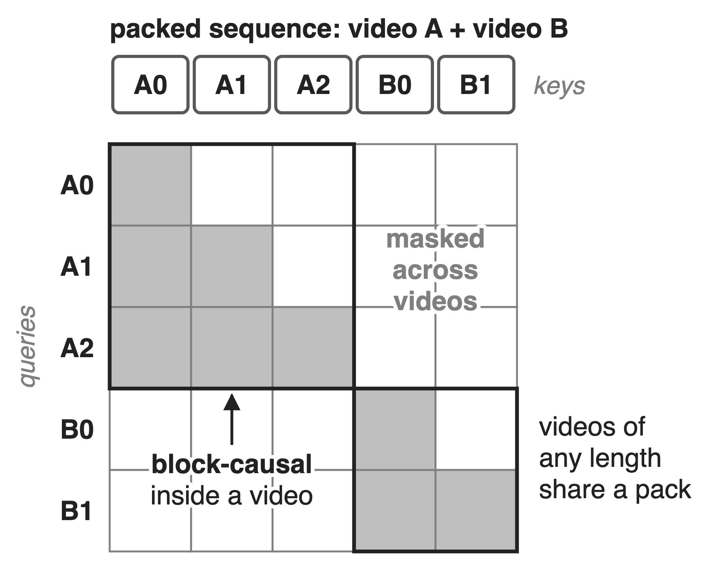{right 50%}
- **24B** autoregressive video model, contexts up to **4M** tokens
- 24-frame chunks attend to all earlier chunks
- Online packing mixes videos of any length
<!-- notes: MAGI-1 is Sand AI's autoregressive video world model; its largest variant has 24 billion parameters and trains with contexts of up to 4 million tokens (MAGI-1, arXiv 2505.13211, abstract). Video is generated in chunks of 24 frames and each chunk attends to all earlier chunks, which is a block-causal mask (MAGI-1 Fig. 1). Training packs videos of different lengths online into fixed-size sequences, Patch-and-Pack, reaching 99% capacity (MAGI-1 §4.1.1; sequence packing in general is deck 51). So the context-parallel attention layer sees the mask on the right: block-causal inside each video, nothing across videos, and a different layout in every pack. MagiAttention is the Apache-2.0 library Sand AI built and open-sourced for exactly this. -->

# Packed masks cut ring attention ≈18×
%% big: ≈18×
%% sub: lower per-GPU throughput for ring P2P attention on a packed causal mask (≈29 TFLOPs/s) than on a full mask (≈513), 64 H100s, forward
%% source: MagiAttention CP benchmark blog, distributed full and varlen causal charts (values read from the charts; ratio derived)
<!-- notes: Same method, same 64 H100s, same 8K tokens per GPU: ring P2P context parallelism sustains about 513 TFLOPs/s per GPU on a full mask but only about 29 on a varlen (packed) causal mask, so the packed mask costs about 18 times. Both values are read from the bar charts in the MagiAttention CP benchmark blog (Fig. 44 and Fig. 50); the throughput counts only the FLOPs inside the mask, so the drop is lost efficiency, not less useful work being counted. These are the MagiAttention team's measurements of baselines in its own harness. -->

# Ring CP ships KV by position, not need
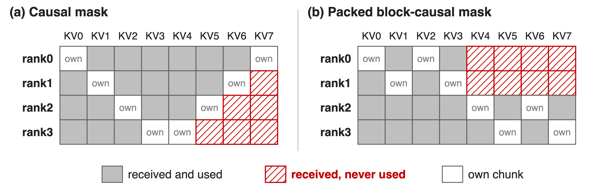{full}
%% caption: 4 ranks, 8 chunks, 2 per rank: ring P2P delivers every remote chunk, and 25% (a) or 33% (b) of it is never read
> Zigzag balancing fits the causal mask only; Ulysses needs heads divisible by CP size
<!-- notes: Ring attention passes every KV chunk around the whole ring, whatever the mask. With a causal mask and the usual zigzag layout (rank r holds chunks r and 7 minus r), rank 3 receives three chunks it never reads: 6 of 24 deliveries, 25%. On the packed block-causal mask with a global last block, ranks 0 and 1 only need chunks 0 to 3, so 8 of 24 deliveries, 33%, are waste (MagiAttention blog Fig. 11; re-derived in notes/sources.md). Zigzag balancing is tailored to one causal mask; per-sample zigzag on a packed mask fragments and pads. Ulysses shards heads instead, so the head count must divide the CP size; USP and LoongTrain combine the two and keep the ring traffic. Dynamic CP (deck 68) resizes CP groups per sample, at the cost of extra NCCL groups and scheduling. -->

# Insight: plan CP from the mask itself
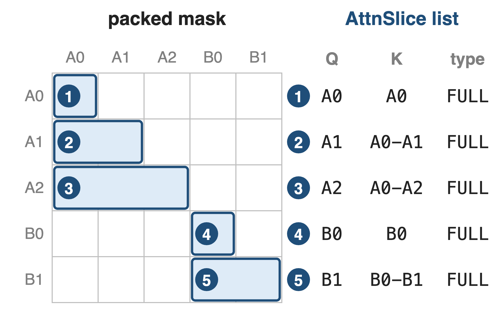{right 50%}
- AttnSlice: Q range, K range, mask type
- Still a slice list after any re-sharding
--
> The slice list tells each rank what to compute and which remote KV it needs, before the step runs
<!-- notes: MagiAttention writes any mask as a list of AttnSlices, each a triplet of query range, key range and mask type (MagiAttention blog, AttnSlice Representation). The running example becomes five FULL slices, one per chunk row. The key property is that the representation survives sharding: cut the sequence into chunks, move them to any rank, and each rank's share is again a slice list. So everything a CP layer needs to decide, the kernel arguments, the balance and the exact KV each rank must fetch, can be computed from the slices ahead of time instead of being fixed by a ring. -->

# MagiAttention compiles the mask into a plan
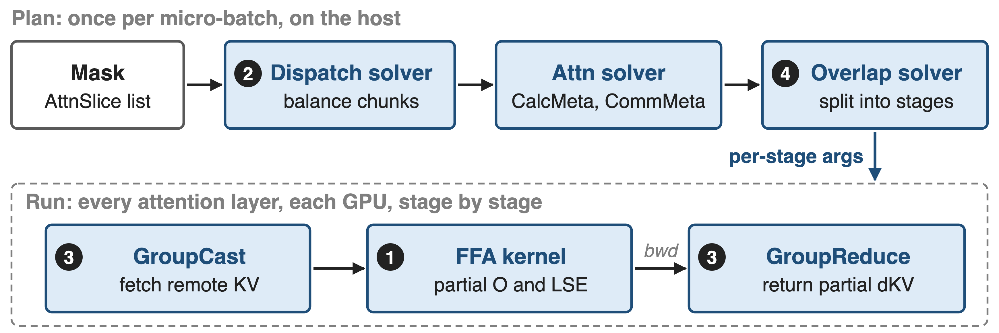{full}
%% caption: API: magi_attn_flex_key, dispatch, calc_attn, undispatch; examples for Megatron-LM, PyTorch FSDP and HF Transformers
<!-- notes: Planning runs on the host once per micro-batch. The dispatch solver balances chunks across ranks; the static attn solver turns the result into CalcMeta (the slice arguments for FFA per rank and stage) and CommMeta (what each rank fetches and reduces); the overlap solver cuts the remote work into stages (MagiAttention blog, Static Attn Solver). At run time every attention layer executes the same plan: GroupCast fetches remote KV, FFA computes partial outputs, and in backward GroupReduce returns partial dKV. The user calls magi_attn_flex_key with the slices, dispatch on the input, calc_attn inside attention and undispatch at the end (quickstart). -->

# ❶ FFA computes any slice list in one kernel
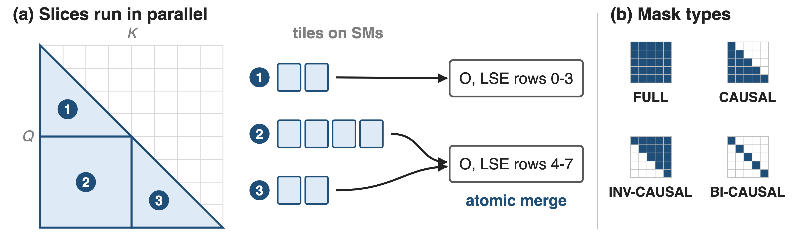{full}
> Built on FA3 for Hopper; on Blackwell, FFA_FA4 turns slices into per-row key intervals on a forked FA4
<!-- notes: Flex-Flash-Attention extends FlashAttention-3 on Hopper: each slice is tiled, tiles from all slices are spread over the SMs, and slices that write the same query rows merge their partial output and LSE atomically, in forward and in backward for dQ, dK, dV (MagiAttention blog Fig. 5). Four mask types, FULL, CAUSAL, INV-CAUSAL and BI-CAUSAL, keep sliding-window patterns compact. FFA_FA4 is a temporary Blackwell backend built with MiniMax and NVIDIA engineers: the slices are converted into per-row key intervals (HSTU function representation) for a forked FlashAttention-4 (FFA_FA4 blog; enabled with MAGI_ATTENTION_FA4_BACKEND=1, v1.1.0). Other attention kernels in this series: decks 07 and 09. -->

# ❷ Dispatch balances mask area, not tokens
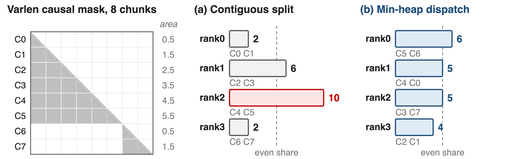{full}
%% caption: Analytic example. Min-heap greedy: largest chunk first, to the least-loaded rank with room; 2 chunks per rank
> The slowest rank drops from 10 to 6 work units; token-wise layers stay balanced
<!-- notes: The sequence is cut into chunks of chunk_size tokens; every rank gets the same number of chunks, so linear layers and norms stay balanced, but which chunks go where is free. The objective is to minimize the largest summed mask area per rank, which is NP-hard, so the solver sorts chunks by area and gives each to the least-loaded rank that still has room, in O(n log n) (MagiAttention blog Eq. 1 and Fig. 10). In this analytic example, two documents of 6 and 2 chunks: a contiguous split gives 2, 6, 10, 2 units; min-heap gives 6, 5, 5, 4, close to the even share of 5 (derivation in notes/sources.md). -->

# ❸ GroupCast sends KV only where needed
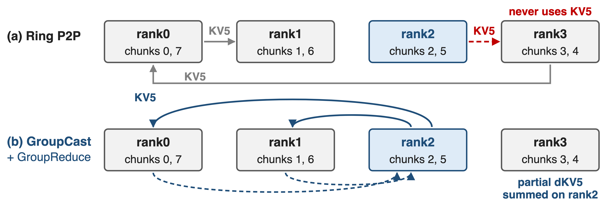{full}
> First built on all-to-all-v: zero redundancy, but extra copy kernels and one buffer per peer
<!-- notes: Same causal example. KV5 lives on rank 2 and is read only by Q6 on rank 1 and Q7 on rank 0. The ring forwards it through rank 3, which never uses it; GroupCast sends it straight to the two ranks that need it, and in backward GroupReduce sums their partial dKV5 back on rank 2 (MagiAttention blog, Group Collective Primitives). Both primitives come from the attn solver's CommMeta, so communication volume is zero-redundant in forward and backward. The first implementation sat on all-to-all-v plus range-gather and range-scatter-reduce kernels; that costs extra device copies and one send buffer per destination. -->

# ❸ Native kernels turn RDMA copies into NVLink
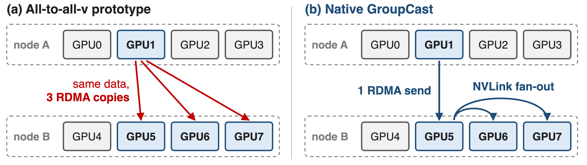{full}
> Built on DeepEP's dispatch and combine kernels (deck 24): no extra copy kernels, LSE merge inside the kernel
<!-- notes: All-to-all-v has one buffer per peer pair, so sending one split to three GPUs of another node sends the same bytes over RDMA three times. The native GroupCast, built on DeepEP's normal-mode dispatch design, sends once over RDMA to the GPU with the same local rank in the destination node, which forwards over NVLink; GroupReduce mirrors this by reducing inside the source node first (native group collective blog, RDMA Transfer De-duplication). The kernels also fuse the pre- and post-processing copies and support an LSE reduce op. Enable with MAGI_ATTENTION_NATIVE_GRPCOLL=1; beyond 8 GPUs it needs IBGDA. DeepEP: decks 24 and 15. Drawn with 4 GPUs per node for space. -->

# ❹ Stages hide KV traffic under FFA
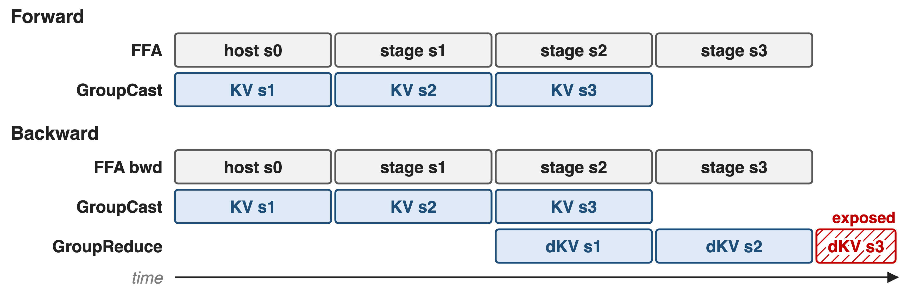{full}
> overlap_degree (1-4) is tuned by hand; a KernelBarrier lets comm kernels take SMs before FFA
<!-- notes: Remote work is split into overlap_degree stages. Forward: the host stage computes with local KV while GroupCast fetches stage 1, and so on, so only the last stage's compute has nothing to hide. Backward also reduces the previous stage's dKV, leaving only the final dKV reduce exposed (MagiAttention blog Fig. 13). The blog recommends tuning overlap_degree by hand in 1 to 4, since the automatic search needs accurate cost estimates. Because a greedy FFA kernel can occupy every SM, MagiAttention reserves an SM margin or uses a KernelBarrier: a one-thread wait kernel holds FFA until the communication kernels have started (kernel-overlap blog). -->

# FFA: ≈90% of FA3, 3.6× FlashMask
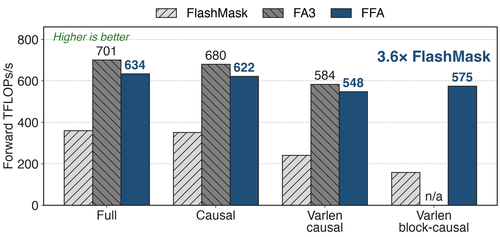{full}
%% caption: H100, BF16, GQA 64:8:8, head dim 128, 32K tokens, forward; values read from the MagiAttention benchmark charts
<!-- notes: On masks FA3 supports, FFA reaches 90 to 94 percent of FA3 forward (634 vs 701 full, 622 vs 680 causal, 548 vs 584 varlen causal) and about 96 percent backward (576 vs 601 full). On MAGI-1's varlen block-causal mask FA2, FA3, cuDNN and FlexAttention are marked unsupported; FFA runs at 575 TFLOPs/s against 159 for Baidu's FlashMask, 3.6 times, and 363 vs 205 backward. Values are read from the CP benchmark blog's kernel charts (Fig. 20, 22, 26, 30, 31). On B200, FFA_FA4 reads 1401 vs 1329 for cuDNN and 1299 for FA4 on the full mask at 32K (Fig. 32). -->

# 64 H100s: 8× ring P2P, 1.06-1.24× best baseline
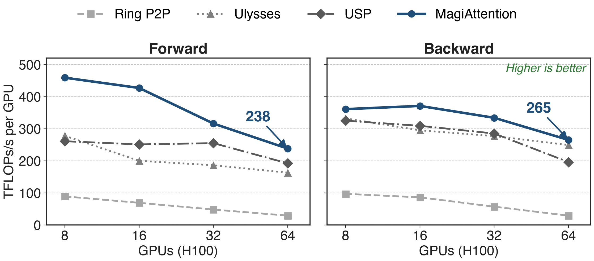{full}
%% caption: Varlen causal mask, 8K tokens per GPU (64K-512K total); all baselines on FA3; values read from the benchmark charts
<!-- notes: Context-parallel size 8 to 64 on H100, total sequence growing with the GPU count. At 64 GPUs MagiAttention reaches 238 TFLOPs/s per GPU forward and 265 backward, against 29 for ring P2P (8 to 9 times) and 193 forward (USP and LoongTrain) or 249 backward (Ulysses) for the best baseline, 1.24 and 1.06 times. Ring AllGather, LoongTrain and Megatron HybridCP are omitted from the plot; at 64 GPUs they read 181, 193, 162 forward. Note that MagiAttention's own per-GPU throughput also drops, from 459 to 238 forward. Source: CP benchmark blog Fig. 50 and 51, read from the charts. -->

# Native kernels add up to 41% at 64 GPUs
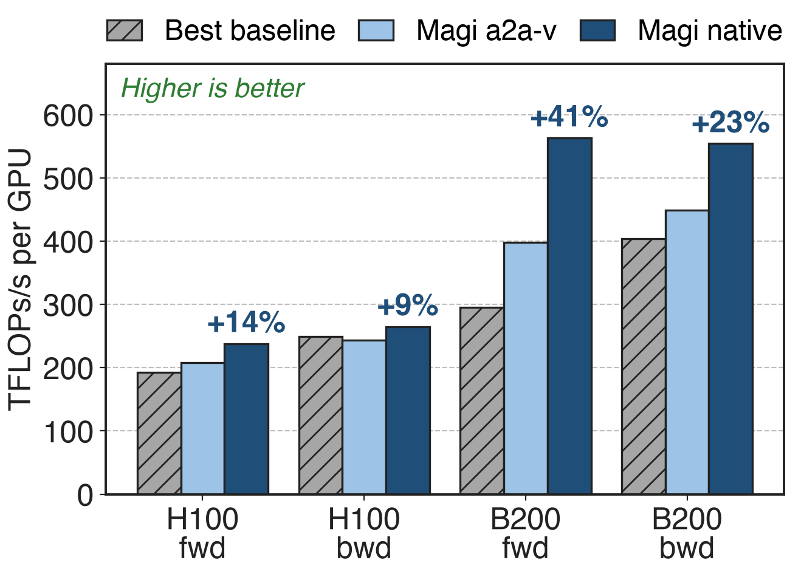{right 58%}
- Over all-to-all-v: **+9-14%** H100, **+23-41%** B200
- B200: **1.4-1.9×** the best baseline
- B200 baselines on cuDNN, Magi on FFA_FA4
<!-- notes: Same benchmark at 64 GPUs. The native, DeepEP-based group collectives beat the all-to-all-v prototype by 14 and 9 percent on H100 (forward, backward) and 41 and 23 percent on B200. On B200 MagiAttention reaches 563 and 554 TFLOPs/s per GPU against 295 (Ring AllGather) and 404 (Ulysses), 1.9 and 1.4 times; part of that gap is the kernel, since the baselines use cuDNN and HybridCP is omitted. At 8 GPUs, inside one node, all-to-all-v is still slightly faster on B200 (913 vs 870 forward). Source: CP benchmark blog Fig. 50, 51, 58, 59, read from the charts. -->

# The cost: hand tuning, IBGDA, no full-mask edge
%% layout: two-col
**Limits**
- Per-GPU throughput still falls: !!459 → 238!! (8 → 64 H100)
- Full mask: backward ≈5% behind USP
- Vendor benchmarks, experimental flags on
|||
**Prerequisites**
- IBGDA for internode native kernels
- overlap_degree tuned by hand
- Mask fixed per micro-batch; tokens permuted
<!-- notes: The varlen-causal charts do not show linear scaling: MagiAttention keeps 52 percent of its 8-GPU forward throughput at 64 GPUs (459 to 238) and 73 percent backward; it leads every baseline at every size. On a plain full mask all methods sit between about 500 and 665 TFLOPs/s and MagiAttention's backward (549) trails USP (581) and Ulysses (578). The benchmark blog warns that experimental features were enabled. Native internode kernels need IBGDA and an intranode size of 8. The static solver assumes one mask per micro-batch known at data-loading time and the same in every layer; the dynamic solver and Q/O communication are still experimental. Dispatch permutes tokens, so RoPE and other per-sample ops need care (quickstart). Maturity: v1.0.0 April 2025, v1.1.0 February 2026 (FFA_FA4, native kernels), v1.1.6 September 2026 (native CuTeDSL FFA on SM100); FFA_FA4 is labeled temporary. -->

# Summary
- Ring CP on packed masks: **≈18×** below full-mask throughput
- ==Insight==: plan compute and traffic from the mask's AttnSlices
- FFA at **≈90%** of FA3 · area-balanced dispatch · GroupCast · staged overlap
- 64 H100s: **8×** ring P2P; 64 B200s: **1.9×** best baseline
%% qr: https://github.com/SandAI-org/MagiAttention
<!-- notes: MagiAttention treats the attention mask as data: one slice representation drives the kernel, the load balance, the communication and the overlap schedule, which is what lets context parallelism survive the packed, block-causal masks of MAGI-1. Related decks: 68 (Megatron context parallelism and Dynamic CP), 69 (KDA context parallelism for linear attention), 51 (sequence packing), 24 and 15 (DeepEP, whose kernels the native group collectives reuse), 07 and 09 (attention kernels). Numbers: pain from the CP benchmark full vs varlen-causal ring P2P bars; results from the same benchmark at 64 GPUs. -->
